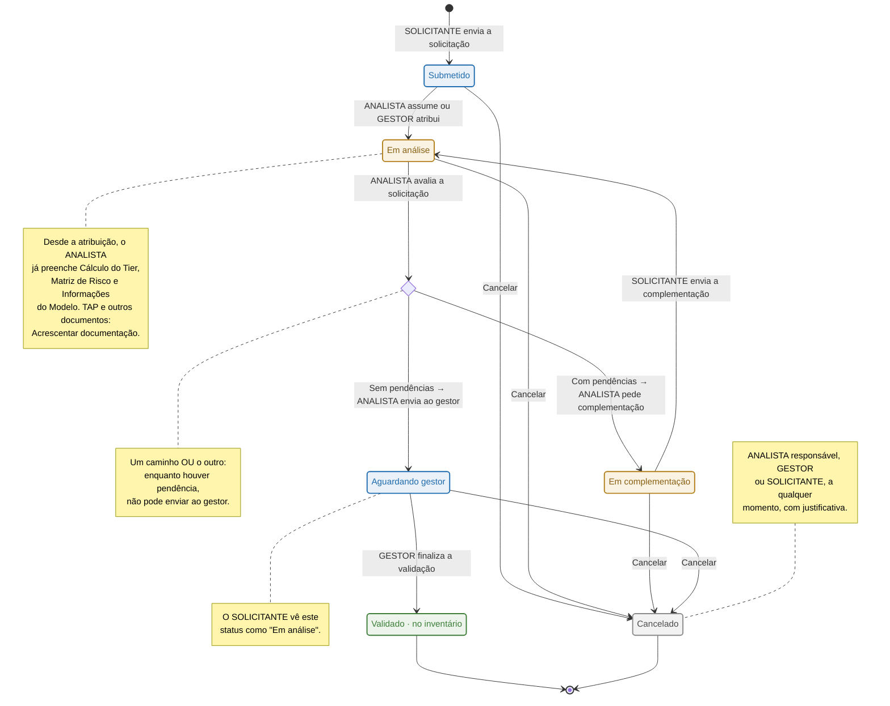
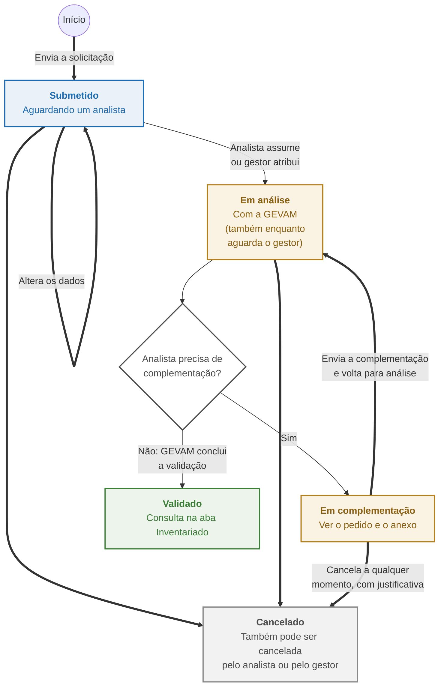
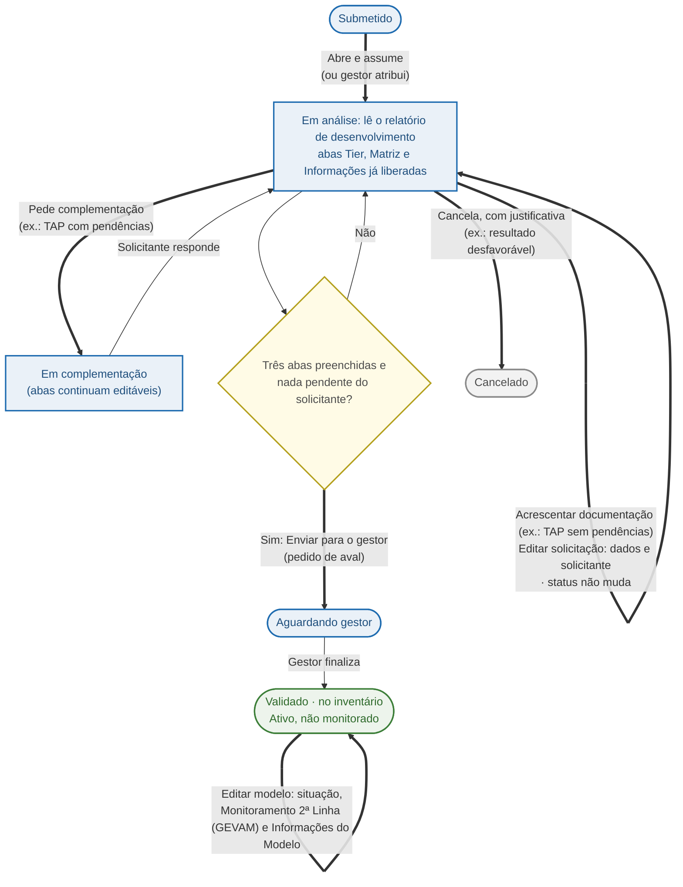
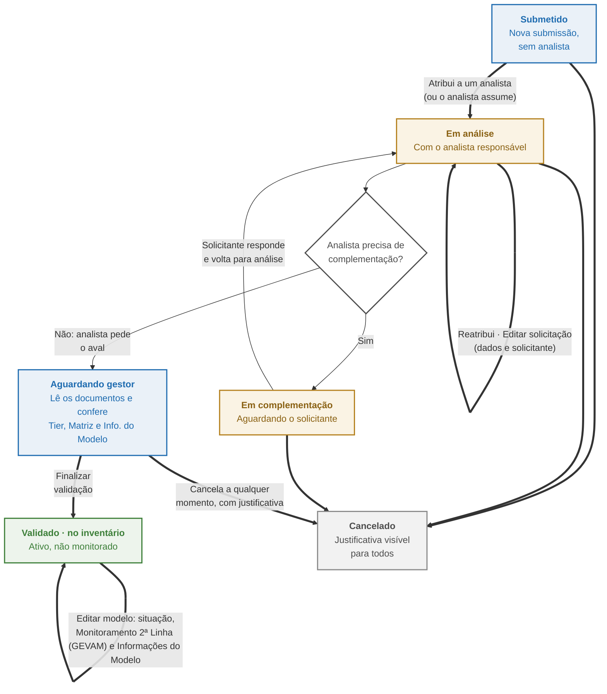

# Fluxos da solicitação de validação independente

Fluxos do processo 15.11.02 no SVM, em [Mermaid](https://mermaid.js.org/). Renderizam direto no GitHub e no
preview de Markdown do VS Code (com a extensão *Markdown Preview Mermaid Support*). Para exportar PNG/SVG, cole
o bloco em [mermaid.live](https://mermaid.live).

**Cores dos status** (as mesmas do sistema): azul = Submetido e Aguardando gestor · âmbar = Em análise e
Em complementação · verde = Validado (no inventário) · cinza = Cancelado.

**Nos fluxos por perfil:** seta **grossa** (`==>`) = ação daquele perfil · seta fina (`-->`) = ação de outro
perfil · seta pontilhada (`-.->`) = cancelamento feito por outro perfil.

**Losango "Precisa de complementação?"**: a análise segue **ou** para Em complementação **ou** para o gestor,
nunca as duas coisas. Só vai ao gestor quando não há mais pendências (todas as complementações atendidas).

## Transições de status (para implementação)

Toda transição grava um evento no histórico da solicitação (data, autor, descrição e anexos).

| Status atual | Ação | Quem pode | Próximo status | Obrigatório / observações |
|---|---|---|---|---|
| — | Enviar solicitação | Solicitante | **Submetido** | Dados do modelo e relatório de desenvolvimento (anexo) obrigatórios |
| Submetido | Alterar dados | Solicitante | Submetido | Só enquanto nenhum analista assumiu |
| Submetido | Abrir a solicitação (auto-atribuição) | Analista | **Em análise** | Analista vira o responsável; grava data/hora da atribuição |
| Submetido | Atribuir a um analista | Gestor | **Em análise** | Idem; registra o gestor |
| Em análise / Em complementação / Aguardando gestor | Reatribuir analista | Gestor | (não muda) | Atualiza analista responsável e data da atribuição |
| Qualquer status em andamento | Editar solicitação | Analista responsável ou gestor | (não muda) | Corrige os dados informados pelo solicitante e, no mesmo formulário, troca o solicitante (sem trocar o relatório). O histórico registra quem fez e só o que mudou; o novo solicitante passa a acompanhar e responder às complementações |
| Qualquer status | Acrescentar documentação | Analista responsável | (não muda) | Documento obrigatório, descrição opcional. Serve para o TAP sem pendências ou qualquer outro documento. Vale inclusive depois de finalizada |
| Em análise | Pedir complementação | Analista responsável | **Em complementação** | Anexo obrigatório (ex.: o TAP com pendências), observação opcional. Sem prazo e sem limite de rodadas. Não se emite novo TAP: as rodadas seguintes são novos pedidos |
| Em complementação | Enviar complementação | Solicitante | **Em análise** | Anexo obrigatório, observação opcional. Volta direto para o mesmo analista |
| Em análise | Enviar ao gestor | Analista responsável | **Aguardando gestor** | Só sem pendências: Cálculo do Tier + Matriz de Risco + Informações do Modelo preenchidos. Sem anexo: é só o pedido de aval (o gestor lê os documentos já em Arquivos). Grava data/hora de finalização da análise |
| Aguardando gestor | Finalizar validação | Gestor | **Validado** | Só confirmação, sem perguntas. Sempre cria o registro no inventário: situação **Ativo**, **não monitorado** |
| Validado (no inventário) | Editar modelo | Analista ou gestor | (não muda) | Situação (Ativo, Inativo, Suspenso), Monitoramento 2ª Linha (GEVAM) (toggle) e textos de Informações do Modelo. Cada mudança vai para o histórico |
| Qualquer status em andamento | Cancelar | Analista responsável, gestor ou solicitante | **Cancelado** | Justificativa obrigatória, visível para todos; registrar quem cancelou (perfil + nome) |

Regras de visibilidade:

- O solicitante vê **Aguardando gestor** como ele é (não é mais trocado por Em análise).
- O solicitante vê todos os documentos (dele, do analista e do gestor) e é notificado a cada mudança de status.
- Validado e Cancelado são status finais: saem da lista Em andamento e não aceitam mais ações sobre o fluxo.
- Todo **Validado** está no inventário. Não existe validada fora do inventário nem “Resultado da validação”.
- O solicitante tem as abas **Inventariado** e **Cancelado**, com os mesmos nomes da GEVAM, mas só com a área dele e só leitura.
- Cada ação gera **um único registro** no histórico.
- **Tempo de análise** desconta os períodos Em complementação (o relógio pausa no pedido e volta na resposta).
- O **Tier** mostrado nas Informações da solicitação é o da Matriz de Risco, quando o analista o alterou lá.

Filtro **Status da solicitação** (lista Em andamento, três perfis): Todos, Submetido, Em análise, Em complementação e
Aguardando gestor (as mesmas opções para os três perfis).

**De-para dos status antigos** (migração dos dados atuais; detalhes na seção 5.1 do `handoff/SPRINT-42.md`):

| Antes | Agora |
|---|---|
| Finalizada e no inventário | **Validado** (continua no inventário) |
| Validada (fora do inventário) | **Validado** (passa a constar no inventário: Ativo, não monitorado) |
| Resultado da validação “Não validado” | **Cancelado** |
| Cancelada | **Cancelado** |
| Monitoramento “Não se aplica” | Monitoramento 2ª Linha (GEVAM) = Não |

## Fluxo geral (status da solicitação)

Cada caixa é um **status**; cada seta é a **ação** que muda o status, com **quem faz em maiúsculas**
(SOLICITANTE, ANALISTA, GESTOR). O ponto de decisão depois de "Em análise" deixa claro que o analista
**ou** pede complementação **ou** envia ao gestor: enquanto houver pendência, não pode enviar.

Correspondência com o BPMN 15.11.02 ("Realizar Validação Independente"):

| Tarefa do BPMN | Status no sistema |
|---|---|
| Solicitar validação independente | Submetido |
| Receber informações · Avaliar preliminarmente · Emitir TAP | Em análise. O TAP é um documento: sem pendências entra por Acrescentar documentação; com pendências, como anexo de Pedir complementação |
| Realizar análise · Consolidar resultados | Em análise (abas Cálculo do Tier, Matriz de Risco, Informações do Modelo) |
| Prestar esclarecimentos ou informações (área gestora) | Em complementação — pedida tanto por pendências do relatório (TAP com pendências) quanto por esclarecimentos na análise |
| Solicitação atendida? = Não | Analista pede de novo (continua Em complementação) ou cancela → Cancelado |
| Emitir Parecer · Emitir Relatório de Validação | Documentos que o analista anexa à solicitação durante a análise (Acrescentar documentação). O envio ao gestor é só o pedido de aval, sem anexo → Aguardando gestor |
| (não existe no BPMN) Aval do gestor | Aguardando gestor → Validado |
| Validação independente concluída | Validado (modelo no inventário, Ativo e não monitorado) |
| Cancelamento da solicitação | Cancelado |

Regras que não aparecem no desenho:

- **Monitoramento 2ª Linha (GEVAM)** é um toggle na página do modelo inventariado (analista e gestor); todo modelo entra **não monitorado**. Não muda o status.
- **Situação** do modelo: todo modelo entra **Ativo**; analista e gestor mudam para Inativo ou Suspenso na página do modelo.
- Resultado desfavorável da validação = a solicitação é **cancelada** (não existe status "reprovado" nem "Resultado da validação": todo modelo do inventário é Validado).
- A revisão do gestor acontece por e-mail, fora do sistema; no sistema ele só tem **Finalizar validação**.

## Solicitante

Em todos os status o solicitante vê todos os documentos (dele, do analista e do gestor) e é notificado quando o
status muda.

## Analista GEVAM

Seta grossa = ação do analista · seta fina = ação de outro perfil. **Acrescentar documentação** (TAP ou qualquer outro
documento) pode ser usado em qualquer status e não muda o status. O envio ao gestor exige Cálculo do Tier, Matriz de
Risco e Informações do Modelo preenchidos.

## Gestor GEVAM

