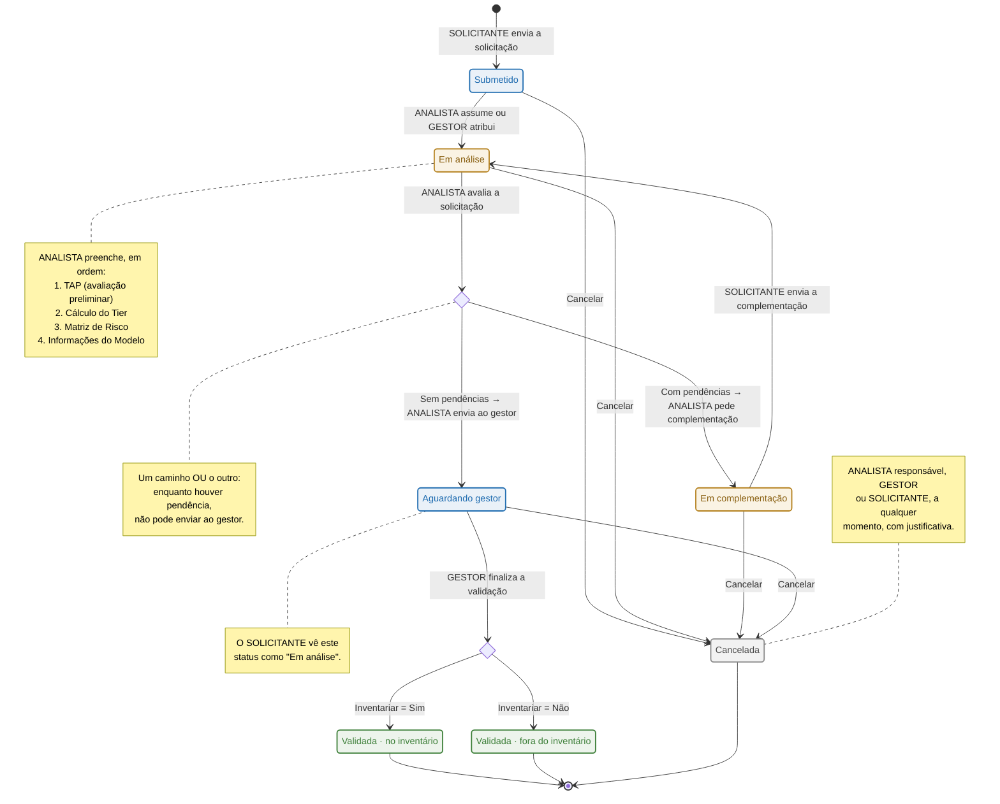
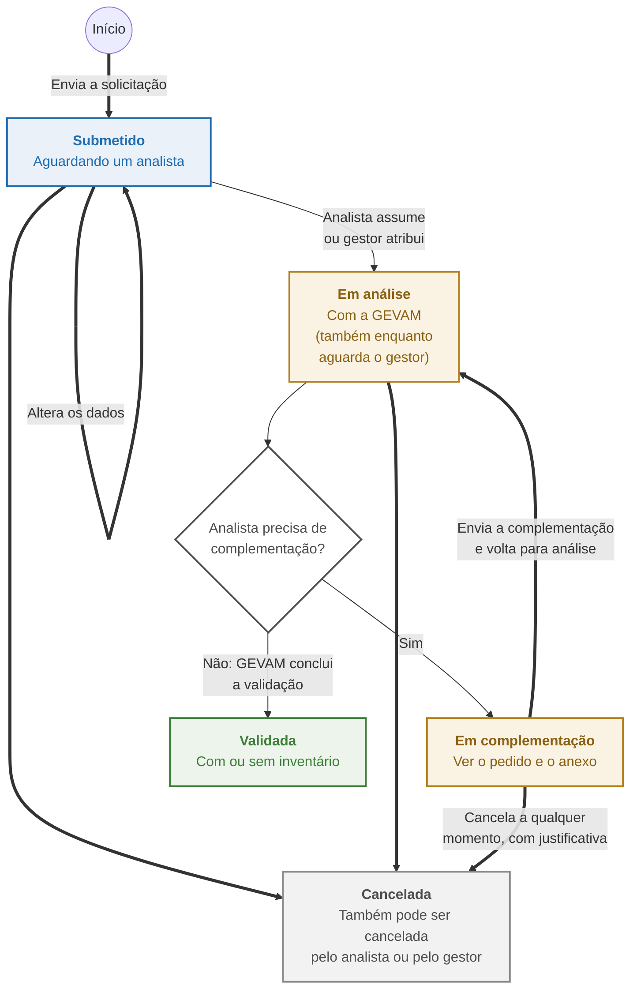
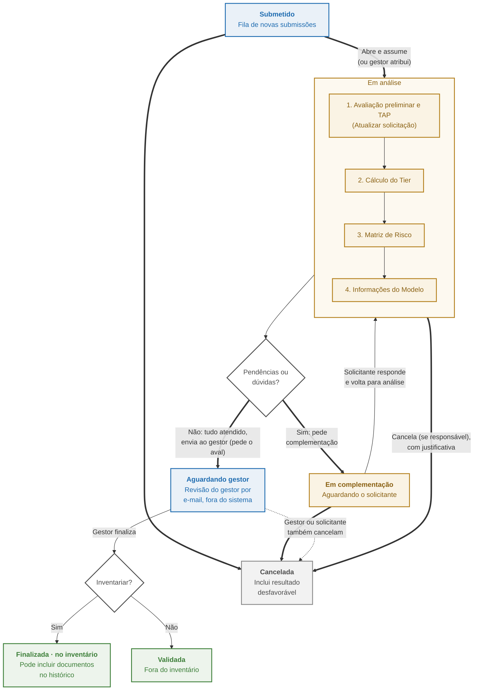
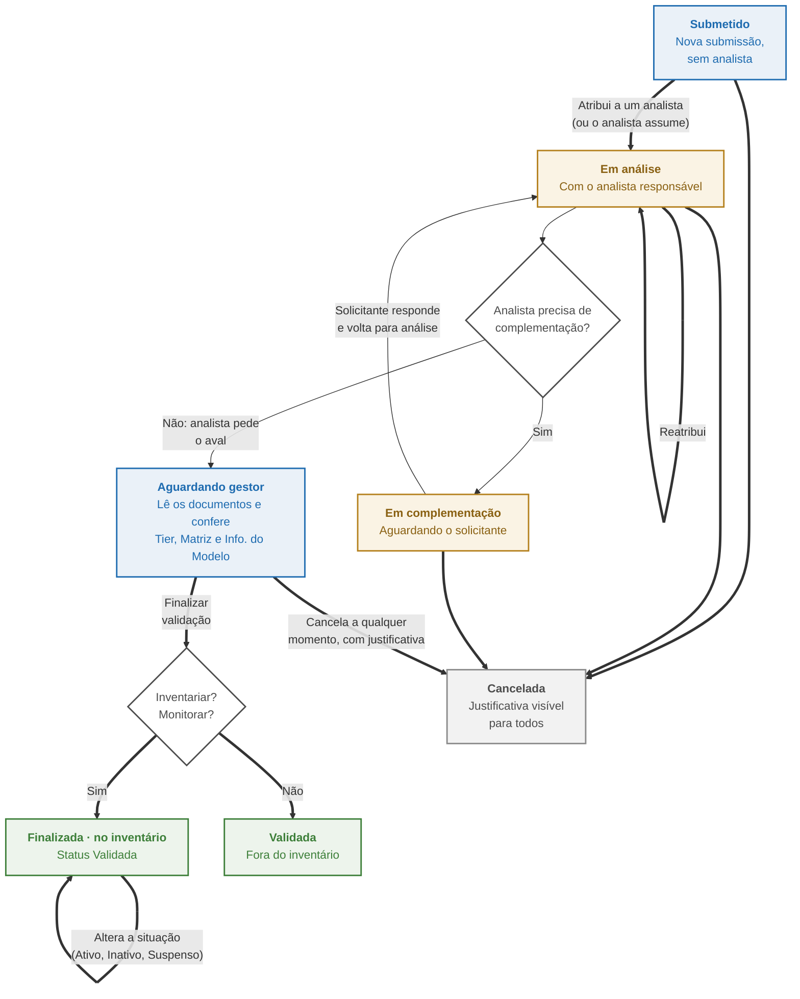

# Fluxos da solicitação de validação independente

Fluxos do processo 15.11.02 no SVM, em [Mermaid](https://mermaid.js.org/). Renderizam direto no GitHub e no
preview de Markdown do VS Code (com a extensão *Markdown Preview Mermaid Support*). Para exportar PNG/SVG, cole
o bloco em [mermaid.live](https://mermaid.live).

**Cores dos status** (as mesmas do sistema): azul = Submetido e Aguardando gestor · âmbar = Em análise e
Em complementação · verde = finalizada · cinza = Cancelada.

**Nos fluxos por perfil:** seta **grossa** (`==>`) = ação daquele perfil · seta fina (`-->`) = ação de outro
perfil · seta pontilhada (`-.->`) = cancelamento feito por outro perfil.

**Losango "Precisa de complementação?"**: a análise segue **ou** para Em complementação **ou** para o gestor,
nunca as duas coisas. Só vai ao gestor quando não há mais pendências (todas as complementações atendidas).

## Transições de status (para implementação)

Toda transição grava um evento no histórico da solicitação (data, autor, descrição e anexos).

| Status atual | Ação | Quem pode | Próximo status | Obrigatório / observações |
|---|---|---|---|---|
| — | Enviar solicitação | Solicitante | **Submetido** | Dados do modelo e relatório de desenvolvimento (anexo) obrigatórios |
| Submetido | Alterar dados | Solicitante | Submetido | Só enquanto nenhum analista assumiu |
| Submetido | Abrir a solicitação (auto-atribuição) | Analista | **Em análise** | Analista vira o responsável; grava data/hora da atribuição |
| Submetido | Atribuir a um analista | Gestor | **Em análise** | Idem; registra o gestor |
| Em análise / Em complementação / Aguardando gestor | Reatribuir analista | Gestor | (não muda) | Atualiza analista responsável e data da atribuição |
| Em análise | Atualizar solicitação | Analista responsável | Em análise | Descrição obrigatória, anexo opcional. Na avaliação preliminar, marcar "TAP sem pendências" (anexo do TAP obrigatório) emite o TAP e libera as abas de análise |
| Em análise | Pedir complementação | Analista responsável | **Em complementação** | Anexo obrigatório, observação opcional. Sem prazo e sem limite de rodadas. Na avaliação preliminar, o anexo é o **TAP com pendências**: ele é gravado como o TAP da solicitação (único) e libera as abas de análise. Durante a análise, é um pedido comum de esclarecimentos |
| Em complementação | Enviar complementação | Solicitante | **Em análise** | Anexo obrigatório, observação opcional. Volta direto para o mesmo analista |
| Em análise | Enviar ao gestor | Analista responsável | **Aguardando gestor** | Só sem pendências: TAP emitido + Cálculo do Tier + Matriz de Risco + Informações do Modelo preenchidos. Sem anexo: é só o pedido de aval (o gestor lê os documentos já em Arquivos). Grava data/hora de finalização da análise |
| Aguardando gestor | Finalizar validação | Gestor | **Validada** | Informar Inventariar (Sim/Não) e Monitorar (Sim/Não). Inventariar = Sim cria o registro no inventário |
| Qualquer status em andamento | Cancelar | Analista responsável, gestor ou solicitante | **Cancelada** | Justificativa obrigatória, visível para todos; registrar quem cancelou (perfil + nome) |

Regras de visibilidade:

- O solicitante vê **Aguardando gestor** como **Em análise**.
- O solicitante vê todos os documentos (dele, do analista e do gestor) e é notificado a cada mudança de status.
- Validada e Cancelada são status finais: saem da lista Em andamento e não aceitam mais ações sobre o fluxo.

## Fluxo geral (status da solicitação)

Cada caixa é um **status**; cada seta é a **ação** que muda o status, com **quem faz em maiúsculas**
(SOLICITANTE, ANALISTA, GESTOR). O ponto de decisão depois de "Em análise" deixa claro que o analista
**ou** pede complementação **ou** envia ao gestor: enquanto houver pendência, não pode enviar.

Correspondência com o BPMN 15.11.02 ("Realizar Validação Independente"):

| Tarefa do BPMN | Status no sistema |
|---|---|
| Solicitar validação independente | Submetido |
| Receber informações · Avaliar preliminarmente · Emitir TAP | Em análise (avaliação preliminar) |
| Realizar análise · Consolidar resultados | Em análise (abas Cálculo do Tier, Matriz de Risco, Informações do Modelo) |
| Prestar esclarecimentos ou informações (área gestora) | Em complementação — pedida tanto por pendências documentais (após o TAP) quanto por esclarecimentos na análise |
| Solicitação atendida? = Não | Analista pede de novo (continua Em complementação) ou cancela → Cancelada |
| Emitir Parecer · Emitir Relatório de Validação | Documentos que o analista anexa à solicitação durante a análise (Atualizar solicitação). O envio ao gestor é só o pedido de aval, sem anexo → Aguardando gestor |
| (não existe no BPMN) Aval do gestor | Aguardando gestor → Validada |
| Validação independente concluída | Validada (com ou sem inventário) |
| Cancelamento da solicitação | Cancelada |

Regras que não aparecem no desenho:

- **Monitorar** (Sim/Não) é decidido junto com o inventário e **não muda o status**.
- Resultado desfavorável da validação = a solicitação é **cancelada** (não existe status "reprovado").
- A revisão do gestor acontece por e-mail, fora do sistema; no sistema ele só tem **Finalizar validação**.

## Solicitante

Em todos os status o solicitante vê todos os documentos (dele, do analista e do gestor) e é notificado quando o
status muda.

## Analista GEVAM

**Atualizar solicitação** (registrar documentos recebidos por outros meios) pode ser usado durante toda a análise.
O envio ao gestor exige Cálculo do Tier, Matriz de Risco e Informações do Modelo preenchidos.

## Gestor GEVAM

