# Evoluções do SVM — Fluxo do Analista GEVAM (Sprint 42)

**Quem é o analista:** a pessoa da GEVAM que faz a validação independente do modelo. Ele assume a solicitação, lê os documentos, pede complementação ao solicitante quando falta algo, preenche as abas de análise (Cálculo do Tier, Matriz de Risco e Informações do Modelo) e envia ao gestor da GEVAM para o aval final. Ele também cuida do inventário: inventaria modelos que já existem e atualiza os modelos inventariados.

**Menu do analista:** **Novo modelo** (abre direto **Inventariar modelo**, para registrar um modelo que já existe), **Consultar modelo**, com três abas: **Em andamento**, **Inventariado** e **Cancelado**, e **Gestão** > **Parametrização** (Parâmetros Gerais, Matriz de Riscos, Expr. Score Tier e Expr. Score Monitoramento). O menu **Gestão** aparece para o **analista** e para o **gestor** da GEVAM; o solicitante não o vê.

**Os status da solicitação:**

- **Submetido:** o solicitante enviou e nenhum analista pegou ainda.
- **Em análise:** o analista responsável está analisando.
- **Em complementação:** o analista pediu algo ao solicitante e espera a resposta.
- **Aguardando gestor:** o analista terminou e pediu o aval do gestor da GEVAM.
- **Validado:** o gestor deu o aval. De praxe, o modelo entra no inventário (aba **Inventariado**) com Validação GEVAM **Validado**, Situação do modelo **Ativo** e Monitoramento 2ª Linha (GEVAM) **Não**.
- **Cancelado:** a solicitação foi encerrada (pelo solicitante ou pela GEVAM), sempre com uma justificativa. Resultado desfavorável da validação também vira Cancelado.

## Histórias do analista

### HA-01. Acompanhar as solicitações em andamento

> **Como** analista, **quero** ver todas as solicitações em andamento e o status de cada uma, **para** escolher o que assumir e acompanhar o que está comigo.

**A tela de hoje será substituída por completo**

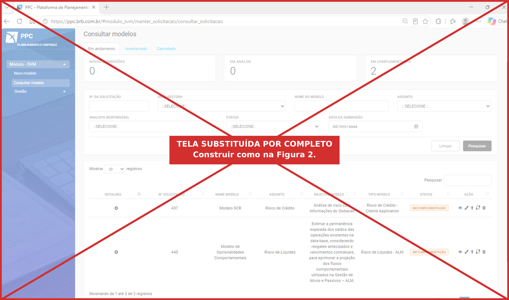

*Figura 1 – Hoje: Consultar modelos > Em andamento. A tela inteira sai e é construída de novo como na Figura 2.*

**Como deve ficar**

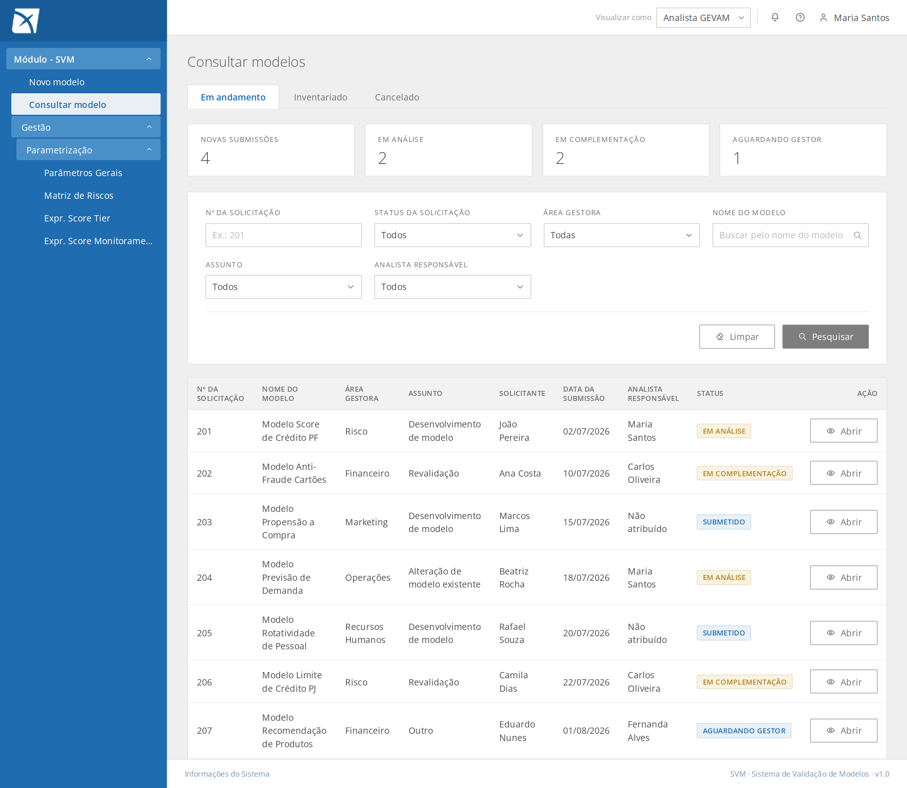

*Figura 2 – Aba Em andamento do analista: quatro quadros de status, filtros e lista só com o botão Abrir.*

**Passo a passo**

1. No menu lateral, clicar em **Consultar modelo**. Abre a aba **Em andamento** (Figura 2).
2. No topo há quatro quadros com a quantidade por status: **Novas submissões** (Submetido), **Em análise**, **Em complementação** e **Aguardando gestor** (novo). Os quadros são só informativos: **não** são clicáveis e não filtram a lista.
3. Em cada linha há **só** o botão **Abrir**, que abre a solicitação (HA-02 e HA-03).

**O que aparece**

- Filtros: Nº da solicitação · **Status da solicitação** (Todos, Submetido, Em análise, Em complementação e Aguardando gestor) · Área gestora · Nome do modelo · Assunto · Analista responsável.
- Colunas: Nº da solicitação · Nome do modelo · Área gestora · Assunto · Solicitante · Data da submissão · Analista responsável · Status · Ação.
- O analista vê as solicitações **de todas as áreas**.
- Solicitações Validado e Cancelado **não** aparecem aqui: ficam nas abas Inventariado (HA-12) e Cancelado (HA-16).

**Não aparece mais na linha:** o “+” de detalhes, as colunas “Objetivo modelo” e “Tipo modelo”, e os ícones de ação. As ações passam para o botão **Ações**, dentro da solicitação, tratado nas histórias **HA-02** (assumir), **HA-04** (acrescentar documentação), **HA-05** (pedir complementação), **HA-10** (enviar para o gestor), **HA-11** (editar) e **HA-15** (cancelar).

### HA-02. Assumir uma solicitação

> **Como** analista, **quero** assumir uma solicitação nova e ficar responsável por ela, **para** começar a análise.

**Passo a passo**

1. Em Consultar modelo > Em andamento, clicar em **Abrir** numa solicitação com status **Submetido** (Figura 3).

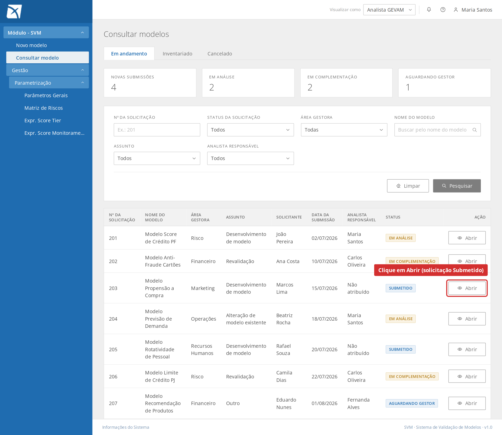

*Figura 3 – Passo 1: clicar em Abrir numa solicitação Submetido.*

2. A solicitação abre **sem mudar nada**: continua **Submetido** e sem analista responsável. No topo aparece o aviso “Esta solicitação ainda não tem analista responsável. Para analisá-la, clique em Ações > Assumir solicitação.” As abas de análise ficam só para leitura.
3. Clicar em **Ações** > “Assumir solicitação” (Figura 4). Nesse momento, é a **única** opção do menu, e o aviso do passo 2 aparece no topo.

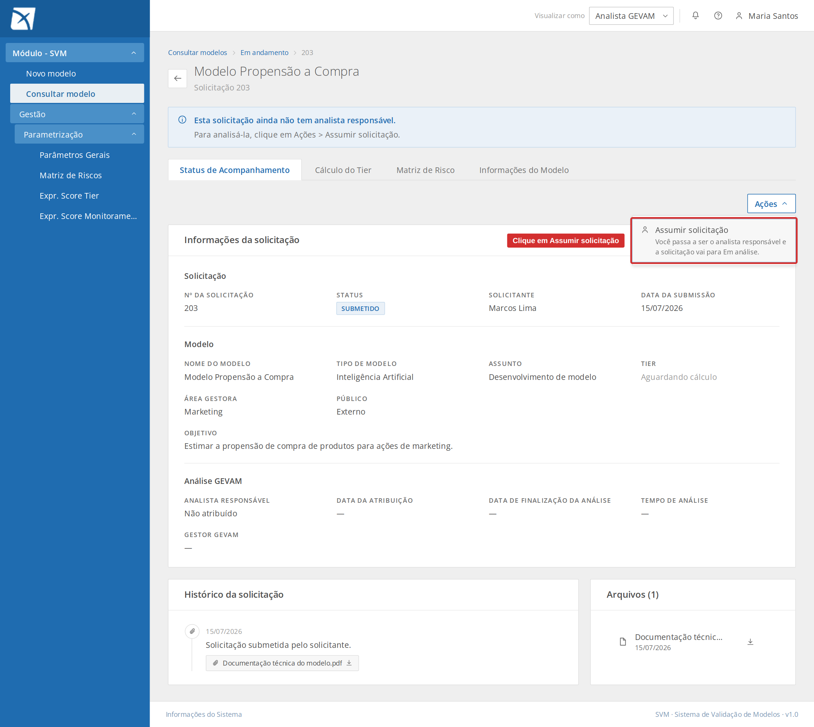

*Figura 4 – Passo 3: solicitação Submetido, com o aviso no topo; em Ações, clicar em Assumir solicitação (a única opção).*

4. O analista **passa a ser o responsável**: o status vira **Em análise** e aparece a mensagem “Solicitação atribuída a você. Ela agora está Em análise.” (Figura 5).

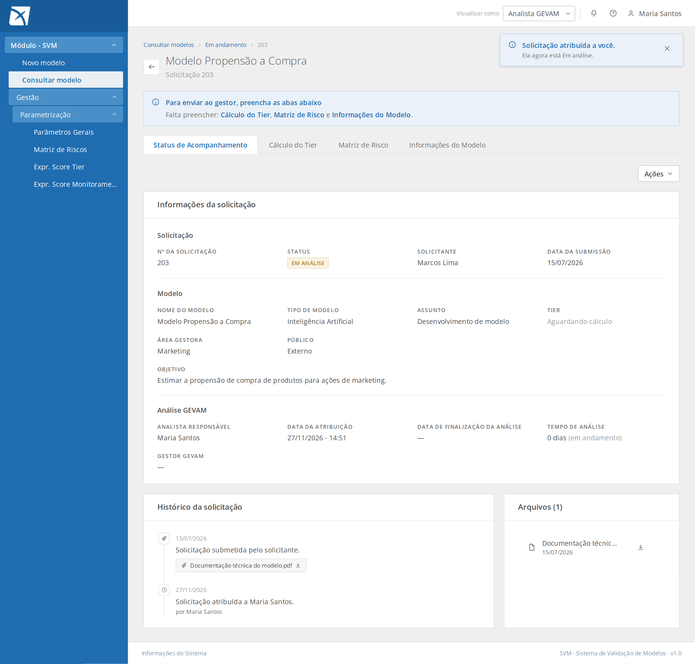

*Figura 5 – Passo 4: solicitação assumida, Em análise, com as abas de análise liberadas e o aviso do que falta preencher.*

5. Só agora as outras ações aparecem no botão **Ações** (“Acrescentar documentação”, “Pedir complementação”, “Enviar para o gestor”, “Editar solicitação” e “Cancelar solicitação”) (Figura 6), e as abas **Cálculo do Tier**, **Matriz de Risco** e **Informações do Modelo** ficam liberadas. No topo aparece o aviso “Para enviar ao gestor, preencha as abas abaixo — Falta preencher: …”, com links para as abas.

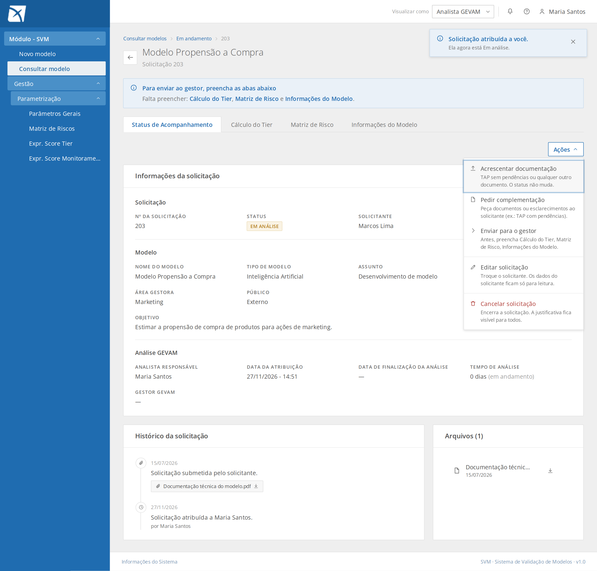

*Figura 6 – Passo 5: depois de assumir, o menu Ações mostra todas as ações do analista.*

**O que acontece**

- O sistema grava o analista responsável e a **data e hora da atribuição**.
- O histórico registra “Solicitação atribuída a [analista].”
- A solicitação também pode chegar ao analista por **atribuição do gestor**. Nesse caso ele já a encontra Em análise, com o nome dele.
- O **gestor** também pode assumir uma solicitação Submetido, pelo mesmo **Ações** > “Assumir solicitação”. Aí ele passa a ser o responsável e faz **a mesma coisa que um analista**: tudo o que está nesta seção (HA-02 a HA-11 e HA-15) vale para ele. Depois de **Enviar para o gestor** (HA-10), ele mesmo pode **finalizar a validação**.
- O **gestor** troca o solicitante (como na HA-11) e também o **analista responsável** (Ações > “Reatribuir analista”). O analista só troca o solicitante: ele **não** passa a solicitação para outro analista.

**O sistema não deixa**

- Agir numa solicitação **Submetido** sem assumir antes. Enquanto ela não tem analista responsável, o botão **Ações** mostra só “Assumir solicitação”: não dá para acrescentar documentação, pedir complementação, enviar para o gestor, editar nem cancelar, e as abas de análise ficam só para leitura.
- Passar a solicitação para **outro analista**. Quem troca o analista é **só o gestor** (Ações > “Reatribuir analista”). Se o analista precisar sair da análise, ele pede ao gestor.
- Agir numa solicitação que está Em análise com **outro analista**. Aparece o aviso “Esta solicitação está em análise com [analista]. Só o analista responsável pode agir sobre ela.”, **sem o botão Ações**, e as abas ficam só para leitura (Figura 7).

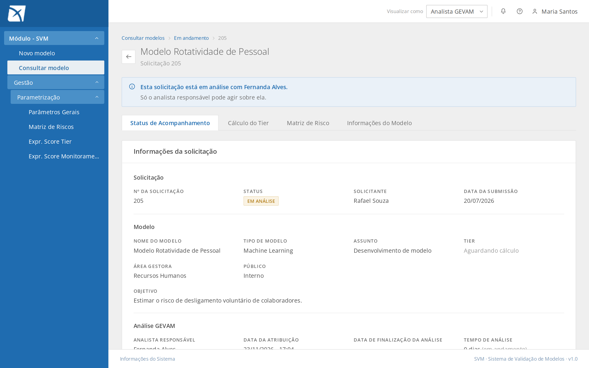

*Figura 7 – Solicitação Em análise com outro analista: aviso no topo, sem o botão Ações e com as abas só para leitura.*

### HA-03. Ver as informações, o histórico e os arquivos

> **Como** analista, **quero** ver os dados da solicitação, o histórico e os documentos num só lugar, **para** não precisar procurar anexos no histórico.

**Passo a passo**

1. Abrir a solicitação (HA-02). Abre a aba **Status de Acompanhamento**.
2. Rolar a página para ver as três partes (Figura 8):
   1. **Informações da solicitação**, em três blocos: *Solicitação* (número, status, solicitante, data da submissão), *Modelo* (nome, tipo, assunto, Tier, área gestora, público, objetivo) e *Análise GEVAM* (analista responsável, data de atribuição, data de finalização da análise, tempo de análise, gestor GEVAM).
   2. **Histórico da solicitação:** cada acontecimento com data, descrição e quem fez. Textos enviados aparecem citados e os anexos têm botão de download.
   3. **Arquivos:** todos os documentos da solicitação, com nome, data, quem enviou e download.

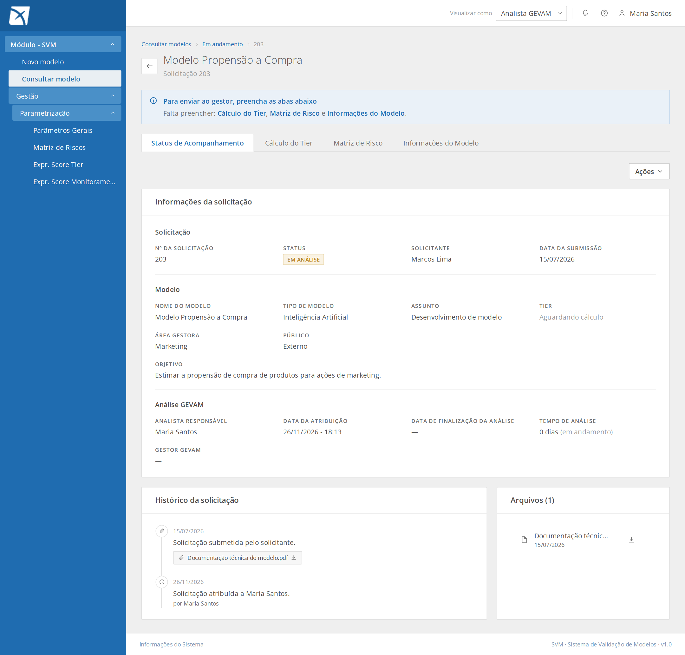

*Figura 8 – A página inteira da solicitação: Informações da solicitação (Solicitação, Modelo e Análise GEVAM), Histórico da solicitação e Arquivos.*

**Regras dos campos**

| Campo | Regra |
| --- | --- |
| Tier | Último cálculo ou recálculo, no formato “Gestão Moderada · 75 pontos”. Se o analista alterar o Tier na Matriz de Risco, vale o Tier da matriz. Antes do cálculo: “Aguardando cálculo”. |
| Data da atribuição | Data e hora em que o analista assumiu ou foi atribuído (a mais recente, se houve reatribuição). |
| Data de finalização da análise | Data e hora do envio ao gestor. Vazia antes disso. |
| Tempo de análise | Dias corridos entre a atribuição e a finalização da análise, **sem contar o tempo Em complementação** (o relógio pausa quando o analista pede algo e volta quando o solicitante responde). Enquanto não termina, conta até hoje e mostra “(em andamento)”; durante uma complementação mostra “(pausado: aguardando o solicitante)”. |
| Gestor GEVAM | Último gestor que atribuiu ou finalizou a validação. Vazio antes disso. |

### HA-04. Acrescentar documentação

> **Como** analista, **quero** incluir documentos na solicitação — o TAP sem pendências ou qualquer outro (por exemplo, recebido por Teams ou e-mail) —, **para** que tudo fique registrado.

**Vale em qualquer status**, inclusive Em complementação, Aguardando gestor e Cancelado, sempre para o analista responsável. Para um modelo **Validado**, o botão fica na página do modelo (HA-13).

**Passo a passo**

1. Abrir a solicitação (HA-02).
2. Clicar em **Ações** > **Acrescentar documentação** (Figura 9). Abre a janela (popup) **Acrescentar documentação**, por cima da página.

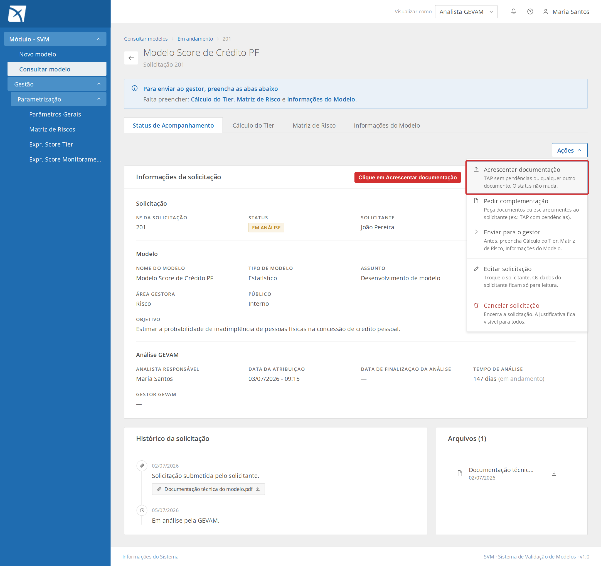

*Figura 9 – Passo 2: em Ações, clicar em Acrescentar documentação.*

3. Em **Documento** (obrigatório), anexar o arquivo. Em **Descrição** (opcional, até 1.000 caracteres), escrever, por exemplo, “TAP sem pendências.”
4. Clicar em **Acrescentar** (Figura 10). Para desistir, clicar em **Cancelar** (nada é gravado).

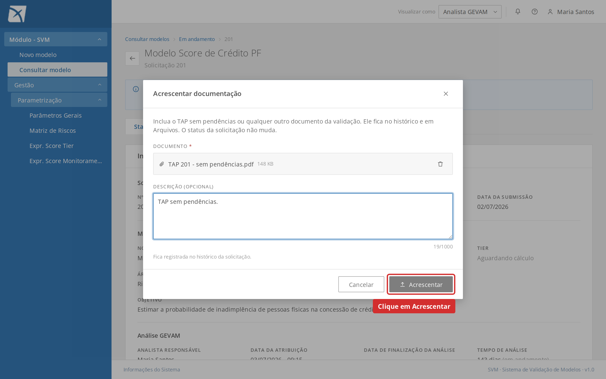

*Figura 10 – Passo 4: janela (popup) preenchida; clicar em Acrescentar.*

**O que acontece**

- O documento entra no histórico (“Documentação acrescentada pelo analista.”) e em Arquivos.
- **O status não muda**: se está Em análise, continua Em análise; se está Cancelado, continua Cancelado.
- O TAP **não é mais uma etapa controlada pelo sistema**: o TAP sem pendências entra por aqui, como qualquer documento, e não libera nem bloqueia nada.

**O sistema não deixa**

- Acrescentar sem anexar o documento: “Anexe o documento.”

### HA-05. Pedir complementação

> **Como** analista, **quero** pedir documentos ou esclarecimentos ao solicitante — inclusive enviando o TAP com as pendências do relatório de desenvolvimento —, **para** completar a análise.

**Só vale em Em análise**, para o analista responsável.

**Passo a passo**

1. Abrir a solicitação (HA-02).
2. Clicar em **Ações** > **Pedir complementação** (Figura 11). Abre a janela (popup) **Pedir complementação ao solicitante**, por cima da página.

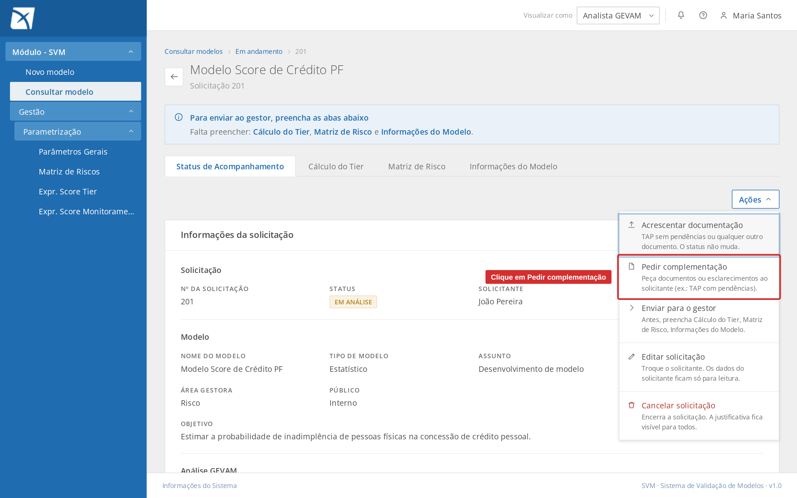

*Figura 11 – Passo 2: em Ações, clicar em Pedir complementação.*

3. Em **Anexo para o solicitante** (obrigatório), anexar o arquivo: o **TAP com pendências**, um documento com o pedido ou uma planilha a preencher.
4. Em **Observações** (opcional, até 1.000 caracteres), escrever o pedido. O solicitante vê exatamente este texto, junto com o anexo.
5. Clicar em **Enviar pedido** (Figura 12). Para desistir, clicar em **Cancelar**.

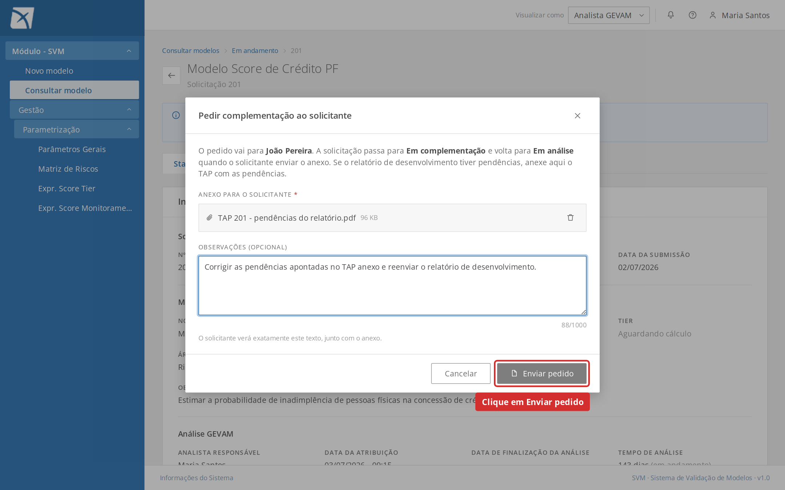

*Figura 12 – Passo 5: janela (popup) com o pedido preenchido e o TAP com pendências anexado; clicar em Enviar pedido.*

6. A solicitação fica **Em complementação**. Aparece a mensagem “Complementação solicitada. [solicitante] precisa enviar o anexo.” e, no topo da página, o quadro **“Aguardando complementação do solicitante”**, com o texto do pedido e o anexo (Figura 13).

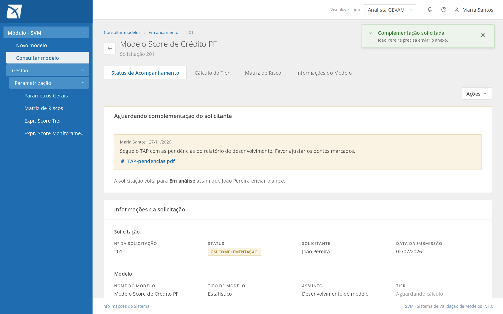

*Figura 13 – Passo 6: solicitação Em complementação, com o quadro “Aguardando complementação do solicitante”, o pedido e o anexo.*

**O que acontece**

- O status vira **Em complementação** e o histórico registra “Complementação solicitada ao solicitante.”
- O solicitante vê o pedido e responde pelo menu Ações dele. Quando ele responde, a solicitação volta para **Em análise** e aparece o quadro “Complementação recebida do solicitante”, com o anexo e a observação.
- Se a resposta não resolver tudo, o analista faz um novo pedido. Não há prazo nem limite de rodadas.
- As abas de análise continuam editáveis enquanto a solicitação está Em complementação.

**O sistema não deixa**

- Pedir de novo enquanto a solicitação já está Em complementação: o item não aparece no menu.
- Enviar sem anexo: “Anexe o arquivo para enviar.”

### HA-06. Calcular o Tier

> **Como** analista, **quero** informar os parâmetros do modelo e calcular o Tier, **para** classificar o nível de gestão do modelo.

As três abas de análise ficam **liberadas desde a atribuição** e só o analista responsável edita, enquanto a solicitação está Em análise ou Em complementação. Depois do envio ao gestor, ficam só para leitura.

**Passo a passo**

1. Na solicitação, clicar na aba **Cálculo do Tier**.
2. Preencher os parâmetros (todos obrigatórios): Materialidade · Impacto na decisão · Complexidade · O modelo utiliza novo algoritmo? · O modelo foi desenvolvido para novo produto? · Implementação automatizada via sistema?
3. Embaixo aparece a prévia (“Prévia: 50 pontos · Gestão Flexível”). Clicar em **Calcular Tier** (Figura 14).

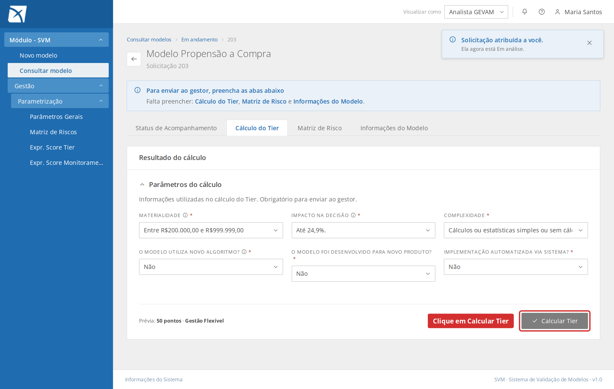

*Figura 14 – Passo 3: parâmetros preenchidos; clicar em Calcular Tier.*

4. Aparecem o **Resultado do cálculo** e o **Tier cálculo** (Figura 15). Depois, se precisar, preencher **Ajustes de MRM** (pontos inteiros, positivos ou negativos) e **Override** (forçar um Tier) e clicar em **Recalcular**.

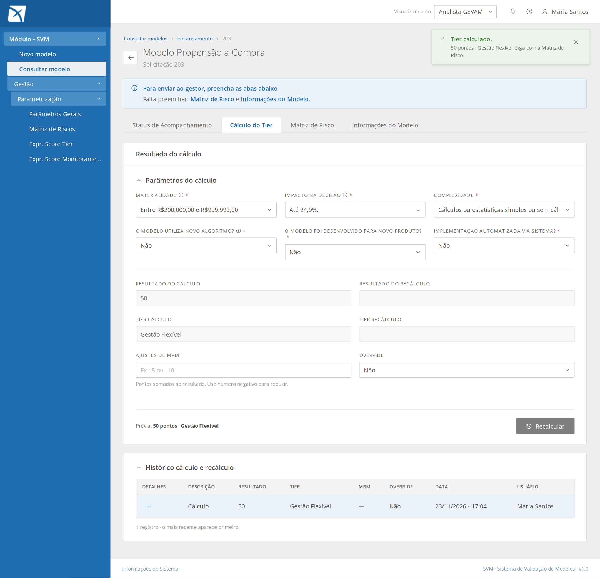

*Figura 15 – Passo 4: resultado do cálculo, com os campos de recálculo.*

**O que aparece**

- Tiers: Gestão Flexível, Gestão Moderada e Gestão Rigorosa.
- **Histórico cálculo e recálculo:** Descrição, Resultado, Tier, MRM, Override, Data e Usuário; cada linha abre para mostrar os parâmetros. Nada é sobrescrito: cada cálculo é uma linha nova.
- A fórmula de pontuação e as faixas são **as mesmas que já existem no SVM**.

**O sistema não deixa**

- Calcular com parâmetro vazio: “Campo obrigatório”.
- MRM que não seja número inteiro: “Informe um número inteiro de pontos (ex.: 5 ou -10).”

### HA-07. Preencher a Matriz de Risco

> **Como** analista, **quero** registrar a nota de classificação do modelo, **para** obter a classificação de risco.

**Passo a passo**

1. Clicar na aba **Matriz de Risco**.
2. Preencher **Prazo de revalidação (meses)** e **Alçada sugerida** (opcionais).
3. Conferir o **Tier**: ele vem do Cálculo do Tier, e o analista pode trocar só aqui.
4. Escolher a **Nota de classificação** (obrigatória). A **Classificação de risco** aparece sozinha.
5. Clicar em **Calcular** (Figura 16). O cálculo entra no **Histórico Matriz de Risco** e o botão vira **Recalcular** (Figura 17). Depois, para mudar, alterar os campos e clicar em **Recalcular**; **Cancelar** volta aos valores salvos. Os dois só ficam ativos quando algo mudou.

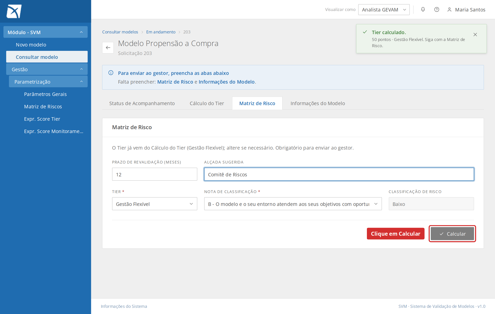

*Figura 16 – Passo 5: matriz preenchida; clicar em Calcular.*

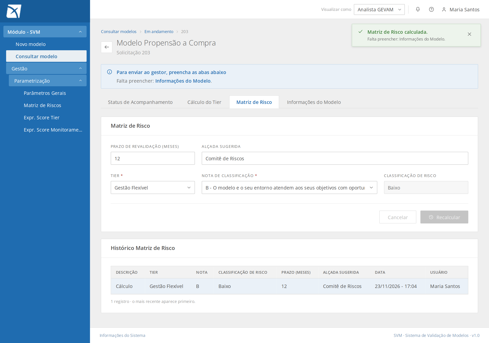

*Figura 17 – Depois de calcular: o botão vira Recalcular e o cálculo entra no histórico.*

**Notas de classificação**

- **A** - O modelo e o seu entorno atendem plenamente aos seus objetivos em todos os aspectos avaliados.
- **B** - O modelo e o seu entorno atendem aos seus objetivos com oportunidades de melhorias em alguns de seus componentes ou critérios avaliados.
- **C** - O modelo e o seu entorno atendem aos seus objetivos com falhas mínimas em alguns de seus componentes ou critérios avaliados.
- **D** - O modelo e/ou seu entorno atendem parcialmente a seus objetivos com falhas importantes em componente central que demandam ação corretiva tempestiva.
- **E** - O modelo e/ou seu entorno não atendem aos seus objetivos com falhas cuja somatória compromete as suas estimativas, sendo recomendado sua desativação a uso.

**O que aparece**

- **Histórico Matriz de Risco:** Descrição, Tier, Nota, Classificação de risco, Prazo (meses), Alçada sugerida, Data e Usuário (Figura 17).
- A tabela Tier × Nota → Classificação de risco é **a mesma que já existe no SVM**.

### HA-08. Preencher as Informações do Modelo

> **Como** analista, **quero** registrar as informações-chave do modelo, **para** consultar depois sem reler o relatório de desenvolvimento.

**Passo a passo**

1. Clicar na aba **Informações do Modelo**.
2. Preencher as seções (texto livre, até 4.000 caracteres cada). Passar o mouse no **(i)** de cada título mostra o que escrever (Figura 18).

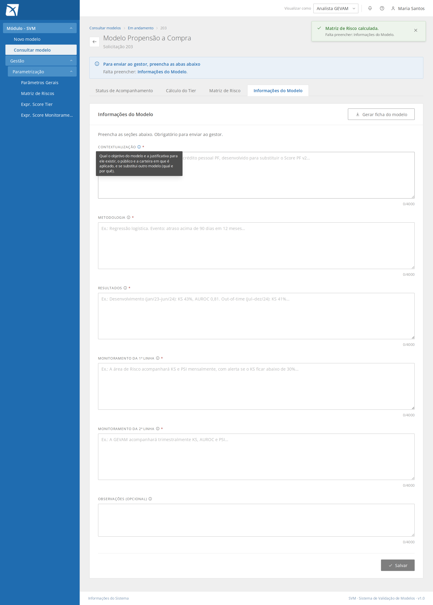

*Figura 18 – Passo 2: o (i) mostra o que escrever em cada seção.*

3. Clicar em **Salvar** (Figura 19). Não há botão Voltar: para ir a outra aba, usar as abas do topo.

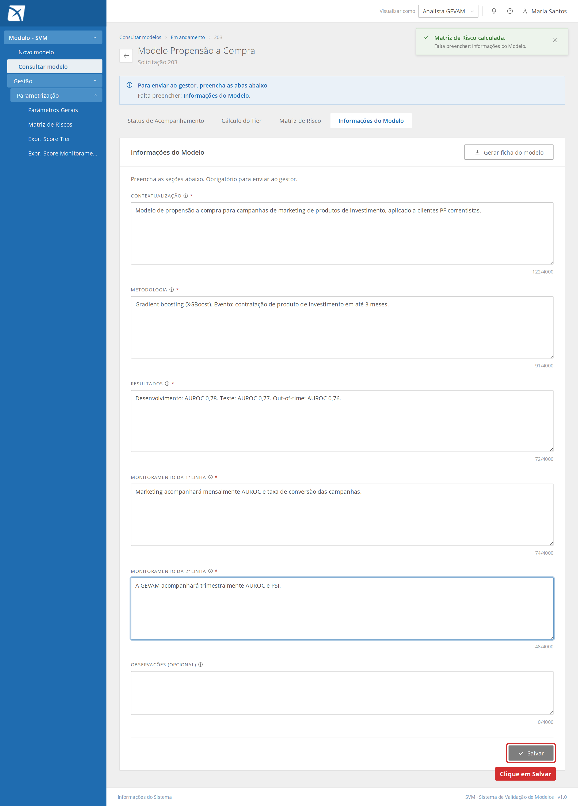

*Figura 19 – Passo 3: seções preenchidas; clicar em Salvar.*

| Seção | Obrigatória para enviar ao gestor | Dica do (i) |
| --- | --- | --- |
| Contextualização | Sim | Qual o objetivo do modelo e a justificativa para ele existir, o público e a carteira em que é aplicado, e se substitui outro modelo (qual e por quê). |
| Metodologia | Sim | Quais técnicas foram utilizadas (regressão logística, SARIMAX, árvore de decisão, XGBoost, redes neurais…), a variável resposta ou evento e o horizonte. |
| Resultados | Sim | Valores dos indicadores de performance (KS, AUROC, acurácia, MAPE…) associados a cada período (desenvolvimento, teste, out-of-time) e os valores dos testes realizados. |
| Monitoramento da 1ª linha | Sim | Qual monitoramento será realizado pela área solicitante: indicadores acompanhados, periodicidade e limites de alerta. |
| Monitoramento da 2ª linha | Sim | Qual monitoramento será realizado pela GEVAM e com quais indicadores (e com que periodicidade). |
| Observações | Não | Informações complementares que não se encaixam nas seções anteriores. |

**Esta seção é só da GEVAM:** o solicitante não vê as Informações do Modelo, nem na solicitação nem no modelo inventariado.

**Salvar com seção vazia:** o sistema **deixa salvar** mesmo com seções obrigatórias vazias, para o analista ir preenchendo aos poucos. Para **enviar ao gestor** (HA-10), todas as seções obrigatórias precisam estar preenchidas: enquanto faltar alguma, a aba aparece em “Falta preencher” e o envio fica bloqueado.

### HA-09. Gerar a ficha do modelo

> **Como** analista, **quero** gerar a ficha do modelo, **para** ter um resumo para consulta e para anexar a documentos.

**Passo a passo**

1. Na aba **Informações do Modelo**, clicar em **Gerar ficha do modelo**, no canto superior direito (Figura 20).

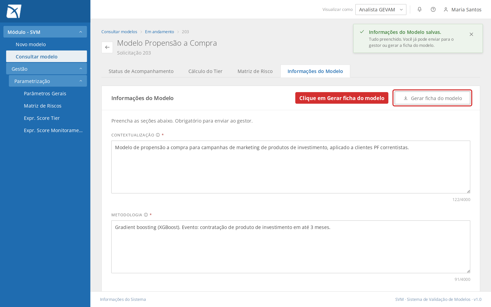

*Figura 20 – Passo 1: clicar em Gerar ficha do modelo.*

2. Abre a pré-visualização do “Relatório Individual de Modelo” (Figura 21).

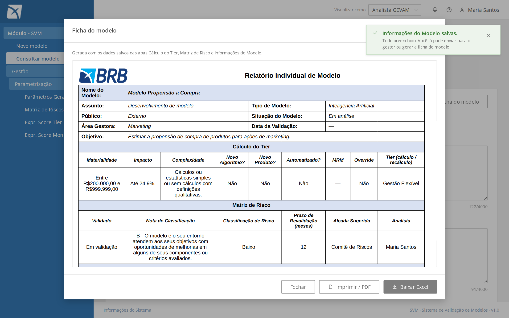

*Figura 21 – Passo 2: pré-visualização da ficha, com Baixar Excel, Imprimir / PDF e Fechar.*

3. Clicar em **Baixar Excel** para baixar o arquivo .xlsx, em **Imprimir / PDF** para imprimir, ou em **Fechar**.

**O que a ficha tem** (com os dados **salvos**, nesta ordem)

1. Cabeçalho: Nome do Modelo, Assunto, Tipo de Modelo, Público, Situação do Modelo, Área Gestora, Data da Validação (= data de finalização da análise) e Objetivo.
2. Cálculo do Tier: Materialidade, Impacto, Complexidade, Novo Algoritmo?, Novo Produto?, Automatizado?, MRM, Override e Tier (cálculo / recálculo).
3. Matriz de Risco: Validado, Nota de Classificação, Classificação de Risco, Prazo de Revalidação (meses), Alçada Sugerida e Analista.
4. Informações do Modelo: as seções de texto.

**Baixar Excel** gera um arquivo **.xlsx** de verdade, com o **logo do BRB** no topo e o mesmo layout da pré-visualização. Nome do arquivo: `Ficha_[nº da solicitação]_[nome do modelo].xlsx`. O modelo da planilha está em `handoff/ficha-do-modelo.xlsx`.

### HA-10. Enviar para o gestor

> **Como** analista, **quero** enviar a análise concluída ao gestor, **para** que ele finalize a validação.

**Só vale em Em análise**, para o analista responsável, e **sem pendências**: Cálculo do Tier, Matriz de Risco e Informações do Modelo preenchidos e nenhuma complementação em aberto.

**Passo a passo**

1. Abrir a solicitação (HA-02), com as três abas preenchidas.
2. Clicar em **Ações** > **Enviar para o gestor** (Figura 22).

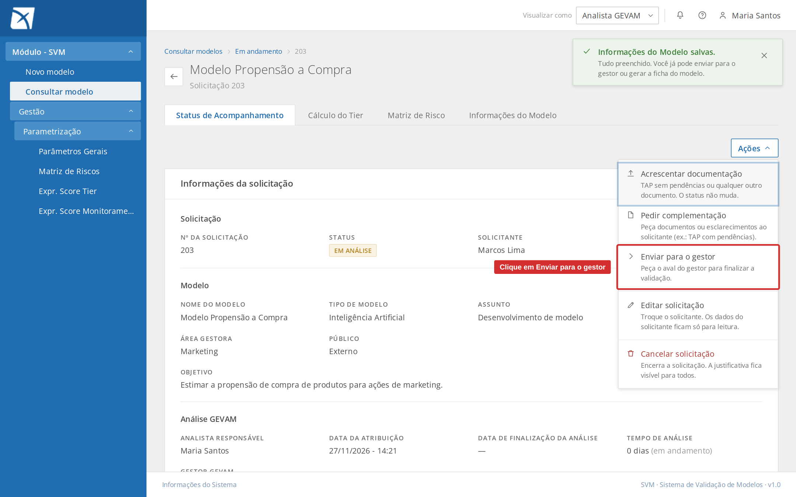

*Figura 22 – Passo 2: com as abas preenchidas, em Ações, clicar em Enviar para o gestor.*

3. Abre a janela (popup) **Enviar para o gestor**, por cima da página, explicando que é um pedido de aval. **Não há anexo nem parecer**: o gestor lê os documentos que já estão em Arquivos.
4. Clicar em **Enviar para o gestor** (Figura 23). Para desistir, clicar em **Cancelar**.

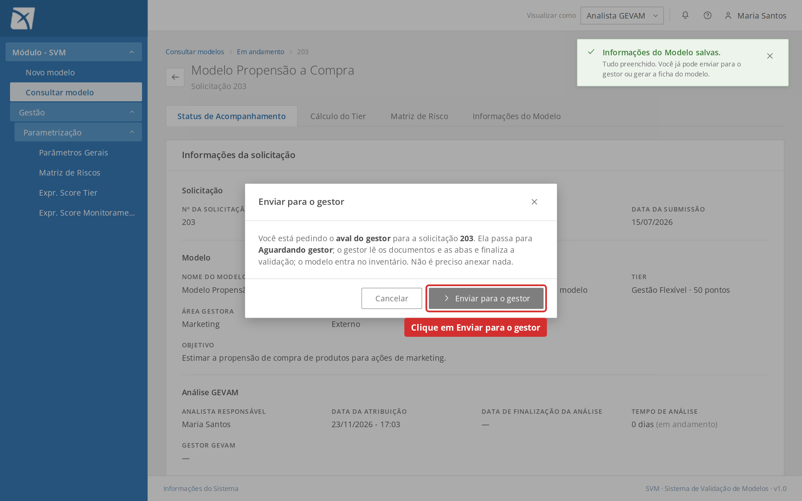

*Figura 23 – Passo 4: janela (popup) de confirmação do envio, sem anexo; clicar em Enviar para o gestor.*

5. A solicitação fica **Aguardando gestor**, com o quadro “Aguardando decisão do gestor” no topo (Figura 24).

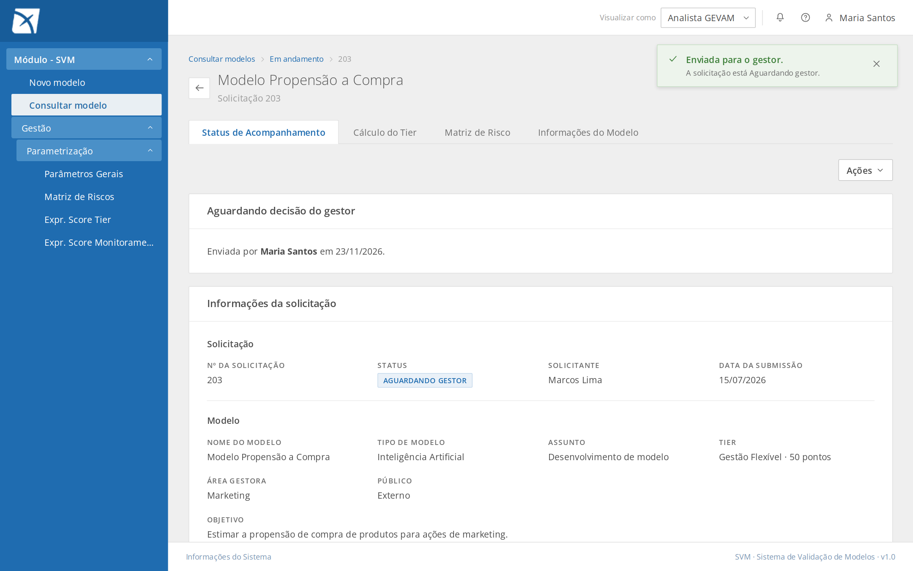

*Figura 24 – Passo 5: status Aguardando gestor e o quadro “Aguardando decisão do gestor”.*

**O que acontece**

- O status vira **Aguardando gestor** e aparece a mensagem “Enviada para o gestor.”
- O sistema grava a **data e hora de finalização da análise**.
- O histórico registra “Análise concluída e enviada para o gestor. Aval solicitado.”
- As abas de análise passam a ficar só para leitura.

**O sistema não deixa**

- Enviar com aba pendente: no menu, a linha do item diz “Antes, preencha …”; ao clicar, aparece o aviso “Preencha as abas pendentes para enviar ao gestor”, com links para as abas que faltam (Figura 25).
- Enviar com a solicitação Em complementação: o item “Enviar para o gestor” não aparece no menu.

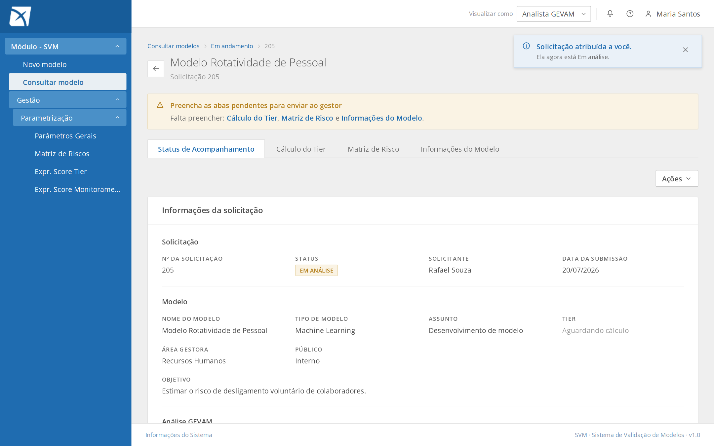

*Figura 25 – Tentativa de enviar com abas pendentes: aviso com links para as abas que faltam.*

### HA-11. Editar a solicitação

> **Como** analista, **quero** trocar o solicitante da solicitação, **para** que ela passe a ser acompanhada pela pessoa certa sem precisar cancelar e abrir outra.

**O analista edita qualquer campo e qualquer aba, exceto as informações preenchidas pelo solicitante** (Nome do modelo, Assunto, Tipo de modelo, Área gestora, Público e Objetivo), que ficam só para leitura. No formulário “Editar solicitação” ele troca o **solicitante**; o que ele mesmo inseriu é editado nas abas **Cálculo do Tier** (HA-06), **Matriz de Risco** (HA-07) e **Informações do Modelo** (HA-08).

**Vale em qualquer status em andamento** (Em análise, Em complementação, Aguardando gestor), para o analista responsável. Numa solicitação Submetido, é preciso assumir antes (HA-02). Não vale em Validado nem Cancelado.

**Passo a passo**

1. Abrir a solicitação (HA-02).
2. Clicar em **Ações** > **Editar solicitação** (Figura 26).

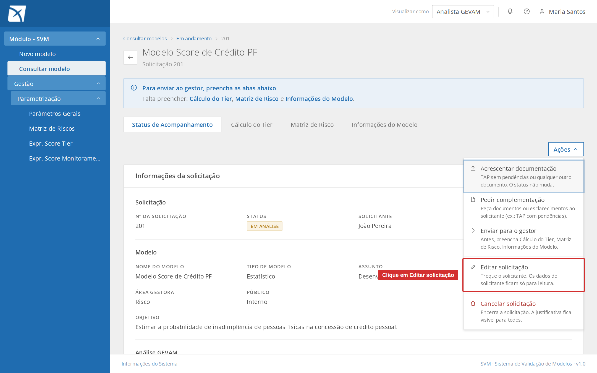

*Figura 26 – Passo 2: em Ações, clicar em Editar solicitação.*

3. Abre o formulário “Editar solicitação”. Só o campo **Solicitante**, no topo, pode ser alterado: é um **campo de texto**, que vem preenchido com o solicitante atual. Os dados informados pelo solicitante (Nome do modelo, Assunto, Tipo de modelo, Área gestora, Público e Objetivo) aparecem **só para leitura**, com os campos desabilitados.
4. Apagar o nome atual e digitar o nome do novo solicitante. Aparece embaixo: “O solicitante passa de [anterior] para [novo], que passa a acompanhar a solicitação e a responder às complementações.”
5. Clicar em **Salvar alterações** (Figura 27). Para desistir, clicar em **Cancelar** (nada é gravado).

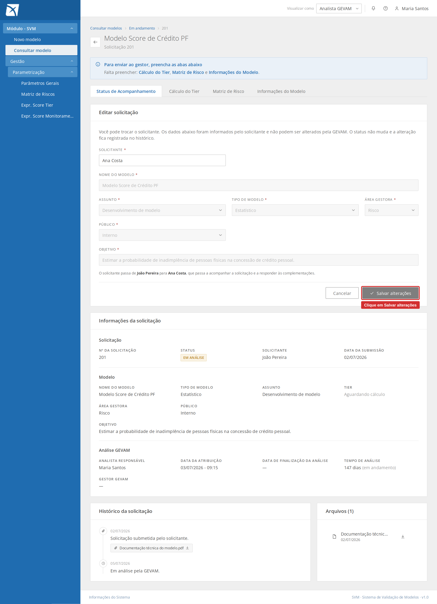

*Figura 27 – Passo 5: só o campo Solicitante pode ser alterado; os dados do solicitante ficam só para leitura. Clicar em Salvar alterações.*

**O que acontece**

- O novo solicitante é gravado e **o status não muda**. Ele passa a acompanhar a solicitação e a responder às complementações.
- O histórico registra **um único registro**: “Solicitação editada pelo analista.”, com o detalhe “Solicitante: [anterior] → [novo].”
- Não há campo de anexos neste formulário: documentos novos entram por Acrescentar documentação (HA-04).

**O sistema não deixa**

- Alterar os dados informados pelo solicitante: os campos ficam desabilitados.
- Salvar com o Solicitante vazio: “Campo obrigatório”.

### HA-12. Consultar os modelos inventariados

> **Como** analista, **quero** consultar os modelos do inventário, validados ou não, **para** acompanhar o inventário.

**A tela de hoje (aba Inventariado) será substituída por completo**

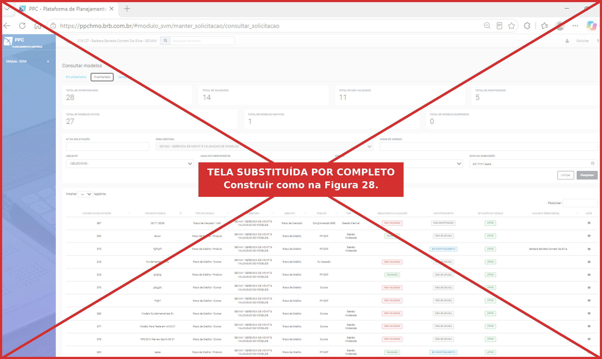

*Figura 28 – Hoje: aba Inventariado. A tela inteira sai e é construída de novo como na Figura 29.*

**Como deve ficar — aba Inventariado**

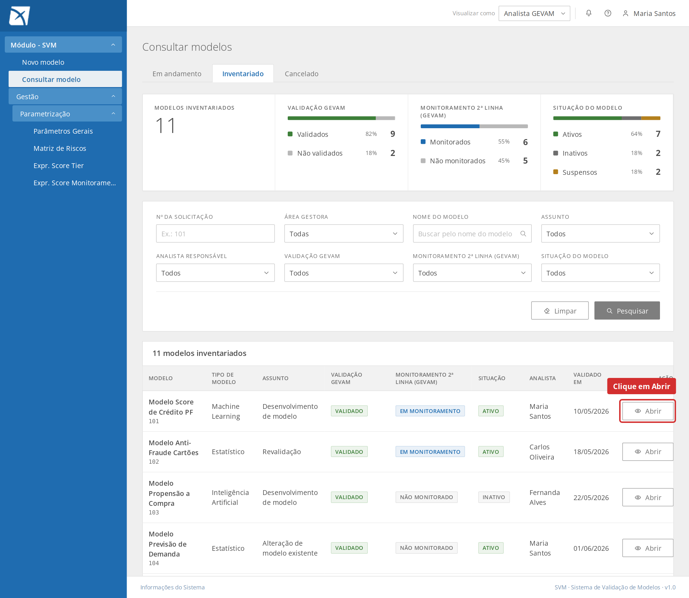

*Figura 29 – Aba Inventariado: quadros, filtros e lista com o botão Abrir em cada linha.*

**Aba Inventariado — passo a passo**

1. Em **Consultar modelo**, clicar na aba **Inventariado** (Figura 29).
2. No topo há quatro quadros informativos (não são clicáveis): **Modelos inventariados** (total); **Validação GEVAM**: Validados e Não validados; **Monitoramento 2ª Linha (GEVAM)**: Monitorados e Não monitorados; **Situação do modelo**: Ativos, Inativos e Suspensos.
3. Filtros: Nº da solicitação · Área gestora · Nome do modelo · Assunto · Analista responsável · Validação GEVAM · Monitoramento 2ª Linha (GEVAM) · Situação do modelo. Clicar em **Pesquisar** ou **Limpar**.
4. Colunas: Modelo (nome e nº da solicitação) · Tipo de modelo · Assunto · Validação GEVAM · Monitoramento 2ª Linha (GEVAM) · Situação · Analista · Validado em · Ação. Para os não validados, “Validado em” fica “—”.
5. Em cada linha há **só** o botão **Abrir**, que abre a **página do modelo** (HA-13).

**Nem todo modelo do inventário foi validado pela GEVAM.** Toda solicitação Validado entra no inventário como **Validado**, mas há modelos antigos, que entraram sem passar pela avaliação da GEVAM e que mesmo assim são monitorados: eles aparecem como **Não validado**. Resultado desfavorável de uma solicitação continua virando **Cancelado** (não entra no inventário).

**Não existe mais:** o monitoramento “Não se aplica”.

### HA-13. Atualizar um modelo inventariado

> **Como** analista, **quero** anexar documentos e alterar a situação, a validação GEVAM, o monitoramento e as Informações do Modelo de um modelo do inventário, **para** manter o inventário em dia depois da validação.

**Passo a passo — acrescentar documentação**

1. Em Consultar modelo > **Inventariado**, clicar em **Abrir** na linha do modelo.
2. Na página do modelo, clicar em **Acrescentar documentação**, no topo (Figura 30). Abre a janela (popup) **Acrescentar documentação**, por cima da página.

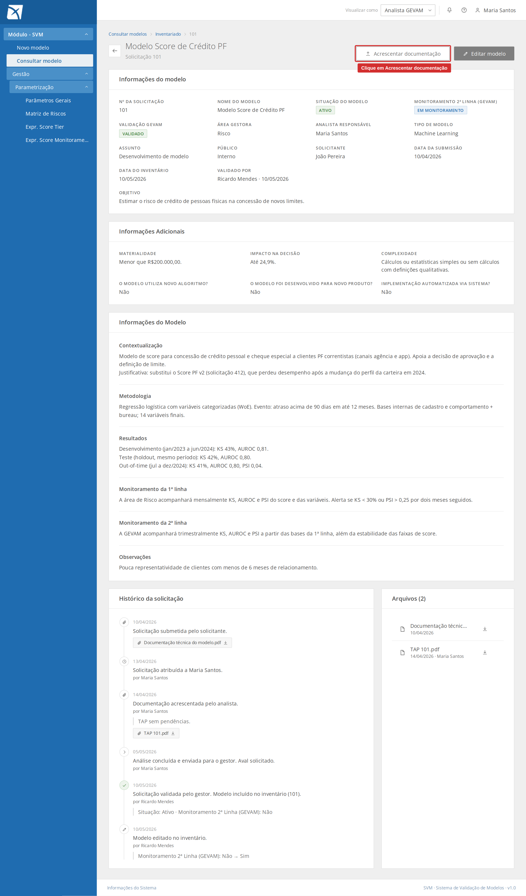

*Figura 30 – Passo 2: página do modelo inventariado; clicar em Acrescentar documentação.*

3. Anexar o **Documento** (obrigatório), escolher **Recebido por** (obrigatório: por onde o documento chegou, por exemplo Teams ou e-mail) e, se quiser, escrever **Observações**.
4. Clicar em **Acrescentar** (Figura 31). Para desistir, clicar em **Cancelar**.

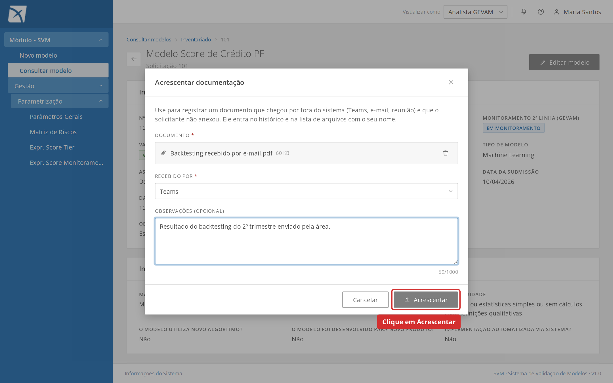

*Figura 31 – Passo 4: janela (popup) Acrescentar documentação no modelo: Documento, Recebido por e Observações; clicar em Acrescentar.*

**Passo a passo — editar o modelo**

1. Na página do modelo, clicar em **Editar modelo**, no topo (Figura 32).

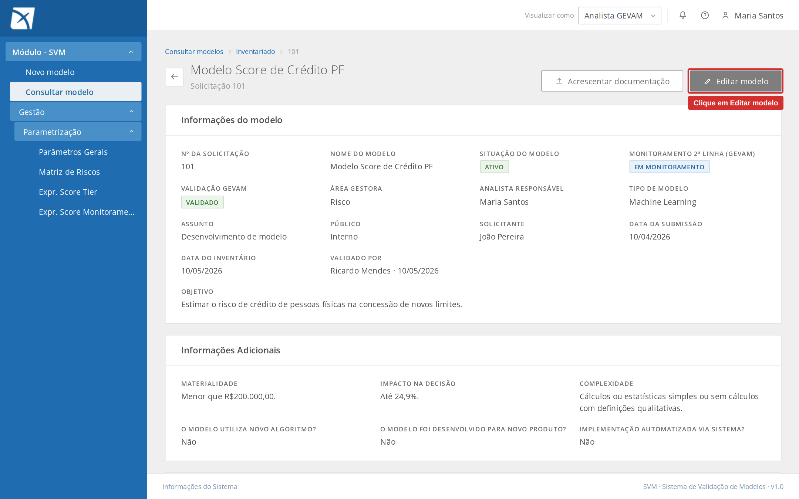

*Figura 32 – Editar o modelo, passo 1: na página do modelo, clicar em Editar modelo.*

2. Alterar o que precisar (Figura 33):
   - **Situação do modelo** (obrigatório): Ativo, Inativo ou Suspenso.
   - **Validação GEVAM** (obrigatório): Validado ou Não validado. Por exemplo, um modelo antigo que passou a ser avaliado pela GEVAM.
   - **Monitoramento 2ª Linha (GEVAM)**: botão liga/desliga (Sim / Não). Indica se a 2ª linha acompanha o modelo; o acompanhamento é feito fora do sistema.
   - **Informações do Modelo**: as mesmas seções da HA-08, já preenchidas, com as mesmas regras.

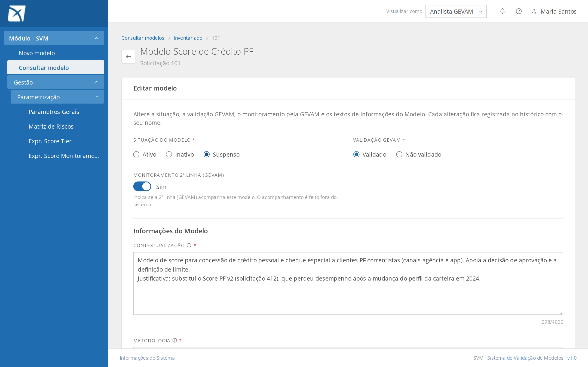

*Figura 33 – Editar o modelo, passo 2: Situação, Validação GEVAM, Monitoramento 2ª Linha (GEVAM) e Informações do Modelo; clicar em Salvar alterações.*

3. Clicar em **Salvar alterações**. Para desistir, clicar em **Cancelar**.

**O que acontece**

- O documento acrescentado entra no histórico e em Arquivos.
- A edição grava e registra no histórico **um único registro**: “Modelo editado no inventário.”, com o resumo do que mudou (ex.: “Situação: Ativo → Suspenso · Validação GEVAM: Não validado → Validado · Monitoramento 2ª Linha (GEVAM): Não → Sim · Informações do Modelo atualizadas”) e o nome de quem alterou.
- De praxe, todo modelo validado entra no inventário como **Validado**, Situação do modelo **Ativo** e Monitoramento 2ª Linha (GEVAM) **Não**; é aqui que o analista muda isso depois.

**O sistema não deixa**

- Acrescentar sem documento: “Anexe o documento.” Sem informar por onde chegou: “Informe por onde o documento chegou.”
- Salvar a edição com seção obrigatória de Informações do Modelo vazia: “Campo obrigatório”.

### HA-14. Inventariar um modelo que já existe

> **Como** analista, **quero** registrar direto no inventário um modelo que já existe, **para** que ele passe a constar no inventário da GEVAM.

**A tela de hoje será substituída por completo**

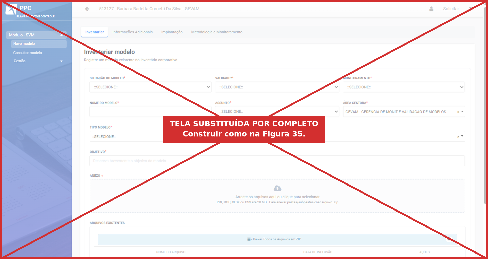

*Figura 34 – Hoje: Novo modelo > Inventariar. A tela inteira sai e é construída de novo como na Figura 35.*

**Passo a passo**

1. No menu lateral, clicar em **Novo modelo**. Abre **Inventariar modelo**, com quatro abas nesta ordem: **Inventariar** → **Cálculo do Tier** → **Matriz de Risco** → **Informações do Modelo**. Cada aba só libera a seguinte quando está completa.
2. Aba **Inventariar**: preencher Situação do modelo · **Validado pela GEVAM?** (Sim ou Não: modelos antigos podem não ter sido avaliados) · Monitoramento 2ª Linha (GEVAM) · Nome do modelo · Tipo de modelo · Público · Área gestora · Objetivo (todos obrigatórios) e, se quiser, **Anexo(s)** (quantos arquivos precisar, de qualquer tipo; o (i) explica o que se espera). Clicar em **Avançar** (Figura 35). Abre a aba Cálculo do Tier.

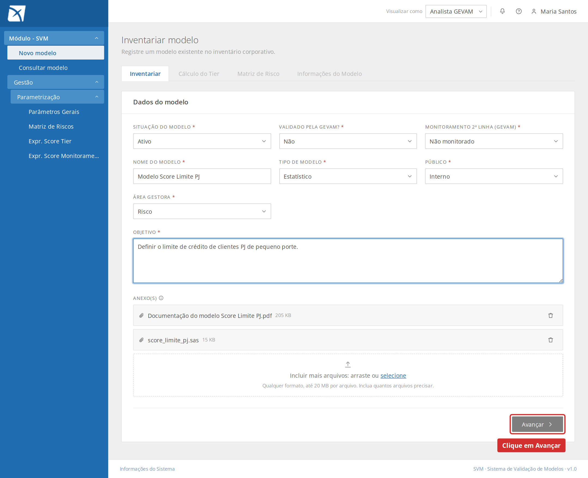

*Figura 35 – Passo 2, aba Inventariar: dados do modelo e Anexo(s); clicar em Avançar.*

3. Aba **Cálculo do Tier**: como na HA-06. Preencher os parâmetros e clicar em **Calcular Tier** (Figura 36). Com o Tier calculado, clicar em **Avançar** (Figura 37). Abre a aba Matriz de Risco.

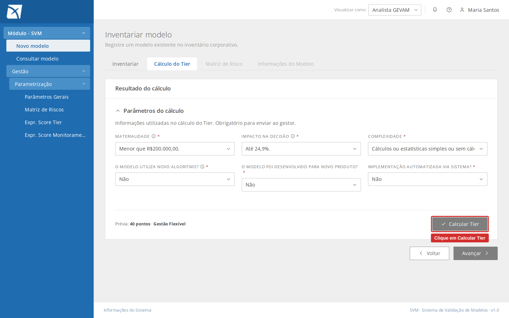

*Figura 36 – Passo 3, aba Cálculo do Tier: parâmetros preenchidos; clicar em Calcular Tier.*

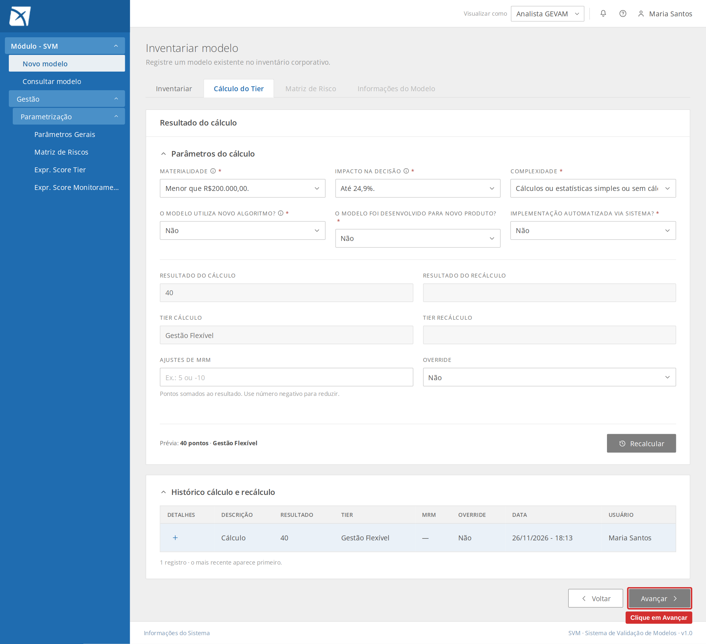

*Figura 37 – Passo 3: Tier calculado (resultado e histórico); clicar em Avançar para ir à Matriz de Risco.*

4. Aba **Matriz de Risco**: como na HA-07. O Tier já vem do cálculo. Preencher e clicar em **Calcular** (Figura 38). Com a matriz calculada, clicar em **Avançar** (Figura 39). Abre a aba Informações do Modelo.

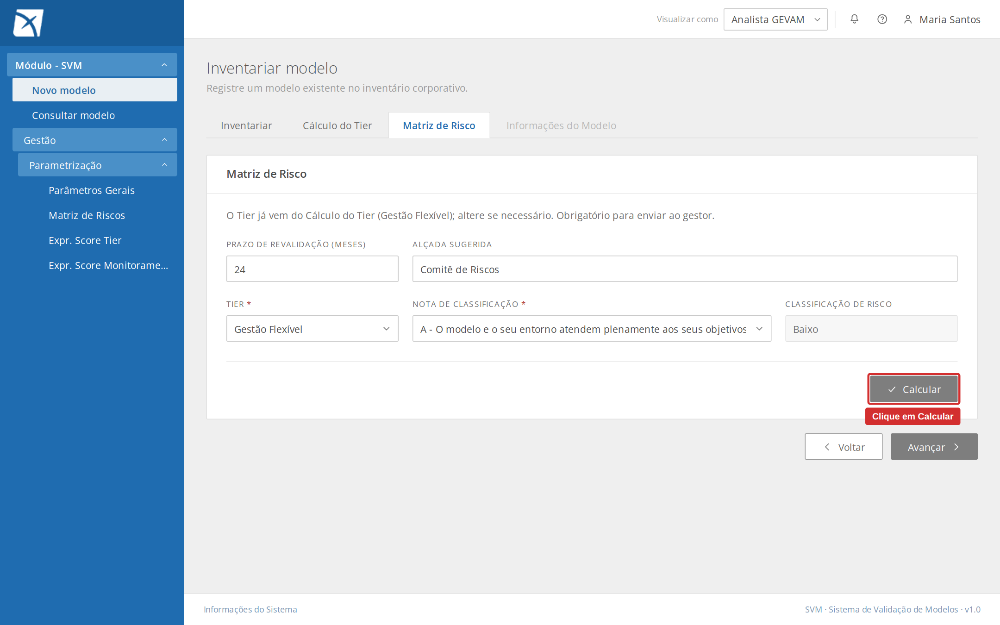

*Figura 38 – Passo 4, aba Matriz de Risco: campos preenchidos; clicar em Calcular.*

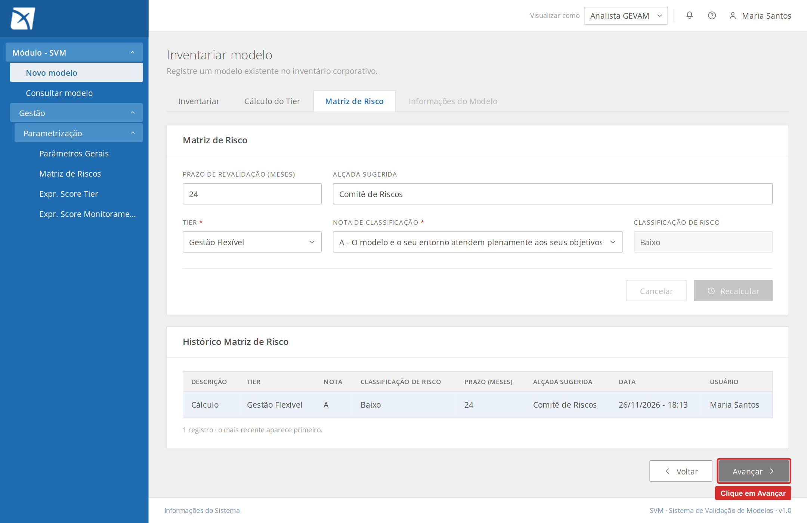

*Figura 39 – Passo 4: Matriz de Risco calculada (histórico); clicar em Avançar para ir às Informações do Modelo.*

5. Aba **Informações do Modelo** (a última): como na HA-08. Preencher as seções e clicar em **Incluir no inventário** (Figura 40). **Voltar** volta para a aba anterior sem perder o que foi preenchido.

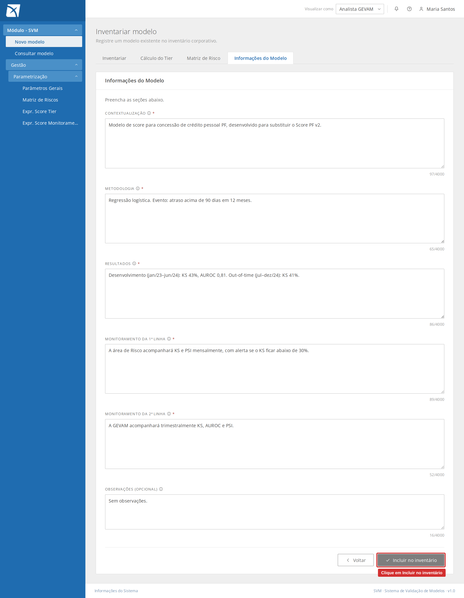

*Figura 40 – Passo 5, aba Informações do Modelo (a última): seções preenchidas; clicar em Incluir no inventário.*

6. Aparece a janela “Modelo inventariado com sucesso.” com o **número do modelo** (Figura 41). O modelo inventariado direto recebe um número da mesma sequência das solicitações (ex.: 244).

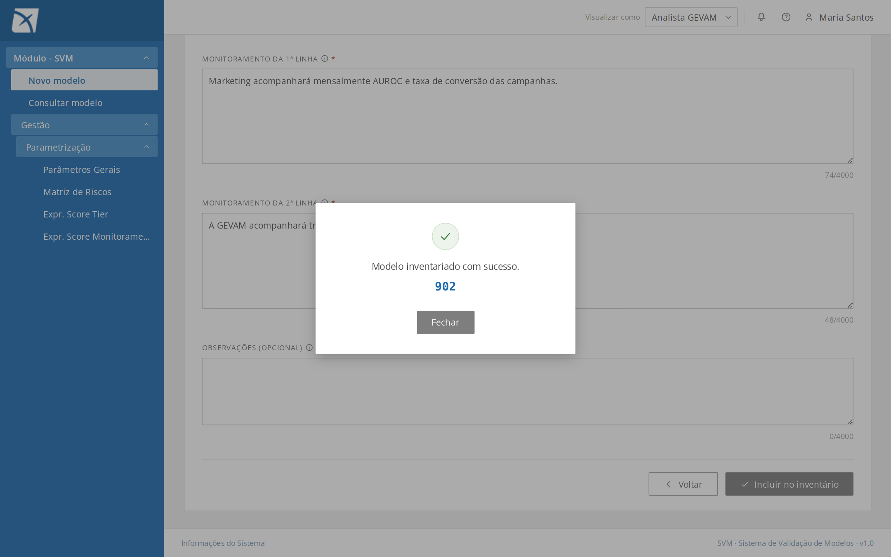

*Figura 41 – Passo 6: modelo incluído, com o número do modelo.*

**O que muda em relação à tela de hoje:** saem as abas “Informações Adicionais”, “Implantação” e “Metodologia e Monitoramento” e entram Cálculo do Tier, Matriz de Risco e Informações do Modelo; “Validado?” vira **“Validado pela GEVAM?”** (Sim / Não, obrigatório); “Monitoramento” vira **Monitoramento 2ª Linha (GEVAM)**; “Anexo” vira **Anexo(s)**, igual ao do envio do solicitante.

**O sistema não deixa**

- Avançar com campo obrigatório vazio: “Campo obrigatório”.
- Avançar do Cálculo do Tier sem calcular: “Calcule o Tier para seguir para a Matriz de Risco.”
- Avançar da Matriz de Risco sem calcular: “Calcule a Matriz de Risco para seguir para as Informações do Modelo.”

### HA-15. Cancelar a solicitação

> **Como** analista, **quero** cancelar a solicitação, **para** encerrar uma validação com resultado desfavorável ou que não vai prosseguir.

**Vale em qualquer status em andamento**, para o analista responsável. Numa solicitação Submetido, é preciso assumir antes (HA-02). Resultado desfavorável da validação **não** tem status próprio: a solicitação é cancelada.

**Passo a passo**

1. Abrir a solicitação (HA-02).
2. Clicar em **Ações** > **Cancelar solicitação** (Figura 42). Abre a janela (popup) **Cancelar solicitação**, por cima da página.

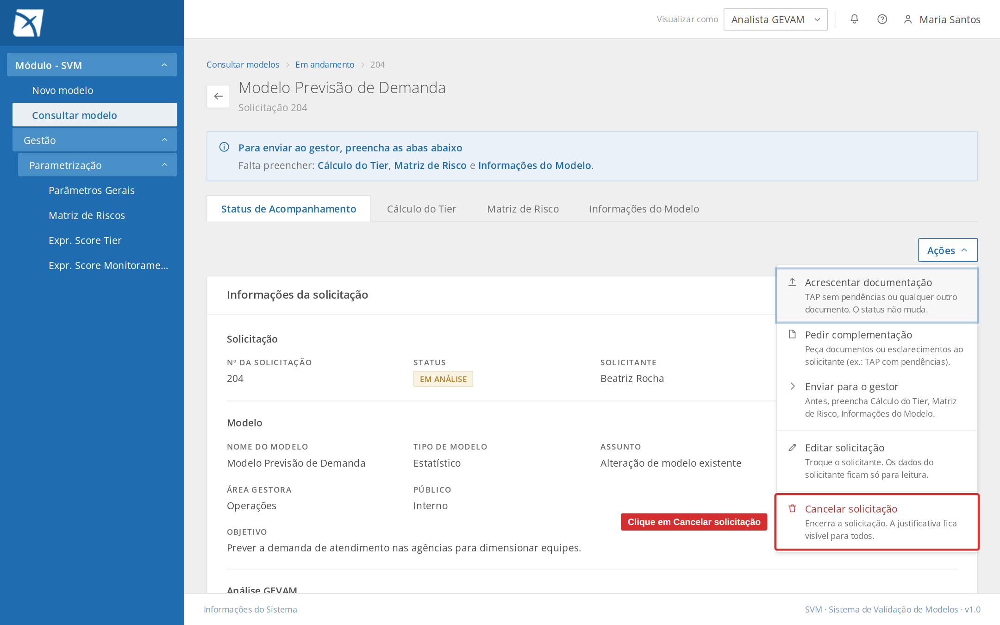

*Figura 42 – Passo 2: em Ações, clicar em Cancelar solicitação.*

3. Escrever a **Justificativa** (obrigatória, até 1.000 caracteres). O solicitante verá a justificativa.
4. Clicar em **Cancelar solicitação** para confirmar (Figura 43). Para desistir, clicar em **Voltar** (nada muda).

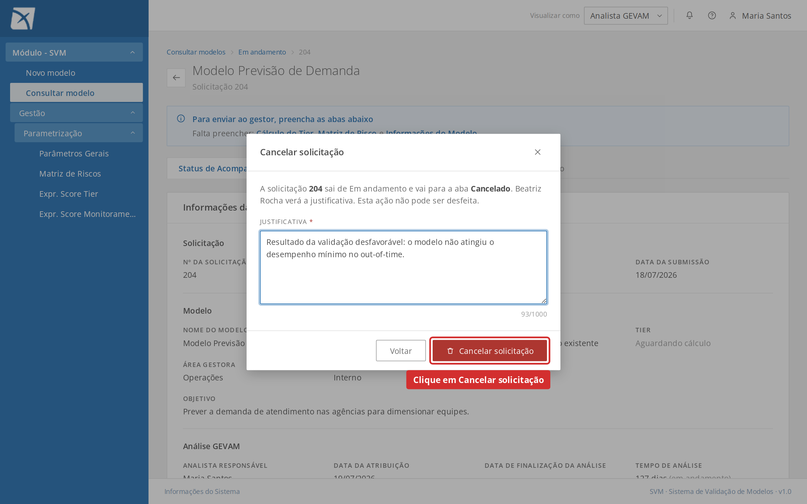

*Figura 43 – Passo 4: janela (popup) Cancelar solicitação com a justificativa; clicar em Cancelar solicitação.*

5. A solicitação fica **Cancelado**. Aparece a mensagem “Solicitação cancelada. Ela agora aparece na aba Cancelado.” e o quadro **“Solicitação cancelada pelo analista”**, com quem cancelou, quando e a justificativa (Figura 44).

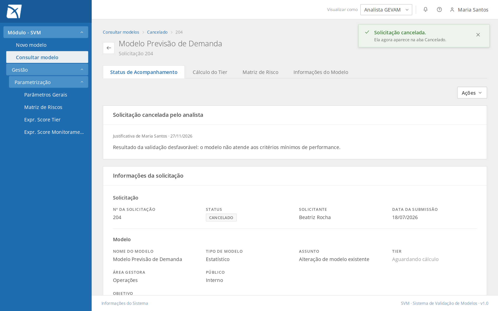

*Figura 44 – Passo 5: solicitação cancelada, com o quadro “Solicitação cancelada pelo analista” e a justificativa.*

**O que acontece**

- O status vira **Cancelado** e a solicitação sai de Em andamento e passa para a aba **Cancelado**.
- A página mostra o quadro “Solicitação cancelada pelo analista”, com nome, data e justificativa.
- O histórico registra um único registro: “Solicitação cancelada pelo analista.”, com a justificativa.

**O sistema não deixa**

- Cancelar sem justificativa: “Informe o motivo do cancelamento.”
- Cancelar solicitação de outro analista: “Só o analista responsável ([analista]), o gestor ou o solicitante cancelam.”
- Desfazer o cancelamento.

### HA-16. Consultar as solicitações canceladas

> **Como** analista, **quero** consultar as solicitações canceladas, **para** saber quem cancelou, quando e por quê.

**Hoje × como deve ficar — aba Cancelado**

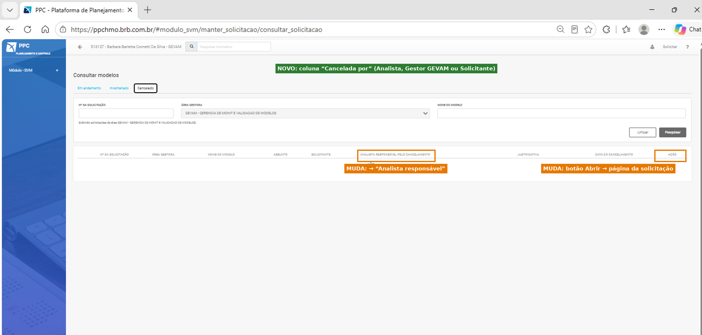

*Figura 45 – Hoje: aba Cancelado. Quadro laranja = muda; verde = novo.*

O que muda em relação à tela de hoje:

1. A coluna “Analista responsável pelo cancelamento” passa a se chamar **“Analista responsável”**.
2. **Nova coluna “Cancelada por”**: Analista, Gestor GEVAM ou Solicitante.
3. O botão **Abrir** abre a **página da solicitação cancelada**, com o quadro “Solicitação cancelada pelo …” (quem, quando e justificativa), as informações, o histórico e os arquivos.

**Como deve ficar — aba Cancelado**

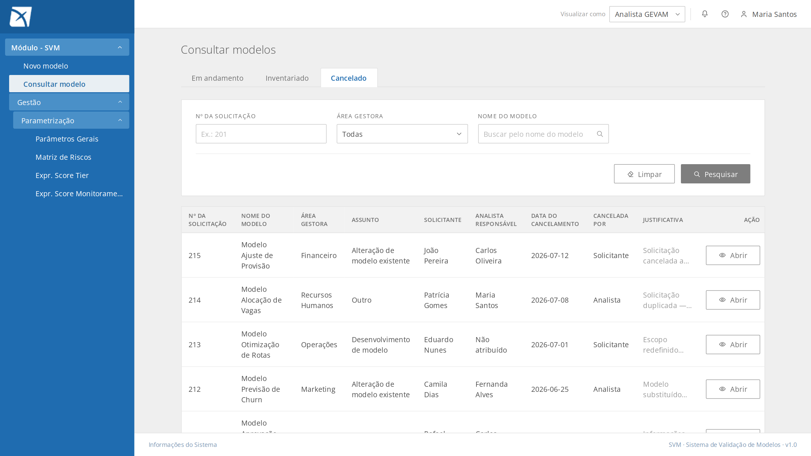

*Figura 46 – Aba Cancelado: quem cancelou, a justificativa e o botão Abrir.*

**Aba Cancelado — passo a passo**

1. Em **Consultar modelo**, clicar na aba **Cancelado** (Figura 46).
2. Filtros: Nº da solicitação · Área gestora · Nome do modelo. Clicar em **Pesquisar** ou **Limpar**.
3. Colunas: Nº da solicitação · Nome do modelo · Área gestora · Assunto · Solicitante · Analista responsável · Data do cancelamento · Cancelada por · Justificativa · Ação.
4. Clicar em **Abrir** abre a página da solicitação cancelada. O analista responsável ainda pode **acrescentar documentação** nela (HA-04); o status continua Cancelado.
