# Evoluções do SVM — Fluxo do Gestor GEVAM (Sprint 42)

**Quem é o gestor:** a pessoa da GEVAM que distribui as solicitações entre os analistas e dá o **aval final** da validação independente. Ele atribui cada solicitação a um analista (ou assume e analisa ele mesmo), troca o analista ou o solicitante quando precisa, confere a análise e finaliza a validação, que inclui o modelo no inventário. Ele também cuida do inventário: edita os modelos inventariados e inventaria modelos que já existem.

**Menu do gestor:** **Novo modelo** (abre direto **Inventariar modelo**, para registrar um modelo que já existe), **Consultar modelo**, com três abas: **Em andamento**, **Inventariado** e **Cancelado**, e **Gestão** > **Parametrização** (Parâmetros Gerais, Matriz de Riscos, Expr. Score Tier e Expr. Score Monitoramento). O menu **Gestão** aparece para o **analista** e para o **gestor** da GEVAM; o solicitante não o vê.

**Os status da solicitação:**

- **Submetido:** o solicitante enviou e ninguém pegou ainda.
- **Em análise:** o responsável (analista ou o próprio gestor) está analisando.
- **Em complementação:** o responsável pediu algo ao solicitante e espera a resposta.
- **Aguardando gestor:** a análise terminou e o gestor precisa dar o aval.
- **Validado:** o gestor deu o aval. De praxe, o modelo entra no inventário (aba **Inventariado**) com Validação GEVAM **Validado**, Situação do modelo **Ativo** e Monitoramento 2ª Linha (GEVAM) **Não**.
- **Cancelado:** a solicitação foi encerrada (pelo solicitante ou pela GEVAM), sempre com uma justificativa. Resultado desfavorável da validação também vira Cancelado.

## Histórias do gestor

### HG-01. Acompanhar as solicitações em andamento

> **Como** gestor, **quero** ver todas as solicitações em andamento e quantas estão em cada status, **para** distribuir o trabalho e saber o que aguarda o meu aval.

**A tela de hoje será substituída por completo** (é a mesma tela do analista)

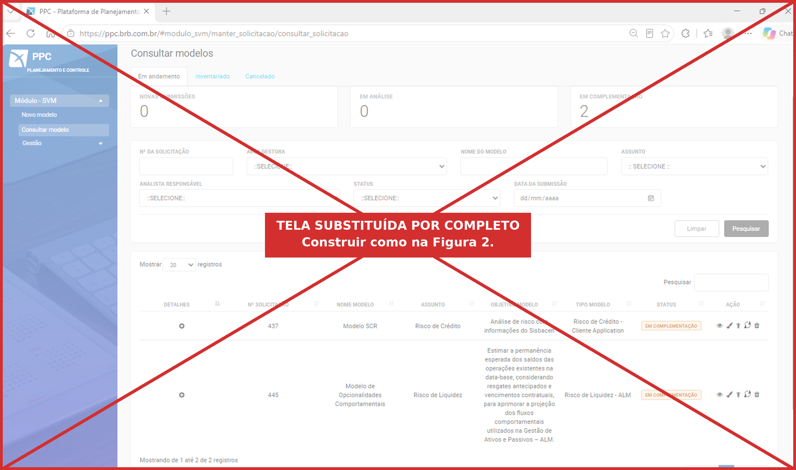

*Figura 1 – Hoje: Consultar modelos > Em andamento. A tela inteira sai e é construída de novo como na Figura 2.*

**Como deve ficar**

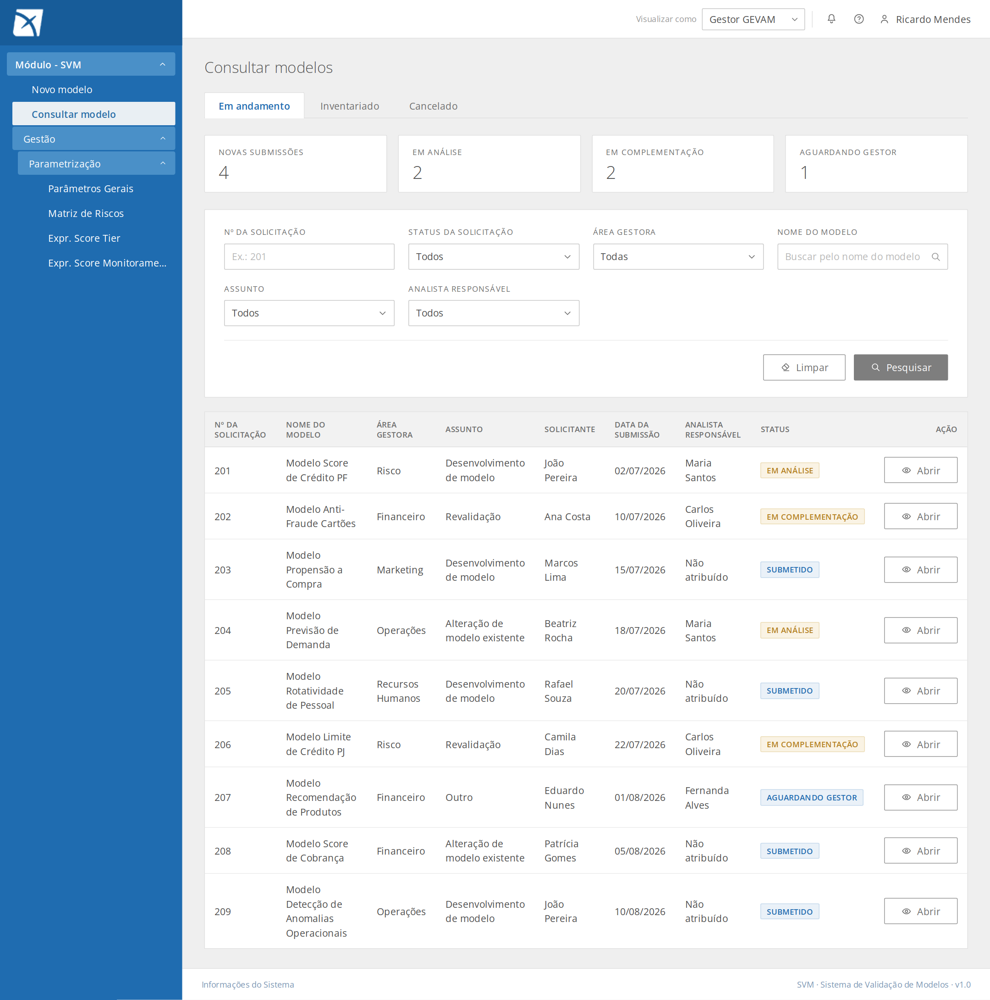

*Figura 2 – Aba Em andamento do gestor: quatro quadros de status, filtros e lista só com o botão Abrir.*

**Passo a passo**

1. No menu lateral, clicar em **Consultar modelo**. Abre a aba **Em andamento** (Figura 2).
2. No topo há quatro quadros com a quantidade por status: **Novas submissões** (Submetido), **Em análise**, **Em complementação** e **Aguardando gestor** (novo). O quadro **Aguardando gestor** mostra o que depende do aval do gestor. Os quadros são só informativos: **não** são clicáveis e não filtram a lista.
3. Em cada linha há **só** o botão **Abrir**, que abre a solicitação.

**O que aparece**

- Filtros: Nº da solicitação · **Status da solicitação** (Todos, Submetido, Em análise, Em complementação e Aguardando gestor) · Área gestora · Nome do modelo · Assunto · Analista responsável.
- Colunas: Nº da solicitação · Nome do modelo · Área gestora · Assunto · Solicitante · Data da submissão · Analista responsável · Status · Ação.
- O gestor vê as solicitações **de todas as áreas**.
- Solicitações Validado e Cancelado **não** aparecem aqui: ficam nas abas Inventariado (HG-09) e Cancelado (HG-12).

**Não aparece mais na linha:** o “+” de detalhes, as colunas “Objetivo modelo” e “Tipo modelo”, e os ícones de ação. As ações passam para o botão **Ações**, dentro da solicitação, tratado nas histórias **HG-02** (assumir), **HG-03** (atribuir a um analista), **HG-04** (trocar o analista), **HG-05** (trocar o solicitante) e **HG-08** (cancelar). O aval fica no botão **Finalizar validação**, no topo da solicitação (**HG-07**).

### HG-02. Assumir uma solicitação (o próprio gestor analisa)

> **Como** gestor, **quero** assumir eu mesmo uma solicitação nova, **para** fazer a análise sem passar para um analista.

**Passo a passo**

1. Em Consultar modelo > Em andamento, clicar em **Abrir** numa solicitação com status **Submetido**.
2. A solicitação abre **sem mudar nada**: continua Submetido e sem responsável. No topo aparece o aviso “Esta solicitação ainda não tem analista responsável. Para analisá-la você mesmo, clique em Ações > Assumir solicitação. Ou atribua a um analista.”
3. Clicar em **Ações** > “Assumir solicitação” (Figura 3).

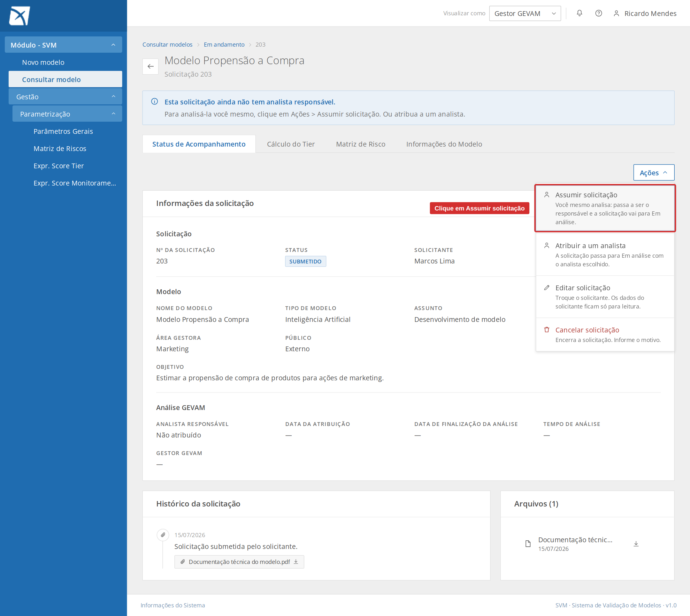

*Figura 3 – Passo 3: solicitação Submetido; em Ações, clicar em Assumir solicitação.*

4. O gestor **passa a ser o responsável**: o status vira **Em análise** e aparece a mensagem “Solicitação atribuída a você. Ela agora está Em análise.”
5. Agora o menu **Ações** também traz as ações do analista responsável (Figura 4): “Acrescentar documentação”, “Pedir complementação” e “Enviar para o gestor”. As abas **Cálculo do Tier**, **Matriz de Risco** e **Informações do Modelo** ficam liberadas para ele.

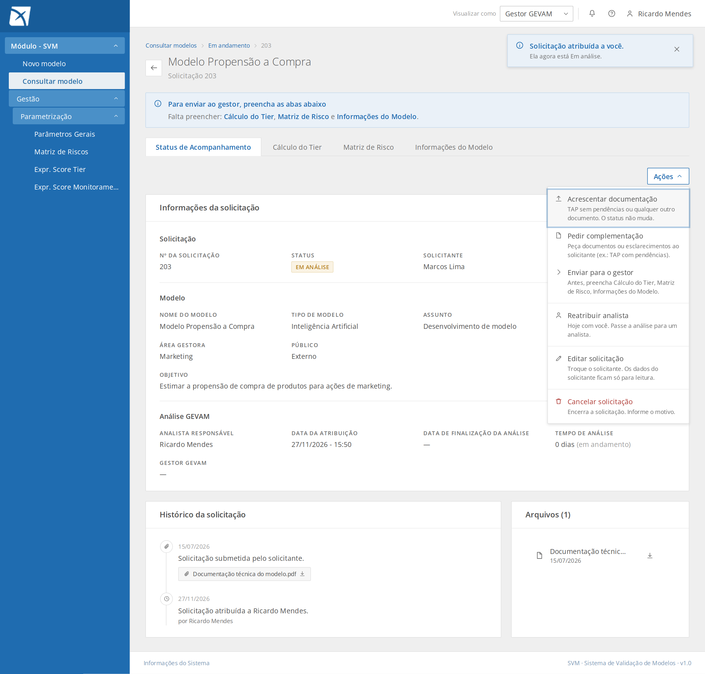

*Figura 4 – Passo 5: solicitação assumida pelo gestor, Em análise; o menu Ações traz as ações do analista e as do gestor.*

6. Daí em diante, o gestor segue as histórias HA-03 a HA-11 do documento do analista. Quando terminar, clica em “Enviar para o gestor” e **ele mesmo pode finalizar a validação** (HG-07).

**O que acontece**

- O sistema grava o gestor como responsável e a **data e hora da atribuição**.
- O histórico registra “Solicitação atribuída a [gestor].”
- O gestor continua com as ações de gestor: no menu, “Reatribuir analista” aparece com a linha “Hoje com você. Passe a análise para um analista.”

**O sistema não deixa**

- Assumir uma solicitação que já está com alguém. “Assumir solicitação” só aparece em Submetido. Para tirar a solicitação de um analista, o gestor usa “Reatribuir analista” (HG-04).

### HG-03. Atribuir uma solicitação a um analista

> **Como** gestor, **quero** atribuir uma solicitação nova a um analista, **para** distribuir a carga de trabalho.

**Passo a passo**

1. Abrir uma solicitação com status **Submetido**.
2. Clicar em **Ações** > “Atribuir a um analista” (Figura 5). Abre a janela (popup) **Atribuir a um analista**, por cima da página.

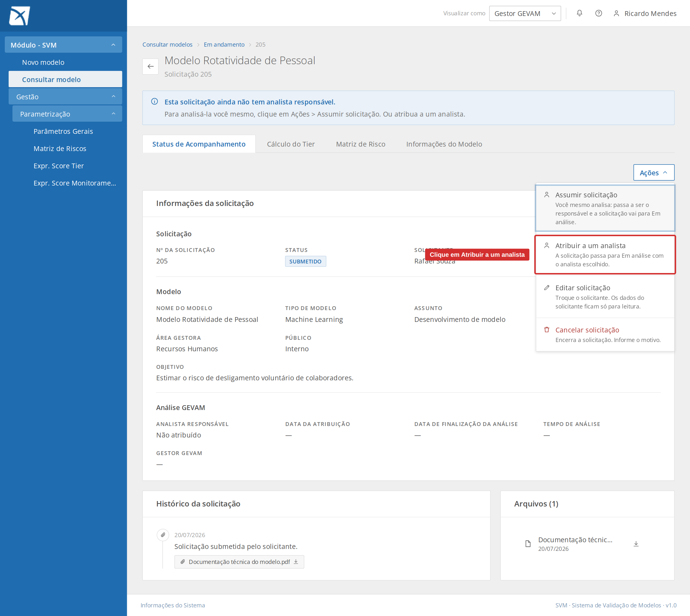

*Figura 5 – Passo 2: em Ações, clicar em Atribuir a um analista.*

3. Em **Analista** (obrigatório), escolher o analista.
4. Clicar em **Atribuir** (Figura 6). Para desistir, clicar em **Cancelar** (nada muda).

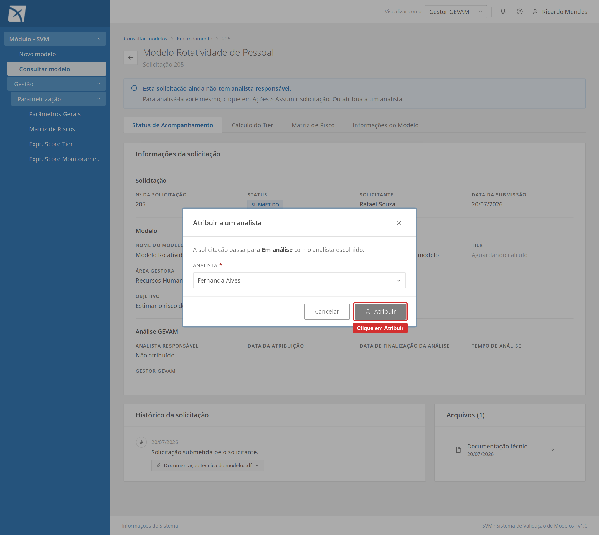

*Figura 6 – Passo 4: janela (popup) Atribuir a um analista, com o analista escolhido; clicar em Atribuir.*

**O que acontece**

- O status vira **Em análise** com o analista escolhido. Aparece a mensagem “Solicitação atribuída. [analista] agora é o analista responsável.”
- O sistema grava a **data e hora da atribuição** e o **gestor GEVAM**.
- O histórico registra “Solicitação atribuída a [analista] pelo gestor.”

**O sistema não deixa**

- Atribuir sem escolher o analista: “Escolha o analista.”

### HG-04. Trocar o analista (reatribuir)

> **Como** gestor, **quero** trocar o analista responsável, **para** redistribuir o trabalho quando alguém sai ou está sobrecarregado.

**Vale em qualquer status em andamento** (Em análise, Em complementação, Aguardando gestor). **Só o gestor** troca o analista.

**Passo a passo**

1. Abrir a solicitação.
2. Clicar em **Ações** > “Reatribuir analista” (Figura 7). A linha de apoio do item mostra com quem a solicitação está hoje.

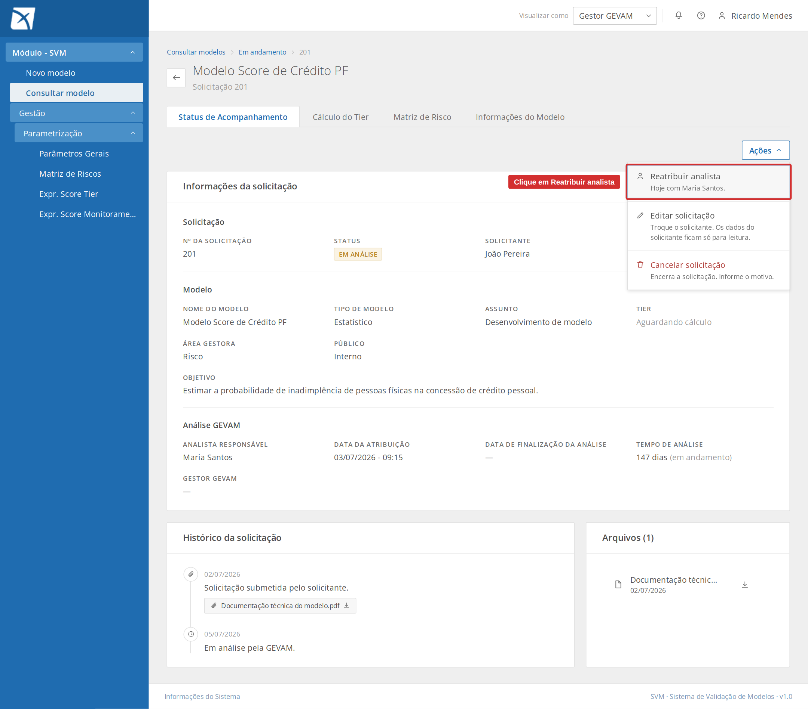

*Figura 7 – Passo 2: em Ações, clicar em Reatribuir analista.*

3. Abre a janela (popup) **Reatribuir analista**, por cima da página: “Hoje com [analista]. O status não muda; só o analista responsável.” Em **Analista** (obrigatório), escolher o novo analista. A lista não traz o analista atual.
4. Clicar em **Atribuir** (Figura 8). Para desistir, clicar em **Cancelar**.

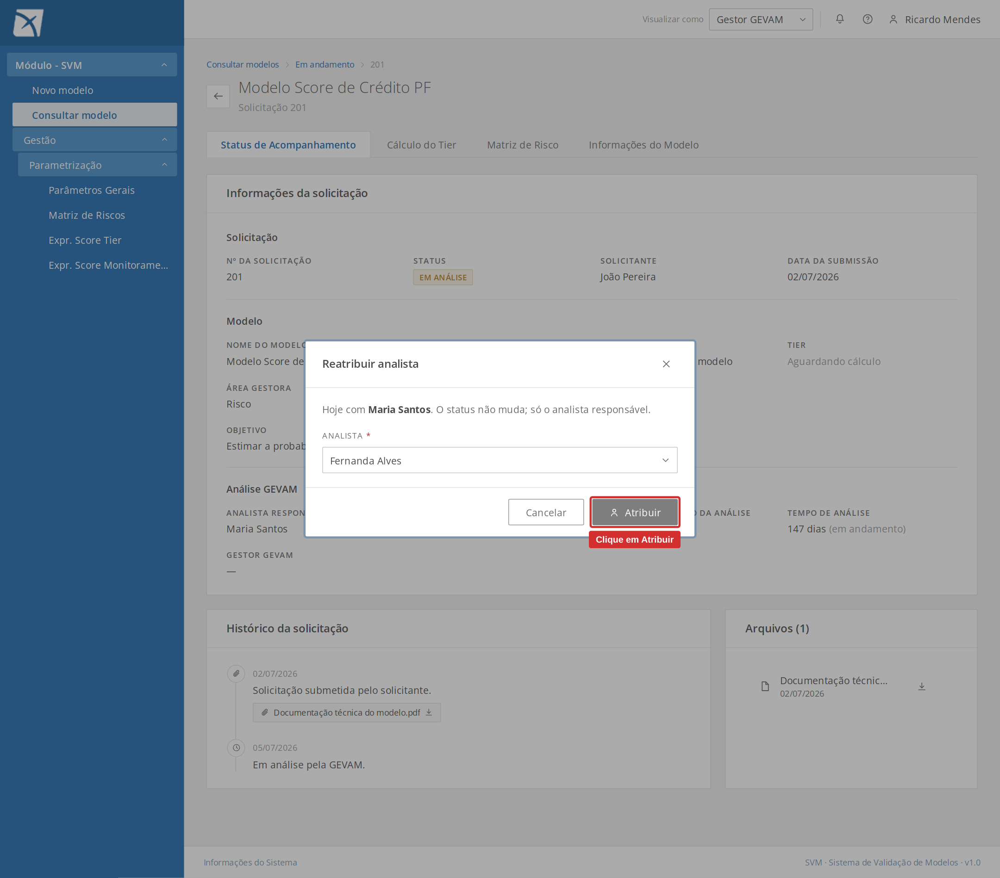

*Figura 8 – Passo 4: janela (popup) Reatribuir analista, com o novo analista escolhido; clicar em Atribuir.*

**O que acontece**

- **O status não muda.** Mudam o analista responsável e a data da atribuição.
- O histórico registra “Solicitação reatribuída de [anterior] para [novo] pelo gestor.”
- O analista anterior passa a ver a solicitação só para leitura.

**O sistema não deixa**

- Reatribuir sem escolher o analista: “Escolha o analista.”
- O analista trocar com outro analista: ele não tem o item “Reatribuir analista”.

### HG-05. Trocar o solicitante

> **Como** gestor, **quero** trocar o solicitante da solicitação, **para** que ela passe a ser acompanhada pela pessoa certa sem precisar cancelar e abrir outra.

**Vale em qualquer status em andamento.** É a mesma regra do analista (HA-11): **só o solicitante pode ser trocado**. Os dados informados pelo solicitante (Nome do modelo, Assunto, Tipo de modelo, Área gestora, Público e Objetivo) ficam **só para leitura**.

**Passo a passo**

1. Abrir a solicitação.
2. Clicar em **Ações** > “Editar solicitação” (Figura 9).

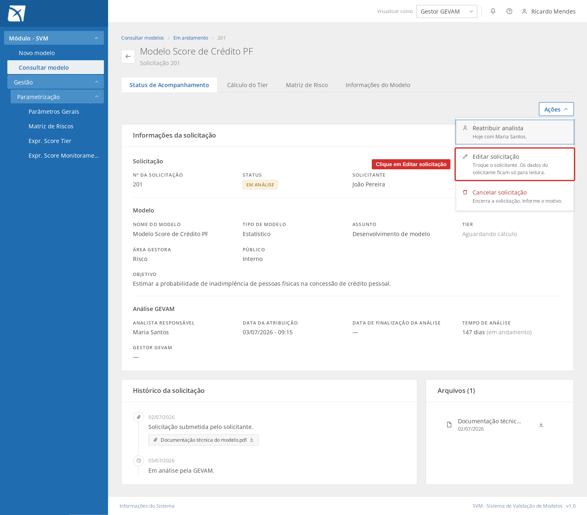

*Figura 9 – Passo 2: em Ações, clicar em Editar solicitação.*

3. Abre o formulário “Editar solicitação”. Só o campo **Solicitante**, no topo, pode ser alterado: é um **campo de texto**, que vem preenchido com o solicitante atual. Os outros campos aparecem desabilitados.
4. Apagar o nome atual e digitar o nome do novo solicitante. Aparece embaixo: “O solicitante passa de [anterior] para [novo], que passa a acompanhar a solicitação e a responder às complementações.”
5. Clicar em **Salvar alterações** (Figura 10). Para desistir, clicar em **Cancelar** (nada é gravado).

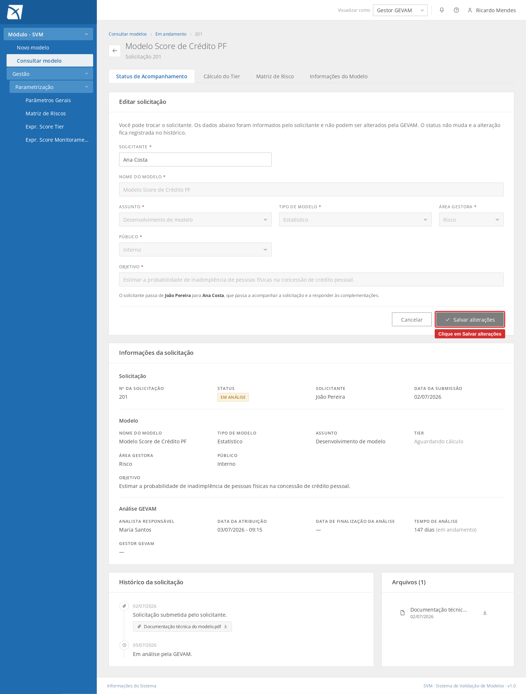

*Figura 10 – Passo 5: só o campo Solicitante pode ser alterado; os dados do solicitante ficam só para leitura. Clicar em Salvar alterações.*

**O que acontece**

- O novo solicitante é gravado e **o status não muda**.
- O histórico registra **um único registro**: “Solicitação editada pelo gestor GEVAM.”, com o detalhe “Solicitante: [anterior] → [novo].”

**O sistema não deixa**

- Alterar os dados informados pelo solicitante: os campos ficam desabilitados.
- Salvar com o Solicitante vazio: “Campo obrigatório”.

### HG-06. Conferir a análise

> **Como** gestor, **quero** ler os documentos e conferir as abas preenchidas pelo analista, **para** dar o aval com segurança.

**Passo a passo**

1. Em Em andamento, filtrar **Status da solicitação** = Aguardando gestor, clicar em **Pesquisar** e depois em **Abrir** na solicitação.
2. No topo da aba **Status de Acompanhamento** aparece o quadro **“Aval solicitado pelo analista”**: “Enviada por [analista] em [data].” e a orientação “Leia os documentos em Arquivos e confira as abas Cálculo do Tier, Matriz de Risco e Informações do Modelo. Em Finalizar validação você dá o aval: a solicitação fica com status Validado e o modelo entra no inventário (Ativo, não monitorado).” (Figura 11).

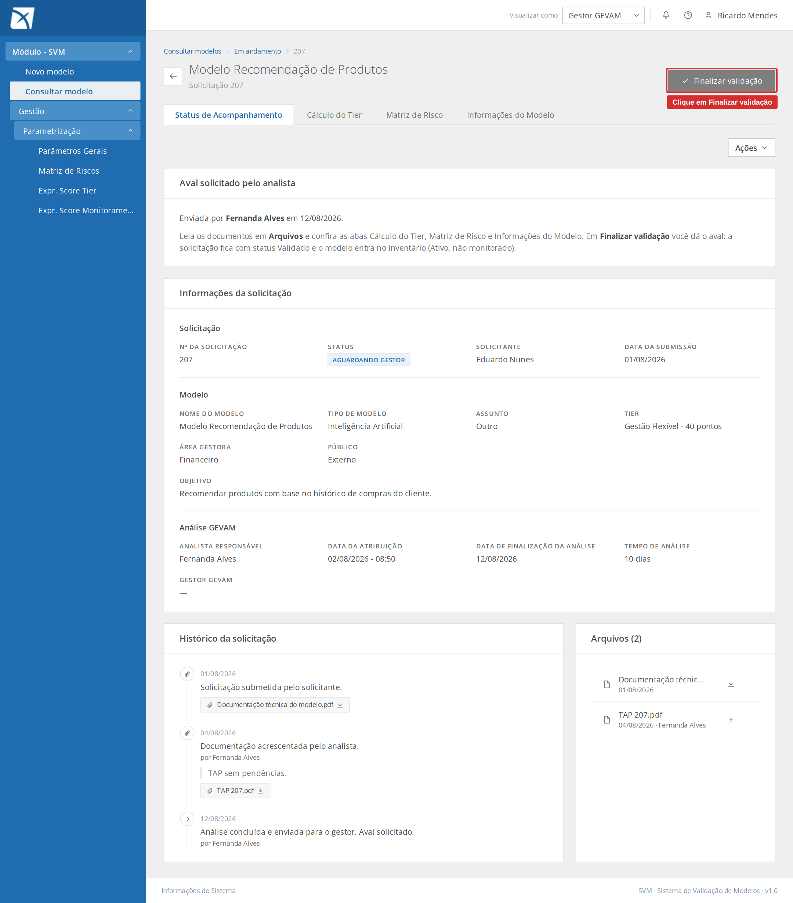

*Figura 11 – Solicitação Aguardando gestor: quadro “Aval solicitado pelo analista”, informações, histórico, arquivos e o botão Finalizar validação no topo.*

3. Rolar a página para ver as informações, o histórico e os **Arquivos** (com download).
4. Clicar nas abas **Cálculo do Tier**, **Matriz de Risco** e **Informações do Modelo** para conferir. Elas ficam **só para leitura**.
5. Se quiser, clicar em **Gerar ficha do modelo**, na aba Informações do Modelo (HA-09).

**O sistema não deixa**

- Editar as abas de análise (a não ser que o próprio gestor tenha assumido a solicitação, HG-02).
- Devolver a solicitação ao analista pelo sistema. Ajustes são combinados por e-mail, fora do sistema, antes do aval.
- Recusar a validação. Resultado desfavorável **não** tem status próprio: a solicitação é cancelada (HG-08).

### HG-07. Finalizar a validação

> **Como** gestor, **quero** dar o aval à validação, **para** concluir a validação independente e incluir o modelo no inventário.

**Vale só em Aguardando gestor.** Vale também quando o próprio gestor assumiu e analisou a solicitação (HG-02): ele envia para o gestor e ele mesmo finaliza.

**Passo a passo**

1. Abrir a solicitação **Aguardando gestor** (HG-06).
2. Clicar em **Finalizar validação**, no topo da página (Figura 11). Abre a janela (popup) **Finalizar validação**, por cima da página.
3. A janela mostra o que vai acontecer e a **Matriz de Risco do analista** (Tier, nota e classificação de risco). Não há perguntas.
4. Clicar em **Finalizar validação** para confirmar (Figura 12). Para desistir, clicar em **Cancelar** (nada muda).

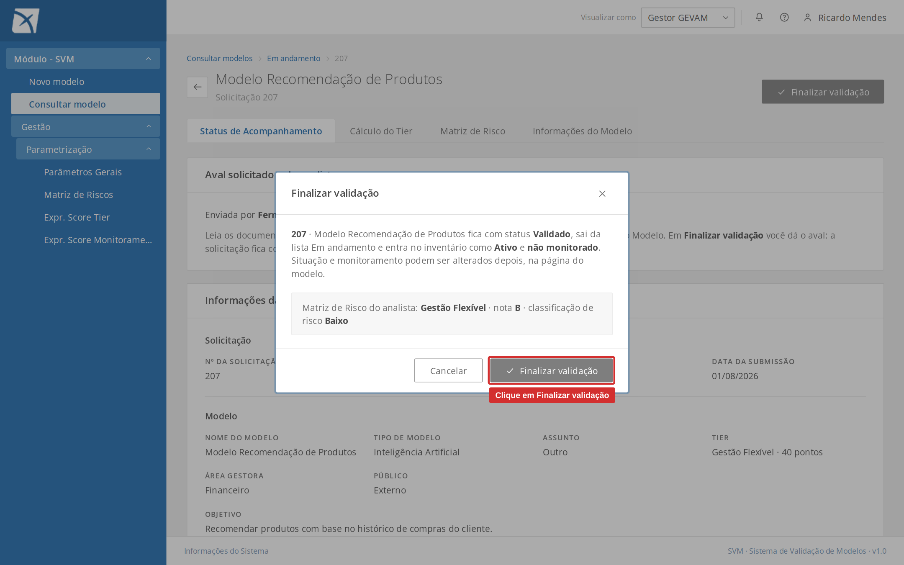

*Figura 12 – Passo 4: janela (popup) Finalizar validação com a Matriz de Risco do analista; clicar em Finalizar validação.*

5. A solicitação fica **Validado**: aparece a mensagem de que o modelo entrou no inventário e o quadro “Solicitação finalizada” (Resultado e Validado por) (Figura 13).

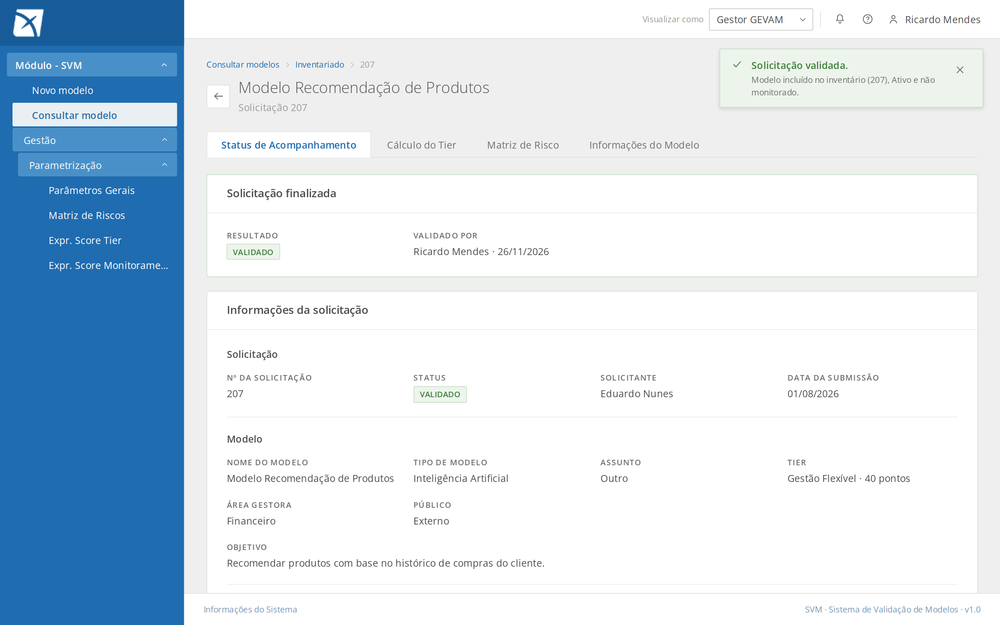

*Figura 13 – Passo 5: solicitação validada: quadro “Solicitação finalizada” e a mensagem de que o modelo entrou no inventário.*

**O que acontece**

- O status vira **Validado** e a solicitação sai de Em andamento.
- O modelo entra em Consultar modelo > **Inventariado** com o **mesmo número da solicitação**, Validação GEVAM **Validado**, Situação do modelo **Ativo** e Monitoramento 2ª Linha (GEVAM) **Não** (de praxe), levando o Cálculo do Tier, a Matriz de Risco e as Informações do Modelo.
- O histórico registra “Solicitação validada pelo gestor. Modelo incluído no inventário.”
- Situação e monitoramento são alterados depois, na página do modelo (HG-10).

### HG-08. Cancelar a solicitação

> **Como** gestor, **quero** cancelar uma solicitação, **para** encerrar uma validação com resultado desfavorável ou que não vai prosseguir.

**Vale em qualquer status em andamento**, inclusive Submetido e Aguardando gestor.

**Passo a passo**

1. Abrir a solicitação.
2. Clicar em **Ações** > “Cancelar solicitação” (Figura 14). Abre a janela (popup) **Cancelar solicitação**, por cima da página.

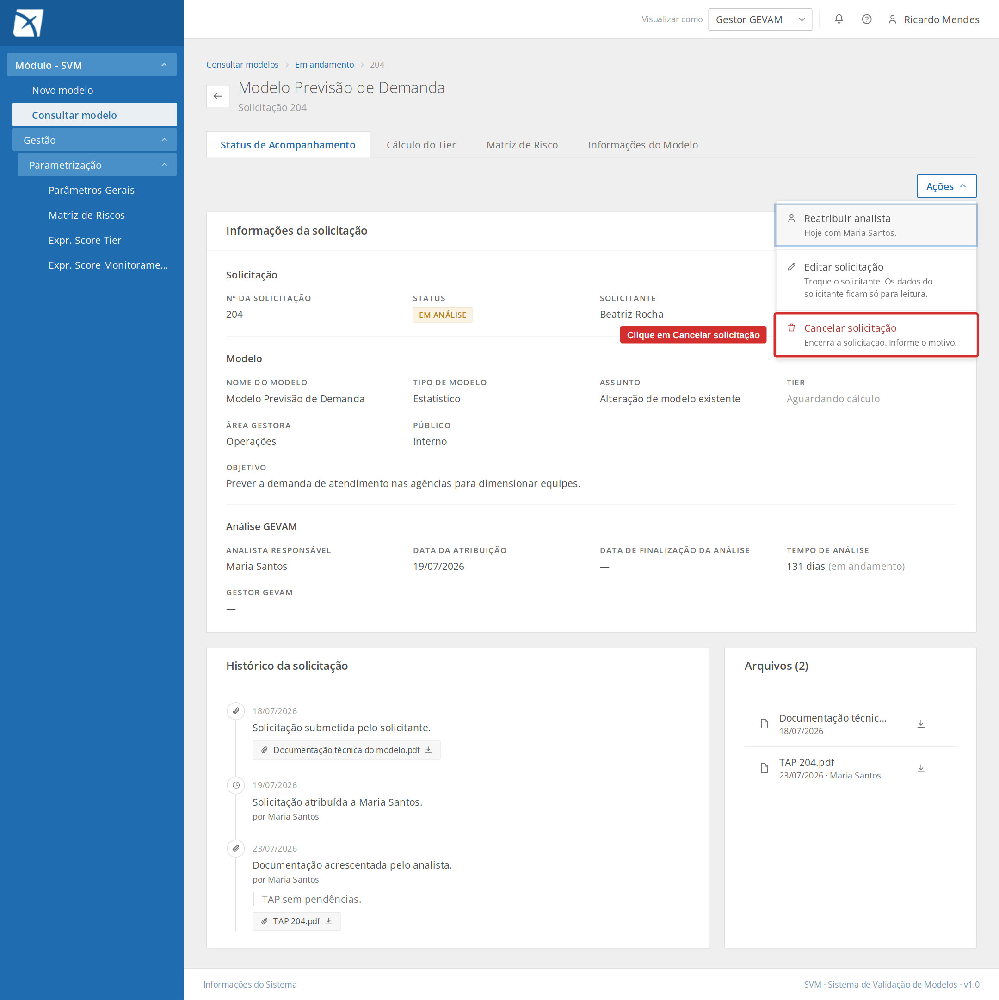

*Figura 14 – Passo 2: em Ações, clicar em Cancelar solicitação.*

3. Escrever a **Justificativa** (obrigatória, até 1.000 caracteres). O solicitante verá a justificativa.
4. Clicar em **Cancelar solicitação** para confirmar (Figura 15). Para desistir, clicar em **Voltar** (nada muda).

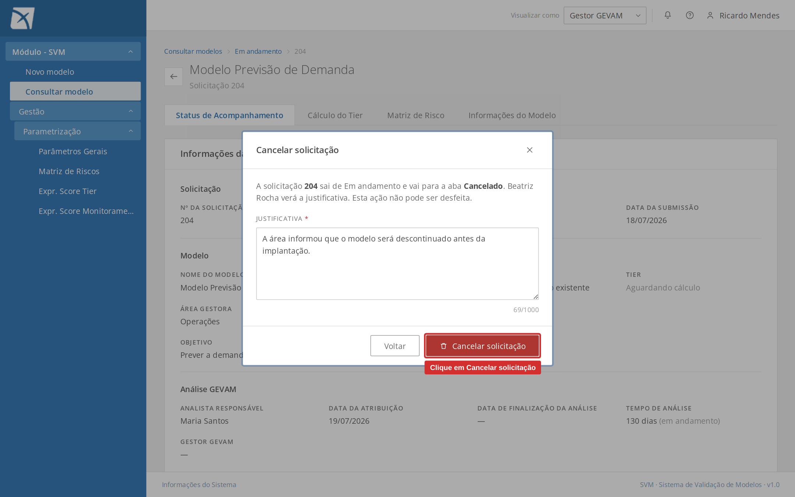

*Figura 15 – Passo 4: janela (popup) Cancelar solicitação com a justificativa; clicar em Cancelar solicitação.*

**O que acontece**

- O status vira **Cancelado** e a solicitação passa para a aba **Cancelado**. Aparece a mensagem “Solicitação cancelada. Ela agora aparece na aba Cancelado.”
- A página mostra o quadro “Solicitação cancelada pelo gestor GEVAM”, com nome, data e justificativa.
- O histórico registra “Solicitação cancelada pelo gestor GEVAM.”, com a justificativa.

**O sistema não deixa**

- Cancelar sem justificativa: “Informe o motivo do cancelamento.”
- Desfazer o cancelamento.

### HG-09. Consultar os modelos inventariados

> **Como** gestor, **quero** consultar os modelos do inventário, validados ou não, **para** acompanhar a carteira de modelos.

**A tela de hoje (aba Inventariado) será substituída por completo** (é a mesma tela do analista)

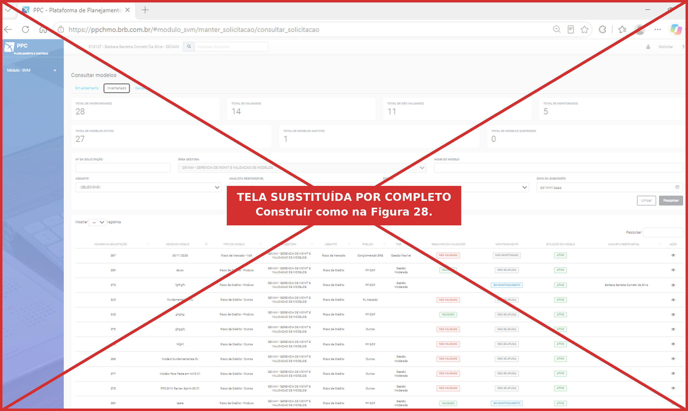

*Figura 16 – Hoje: aba Inventariado. A tela inteira sai e é construída de novo como na Figura 17.*

**Como deve ficar**

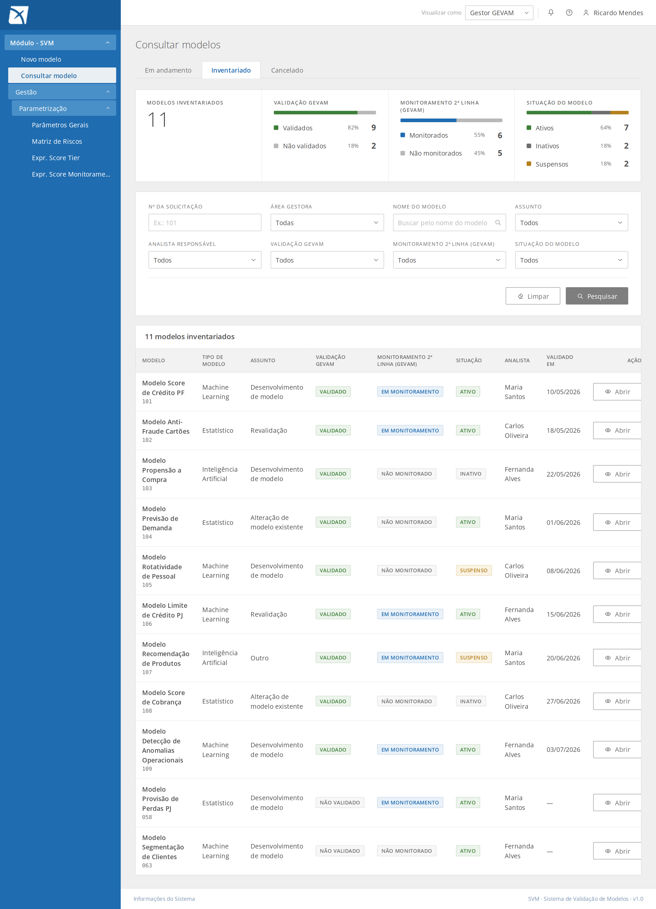

*Figura 17 – Aba Inventariado: quadros informativos, filtros e lista com o botão Abrir em cada linha.*

**Passo a passo**

1. Em **Consultar modelo**, clicar na aba **Inventariado** (Figura 17).
2. A tela é a mesma do analista (HA-12): quatro quadros informativos (não são clicáveis), os filtros (Nº da solicitação · Área gestora · Nome do modelo · Assunto · Analista responsável · Validação GEVAM · Monitoramento 2ª Linha (GEVAM) · Situação do modelo) e a lista.
3. Em cada linha há **só** o botão **Abrir**, que abre a **página do modelo** (HG-10).

### HG-10. Atualizar um modelo inventariado

> **Como** gestor, **quero** anexar documentos e alterar a situação, a validação GEVAM, o monitoramento e as Informações do Modelo de um modelo do inventário, **para** manter o inventário em dia depois da validação.

**Passo a passo — acrescentar documentação**

1. Em Consultar modelo > **Inventariado**, clicar em **Abrir** na linha do modelo.
2. Na página do modelo, clicar em **Acrescentar documentação**, no topo (Figura 18). Abre a janela (popup) **Acrescentar documentação**, por cima da página.

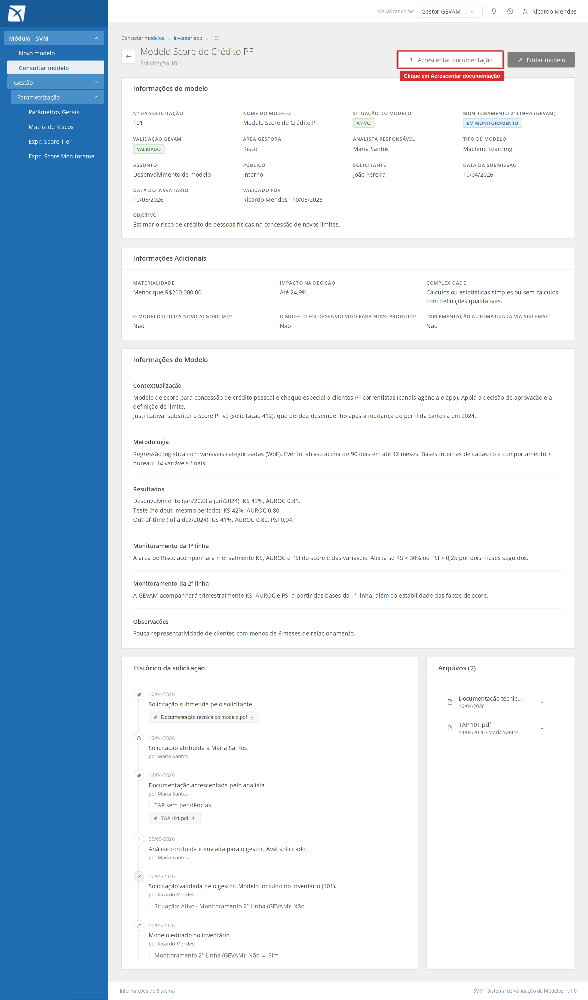

*Figura 18 – Passo 2: página do modelo inventariado; clicar em Acrescentar documentação.*

3. Anexar o **Documento** (obrigatório), escolher **Recebido por** (obrigatório: por onde o documento chegou, por exemplo Teams ou e-mail) e, se quiser, escrever **Observações**.
4. Clicar em **Acrescentar** (Figura 19). Para desistir, clicar em **Cancelar**.

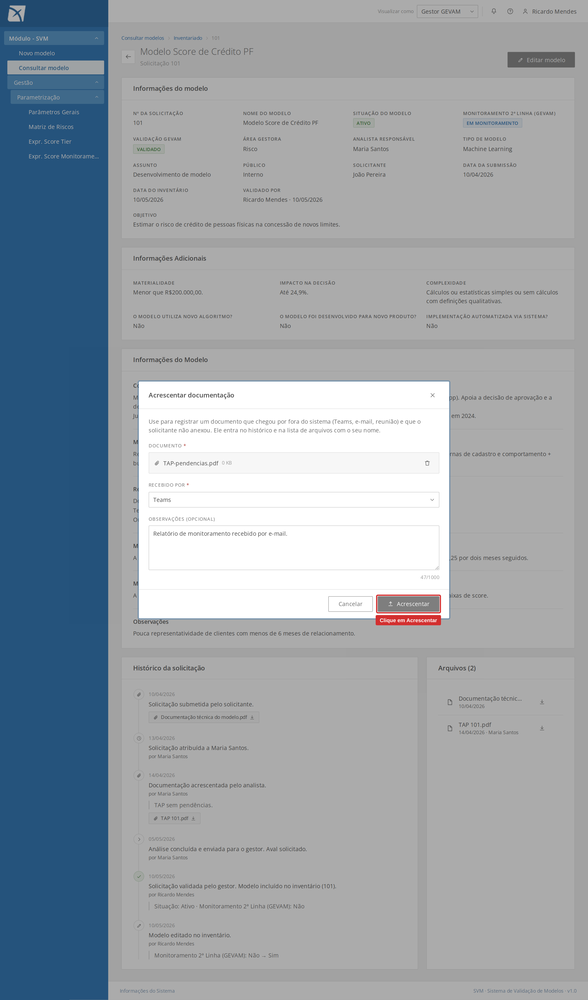

*Figura 19 – Passo 4: janela (popup) Acrescentar documentação no modelo: Documento, Recebido por e Observações; clicar em Acrescentar.*

**Passo a passo — editar o modelo**

1. Na página do modelo, clicar em **Editar modelo**, no topo (Figura 20).

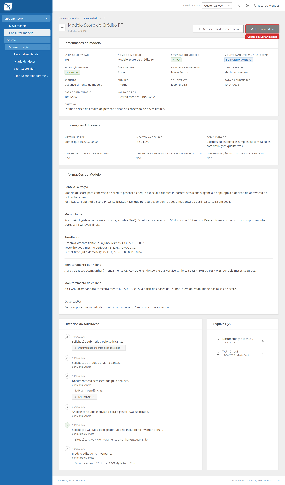

*Figura 20 – Editar o modelo, passo 1: na página do modelo, clicar em Editar modelo.*

2. Alterar o que precisar: **Situação do modelo** (Ativo, Inativo ou Suspenso), **Validação GEVAM** (Validado ou Não validado), **Monitoramento 2ª Linha (GEVAM)** (Sim / Não) e **Informações do Modelo**. O formulário e as regras são os mesmos do analista (HA-13).
3. Clicar em **Salvar alterações**. Para desistir, clicar em **Cancelar**.

**O que acontece**

- O documento acrescentado entra no histórico (“Documentação acrescentada pelo gestor GEVAM (recebida por [origem]).”) e em Arquivos.
- A edição registra no histórico **um único registro**: “Modelo editado no inventário.”, com o resumo do que mudou e o nome do gestor.

**O sistema não deixa**

- Acrescentar sem documento: “Anexe o documento.” Sem informar por onde chegou: “Informe por onde o documento chegou.”
- Salvar a edição com seção obrigatória de Informações do Modelo vazia: “Campo obrigatório”.

### HG-11. Inventariar um modelo que já existe

> **Como** gestor, **quero** registrar direto no inventário um modelo que já existe, **para** que ele passe a constar no inventário da GEVAM.

**Passo a passo**

1. No menu lateral, clicar em **Novo modelo**. Abre **Inventariar modelo**, com quatro abas nesta ordem: **Inventariar** → **Cálculo do Tier** → **Matriz de Risco** → **Informações do Modelo**.
2. Seguir o mesmo passo a passo do analista (HA-14), aba por aba: preencher, clicar em **Avançar** em cada aba e, na última, clicar em **Incluir no inventário**.
3. Aparece a janela “Modelo inventariado com sucesso.” com o **número do modelo**.

As telas, as regras e as mensagens são as mesmas da HA-14.

### HG-12. Consultar as solicitações canceladas

> **Como** gestor, **quero** consultar as solicitações canceladas, **para** saber quem cancelou, quando e por quê.

**Hoje × como deve ficar** (é a mesma tela do analista)

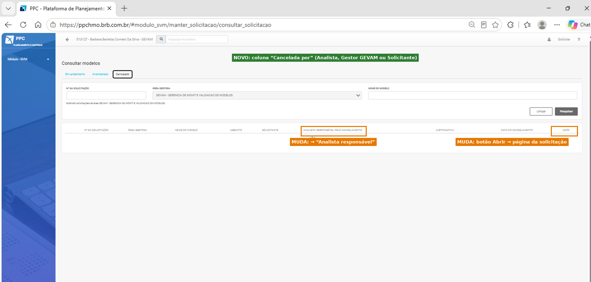

*Figura 21 – Hoje: aba Cancelado. Quadro laranja = muda; verde = novo.*

O que muda em relação à tela de hoje:

1. A coluna “Analista responsável pelo cancelamento” passa a se chamar **“Analista responsável”**.
2. **Nova coluna “Cancelada por”**: Analista, Gestor GEVAM ou Solicitante.
3. O botão **Abrir** abre a **página da solicitação cancelada**, com o quadro “Solicitação cancelada pelo …” (quem, quando e justificativa), as informações, o histórico e os arquivos.

**Como deve ficar**

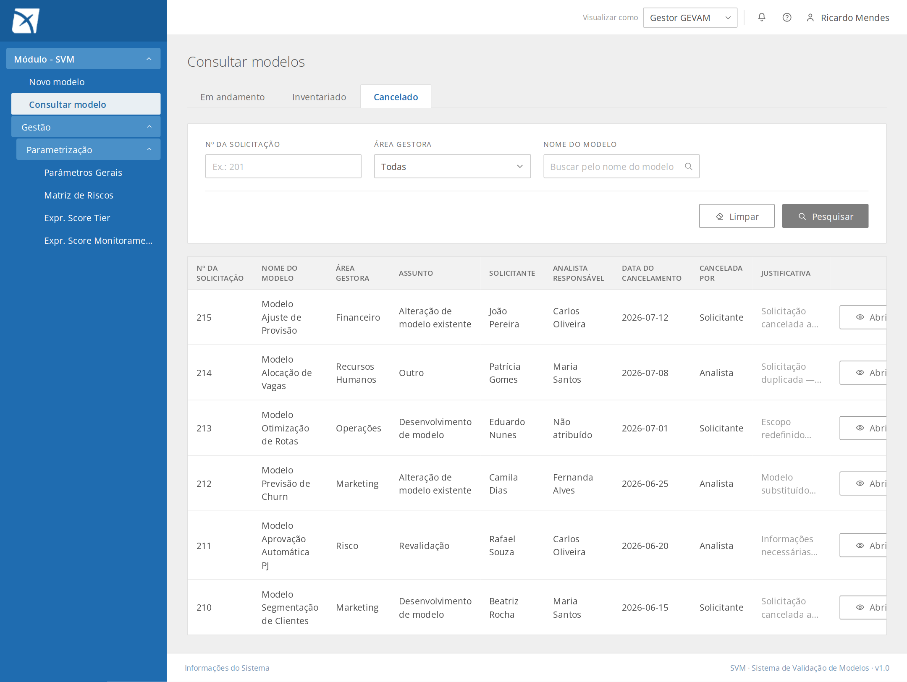

*Figura 22 – Aba Cancelado: quem cancelou, a justificativa e o botão Abrir.*

**Passo a passo**

1. Em **Consultar modelo**, clicar na aba **Cancelado** (Figura 22).
2. Filtros: Nº da solicitação · Área gestora · Nome do modelo. Clicar em **Pesquisar** ou **Limpar**.
3. Colunas: Nº da solicitação · Nome do modelo · Área gestora · Assunto · Solicitante · Analista responsável · Data do cancelamento · Cancelada por · Justificativa · Ação.
4. Clicar em **Abrir** abre a página da solicitação cancelada, só para leitura. O status continua Cancelado.
