# Evoluções do SVM — Fluxo do Solicitante (Sprint 42)

Este documento mostra, tela por tela, o que muda para o **solicitante** no SVM. Para cada tela há o passo a passo do que o usuário faz, o que aparece, o que o sistema não deixa fazer (com a mensagem exata) e a imagem de **como deve ficar**. Quando já existe a tela no sistema atual, ela aparece antes, com um **X vermelho** no que sai, um **quadro laranja** no que muda e uma **etiqueta verde** no que é novo.

As imagens de “como deve ficar” vêm do protótipo (repositório `svm-frontend`). Os nomes, dados e números das imagens são exemplos.

**Quem é o solicitante:** a pessoa da área gestora do modelo (por exemplo, da área Financeiro). Ele envia o modelo para a GEVAM validar, responde quando a GEVAM pede algum documento e acompanha o resultado. Ele **não** faz a análise: isso é com o analista e o gestor da GEVAM.

**Menu do solicitante:** no menu lateral ele tem só duas opções: **Novo modelo** (para enviar um modelo) e **Consultar modelo** (para acompanhar). Em Consultar modelo há três abas: **Em andamento**, **Inventariado** e **Cancelado** (os mesmos nomes que a GEVAM vê).

**Regra de ouro das ações:** nas listas, cada linha tem só o botão **Abrir**. Tudo o que o solicitante pode fazer com uma solicitação (editar, responder complementação, cancelar) fica no botão **Ações**, dentro da solicitação aberta.

**Os status que o solicitante vê:**

- **Submetido:** o solicitante enviou e nenhum analista pegou a solicitação ainda. Só aqui ele pode editar.
- **Em análise:** o analista da GEVAM está analisando.
- **Em complementação:** a GEVAM pediu um documento ou esclarecimento. **Depende do solicitante:** ele precisa responder.
- **Aguardando gestor:** o analista terminou e a solicitação está com o gestor da GEVAM para o aval final. O solicitante vê esse status do jeito que ele é.
- **Validado:** a GEVAM terminou e validou. O modelo passa a constar na aba **Inventariado**.
- **Cancelado:** a solicitação foi encerrada (pelo solicitante ou pela GEVAM), sempre com uma justificativa.

## 1. Fluxo do solicitante

Só o que o solicitante faz. O que a GEVAM faz não aparece aqui.

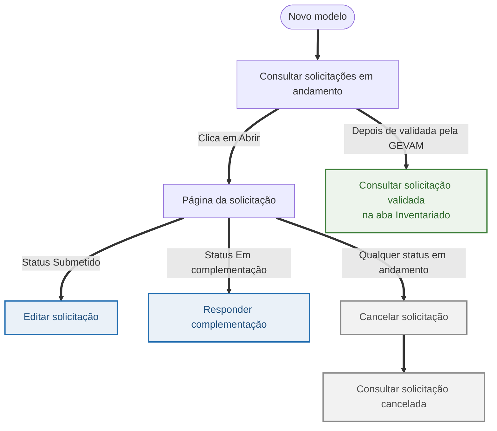

## 2. Histórias do solicitante

### HS-01. Enviar um novo modelo para validação

> **Como** solicitante, **quero** enviar um novo modelo com o relatório de desenvolvimento e os demais arquivos, **para** que a GEVAM faça a validação independente.

**Hoje × como deve ficar**

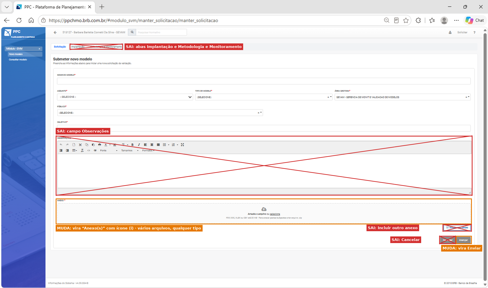

*Figura 1 – Hoje: Novo modelo > Solicitação. X vermelho = sai; quadro laranja = muda.*

O que muda em relação à tela de hoje:

1. **Saem as abas** “Implantação” e “Metodologia e Monitoramento”. Como sobra só a solicitação, a barra de abas some: o solicitante vê direto o formulário.
2. **Sai o campo “Observações”** (o editor de texto inteiro).
3. O campo **“Anexo” passa a se chamar “Anexo(s)”**, com um ícone **(i)** ao lado do nome que explica o que se espera: “Esperamos o relatório de desenvolvimento do modelo em PDF, os scripts de código, as planilhas e qualquer outro arquivo que ajude na análise. Você pode anexar quantos arquivos precisar.” Aceita **vários arquivos, de qualquer tipo** (até 20 MB cada).
4. **Sai o botão “Incluir outro anexo”**: o próprio quadro de anexar aceita vários arquivos de uma vez e continua aparecendo embaixo da lista para incluir mais.
5. **Sai o botão “Cancelar”.**
6. **O botão “Avançar” vira “Enviar”**: não há mais próximas abas; o envio acontece aqui.

**Passo a passo**

1. No menu lateral, clicar em **Novo modelo**.
2. Preencher todos os campos (todos são obrigatórios), nesta ordem: Nome do modelo · Assunto · Tipo de modelo · Área gestora · Público · Objetivo (até 500 caracteres: um resumo curto e direto do uso do modelo, que precisa caber na ficha do modelo e nas listas).
3. Em **Anexo(s)**, arrastar os arquivos para o quadro ou clicar em “selecione” (dá para escolher vários de uma vez). Cada arquivo aparece numa linha da lista, com nome, tamanho e um ícone de lixeira para remover. O quadro continua embaixo da lista para incluir mais arquivos, quantos precisar. Passar o mouse no **(i)** ao lado de “Anexo(s)” mostra o que se espera nos anexos.
4. Clicar em **Enviar**.
5. Aparece a janela “Solicitação enviada com sucesso.” com o **número da solicitação**: só o número, sem prefixo nem traços (ex.: 244). Clicar em **Fechar**.
6. A solicitação passa a aparecer em Consultar modelo > Em andamento, com status **Submetido**.

**O sistema não deixa**

- Enviar com algum campo vazio: aparece “Campo obrigatório” em vermelho, embaixo de cada campo vazio.
- Enviar sem nenhum anexo: aparece “Campo obrigatório” embaixo de Anexo(s). É preciso pelo menos um arquivo.
- O tipo do arquivo **não** é conferido (PDF, scripts, planilhas, etc.); o limite é 20 MB por arquivo.

**Como deve ficar**

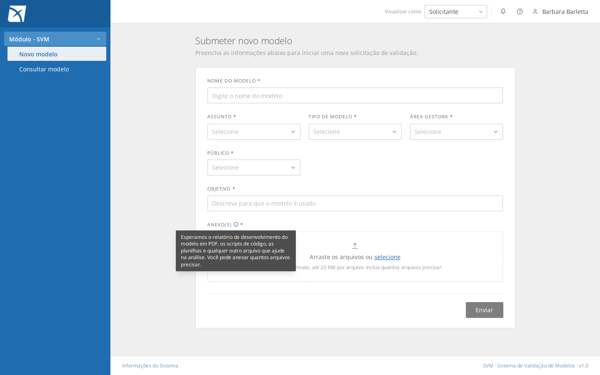

*Figura 2 – Como deve ficar: formulário vazio, sem abas, sem Observações, com o campo Anexo(s) (dica do (i) aberta) e o botão Enviar.*

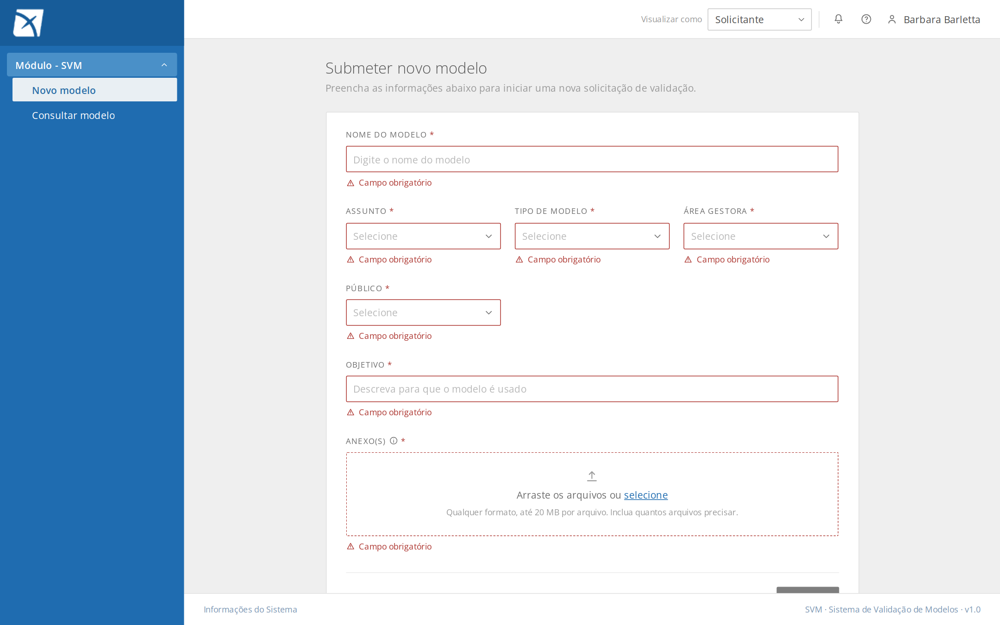

*Figura 3 – Clicou em Enviar com os campos vazios: “Campo obrigatório” em cada campo, inclusive em Anexo(s).*

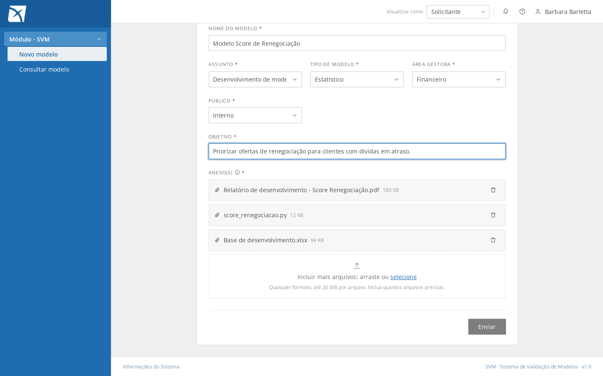

*Figura 4 – Formulário preenchido, com vários anexos (relatório em PDF, script e planilha) e o quadro para incluir mais.*

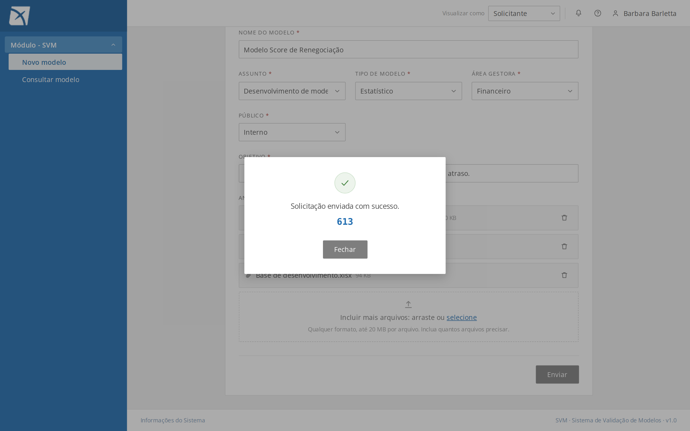

*Figura 5 – Depois de Enviar: janela de sucesso com o número da solicitação.*

### HS-02. Acompanhar minhas solicitações

> **Como** solicitante, **quero** ver as solicitações da minha área e o status de cada uma, **para** saber o que está com a GEVAM e o que depende de mim.

**A tela de hoje será substituída por completo**

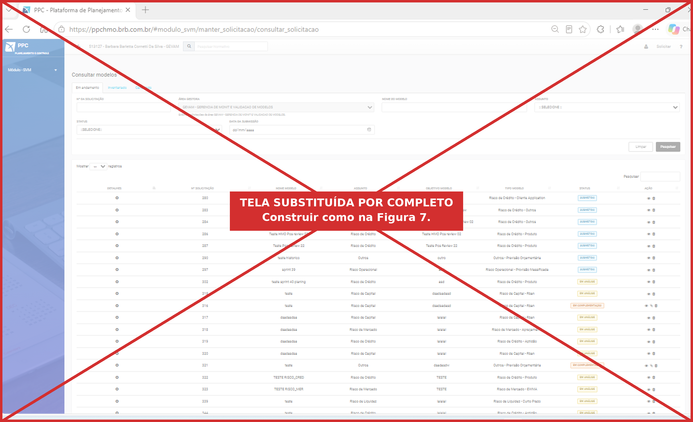

*Figura 6 – Hoje: Consultar modelos > Em andamento. A tela inteira sai e é construída de novo como na Figura 7.*

**Como deve ficar**

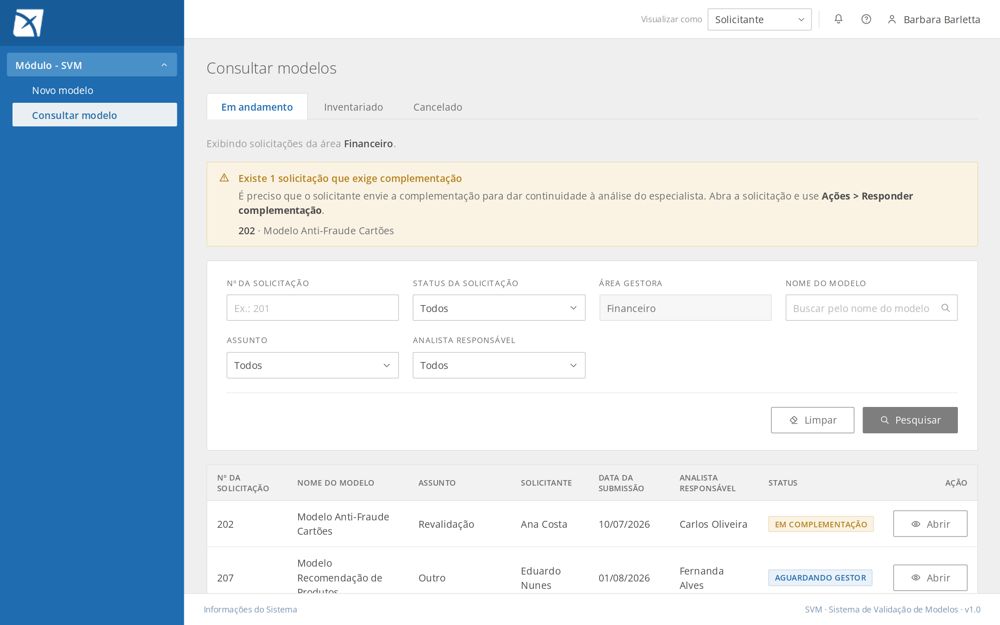

*Figura 7 – Aba Em andamento: aviso de complementação pendente, filtros e lista da área do solicitante, só com o botão Abrir.*

**Passo a passo**

1. No menu lateral, clicar em **Consultar modelo**. Abre a aba **Em andamento**.
2. A lista mostra **só as solicitações da área do solicitante**. Acima da lista aparece “Exibindo solicitações da área [área]”.
3. Se alguma solicitação está esperando resposta dele, aparece no topo um **aviso amarelo**: “Existe(m) N solicitação(ões) que exige(m) complementação”, com o texto “É preciso que o solicitante envie a complementação para dar continuidade à análise do especialista. Abra a solicitação e use Ações > Responder complementação.” e a lista com o número e o nome de cada uma.
4. Para filtrar, preencher os campos e clicar em **Pesquisar**. Para voltar ao normal, clicar em **Limpar**.
5. Em cada linha há **só** o botão **Abrir**, que abre a solicitação (HS-03).

**O que aparece**

- Filtros: Nº da solicitação · **Status da solicitação** · Área gestora (fixa na área dele, não dá para trocar) · Nome do modelo · Assunto · Analista responsável.
- **Status da solicitação** tem as opções: Todos, Submetido, Em análise, Em complementação e Aguardando gestor.
- Colunas: Nº da solicitação · Nome do modelo · Assunto · Solicitante · Data da submissão · Analista responsável · Status · Ação. **Não há coluna Área gestora** (seria sempre a área dele).
- Solicitações Validado e Cancelado **não** aparecem aqui: ficam nas abas Inventariado e Cancelado (HS-07).

**Não aparece para o solicitante:** os quadros de contagem por status (são só da GEVAM), botões de ação na linha e qualquer ação da GEVAM.

### HS-03. Ver os detalhes de uma solicitação

> **Como** solicitante, **quero** abrir a solicitação, **para** ver o status, o histórico e todos os documentos.

**Passo a passo**

1. Em Consultar modelo > Em andamento, clicar em **Abrir** na linha da solicitação (Figura 8).
2. Abre a página da solicitação. No topo aparecem o nome do modelo, o número e o caminho “Consultar modelos > Em andamento > [número]” (clicar em “Consultar modelos” volta para a lista).
3. Rolar a página para ver as três partes:
   1. **Informações da solicitação**, em três blocos: *Solicitação* (número, status, solicitante, data da submissão), *Modelo* (nome, tipo, assunto, Tier, área gestora, público, objetivo) e *Análise GEVAM* (analista responsável, data de atribuição, data de finalização da análise, tempo de análise, gestor GEVAM).
   2. **Histórico da solicitação:** cada acontecimento com data, descrição e quem fez. Textos enviados aparecem citados e os anexos têm botão de download.
   3. **Arquivos:** todos os documentos da solicitação (do solicitante, do analista e do gestor), com nome, data, quem enviou e download.

**Regras**

- O solicitante vê **todos os documentos**, inclusive os da GEVAM.
- Quando a solicitação está com o gestor da GEVAM, o status aparece como **Aguardando gestor**.
- O solicitante **não** vê as abas de análise da GEVAM (Cálculo do Tier, Matriz de Risco e Informações do Modelo): a página dele não tem abas.
- O botão **Ações** fica no canto superior direito (Figura 10; HS-04, HS-05 e HS-06).

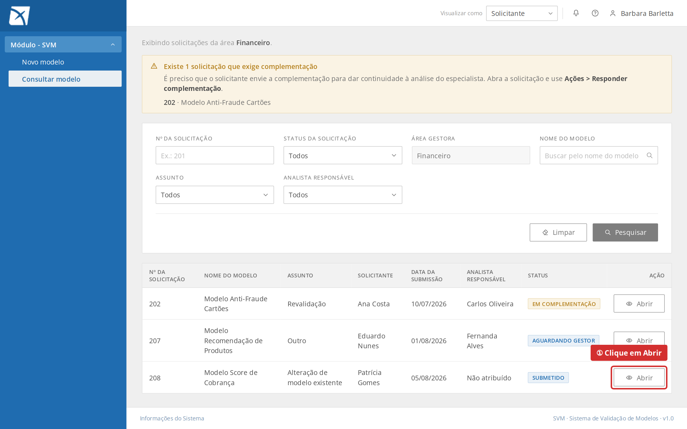

*Figura 8 – Lista Em andamento: o solicitante clica em Abrir na linha da solicitação.*

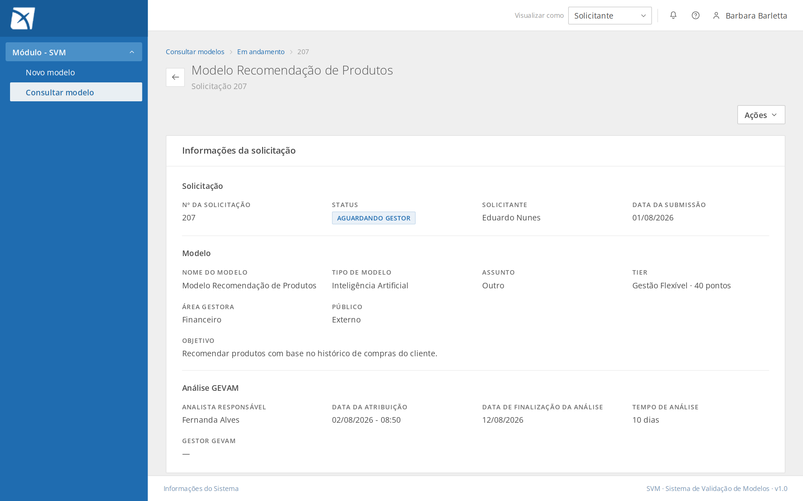

*Figura 9 – Página da solicitação vista pelo solicitante: Informações da solicitação (sem abas de análise).*

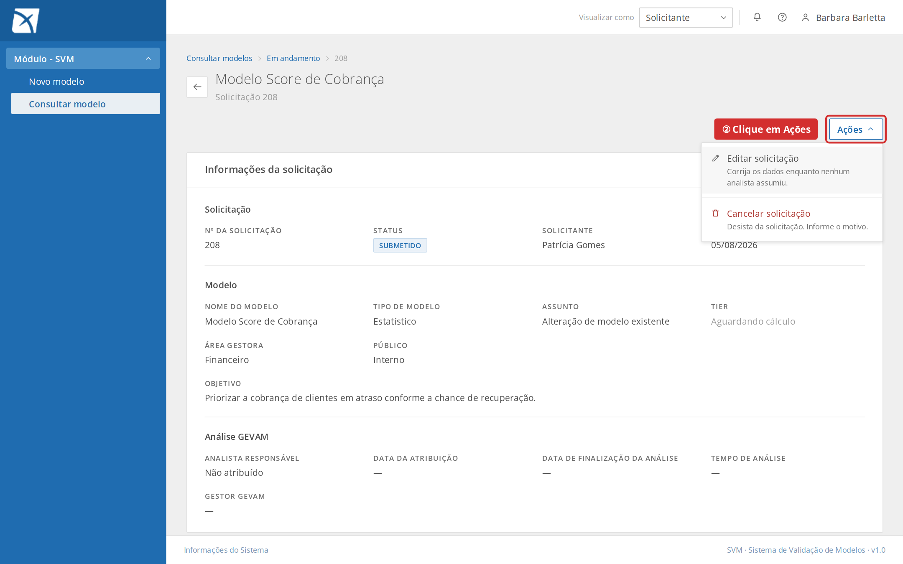

*Figura 10 – Na página da solicitação, o solicitante clica em Ações (canto superior direito) e vê as ações disponíveis. Em Submetido: Editar solicitação e Cancelar solicitação.*

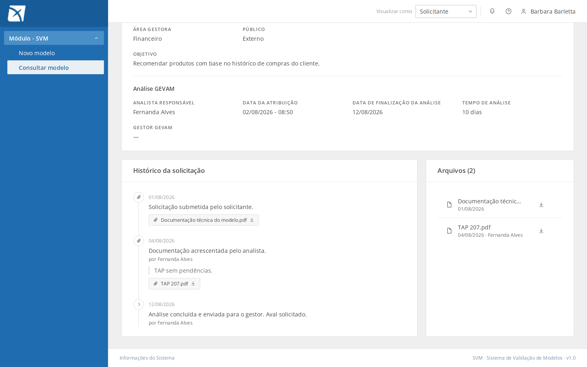

*Figura 11 – Mais abaixo na mesma página: Histórico da solicitação e Arquivos.*

### HS-04. Editar a solicitação

> **Como** solicitante, **quero** corrigir os dados que enviei, **para** não precisar cancelar e abrir outra solicitação por causa de um erro.

**Só vale enquanto o status é Submetido** (nenhum analista pegou a solicitação ainda). Nos outros status o item **“Editar solicitação” não aparece** no menu Ações (some; não fica cinza).

**Passo a passo**

1. Abrir a solicitação (HS-03).
2. Clicar em **Ações** (canto superior direito) > **Editar solicitação**.
3. Abre o formulário “Editar solicitação” com os mesmos campos do envio, já preenchidos. Corrigir o que precisar.
4. Em **Anexo(s)** aparecem os arquivos já enviados, cada um com lixeira para remover. Para incluir mais, usar o quadro embaixo da lista (quantos arquivos precisar). O (i) mostra o mesmo texto do envio.
5. Clicar em **Salvar alterações**. Para desistir, clicar em **Cancelar** (nada é gravado).

**O que acontece**

- Os dados são gravados e o histórico registra **um único registro**: “Solicitação editada pelo solicitante.” Não se detalha o que foi alterado.
- Anexo removido é **apagado**: sai do histórico e da lista de Arquivos. Os anexos novos ficam anexados a esse mesmo registro.

**O sistema não deixa**

- Salvar com campo vazio: “Campo obrigatório”.
- Salvar sem nenhum anexo (removeu todos e não incluiu outro): “Campo obrigatório” embaixo de Anexo(s).
- Editar depois que um analista pegou a solicitação: o item “Editar solicitação” não aparece mais no menu.

*Figura 12 – Menu Ações em uma solicitação Submetido: Editar solicitação e Cancelar solicitação.*

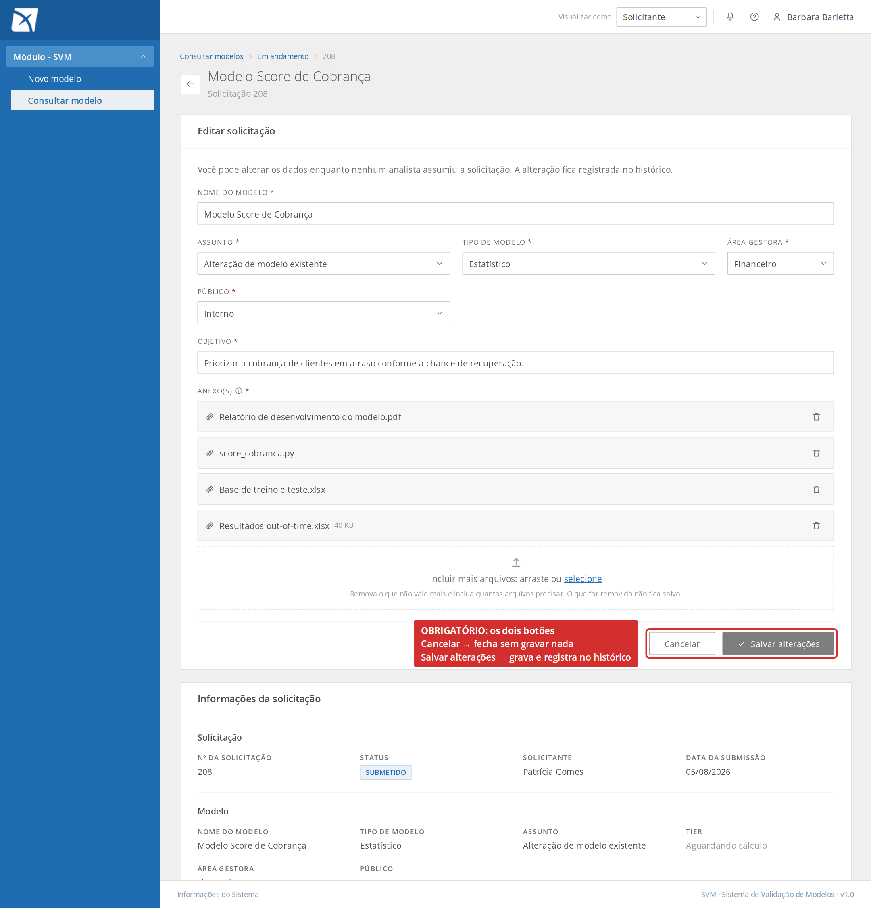

*Figura 13 – Formulário Editar solicitação completo, com os anexos já enviados (cada um com lixeira) e um anexo novo incluído. Embaixo, os dois botões obrigatórios: Cancelar (fecha sem gravar) e Salvar alterações (grava).*

### HS-05. Responder a um pedido de complementação

> **Como** solicitante, **quero** ver o que a GEVAM pediu e enviar o que falta, **para** que a análise continue.

**Só vale quando o status é Em complementação.** Não há botão na lista: a resposta fica no menu **Ações**, dentro da solicitação.

**Passo a passo**

1. Em Consultar modelo > Em andamento, o aviso amarelo do topo mostra quais solicitações esperam complementação. Clicar em **Abrir** na linha da solicitação.
2. No topo da página aparece o quadro **“O analista pediu uma complementação”**: quem pediu, quando, o texto do pedido e o arquivo anexado (por exemplo, o TAP com as pendências do relatório), que pode ser baixado. Embaixo: “Para responder, clique em Ações > Responder complementação.”
3. Clicar em **Ações** > **Responder complementação** (Figura 15). Abre a janela (popup) **Responder complementação**, por cima da página, com o pedido do analista e os campos de resposta (Figura 16).
4. Em **Anexo da complementação** (obrigatório), anexar o documento pedido.
5. Se quiser, escrever uma **Observação para o analista** (opcional, até 500 caracteres).
6. Clicar em **Enviar complementação**. Para desistir, clicar em **Cancelar** (nada é enviado).

**O que acontece**

- O status volta para **Em análise**, com o mesmo analista, e a solicitação sai do aviso amarelo da lista.
- O histórico registra **um único registro**: “Complementação enviada pelo solicitante.”, com o anexo e a observação.
- Se a resposta não resolver tudo, a GEVAM pode pedir de novo. Não há prazo nem limite de vezes.

**O sistema não deixa**

- Enviar sem anexo: aparece “Anexe o documento solicitado pelo analista para enviar a complementação.”

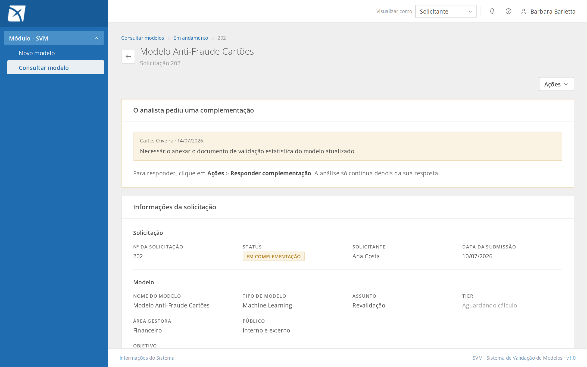

*Figura 14 – Solicitação aberta: o pedido da GEVAM e a orientação para responder pelo menu Ações.*

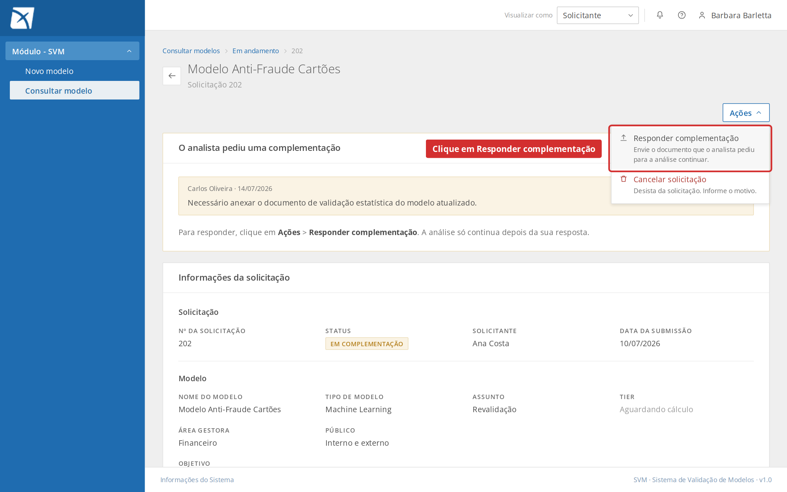

*Figura 15 – Passo 3: em Ações, clicar em Responder complementação (destacado em vermelho). O menu também tem Cancelar solicitação.*

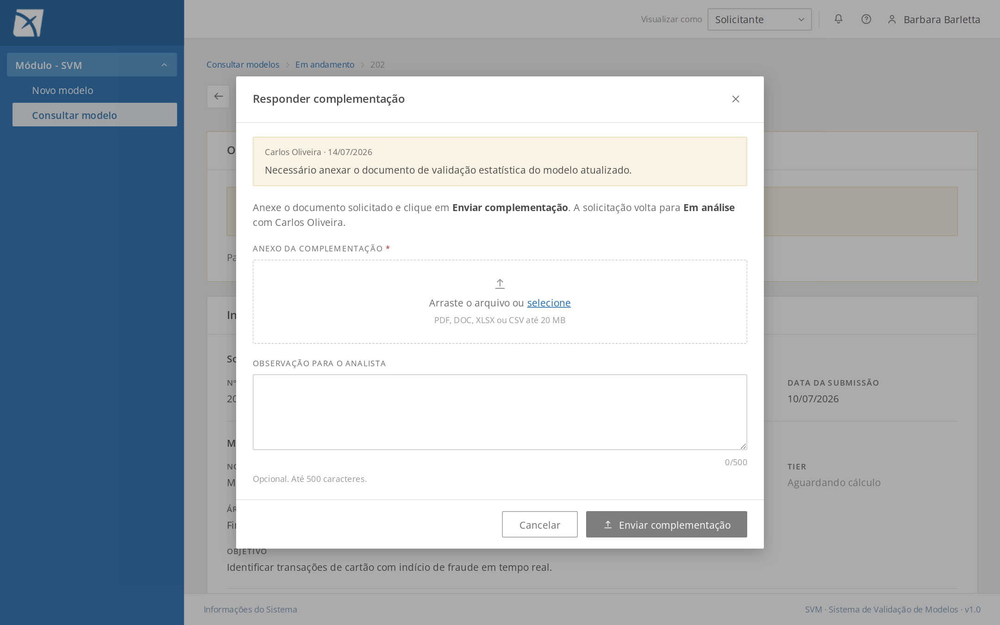

*Figura 16 – Depois de clicar em Responder complementação, abre a janela (popup) de resposta: o pedido do analista, Anexo da complementação, Observação para o analista e os botões Cancelar e Enviar complementação.*

### HS-06. Cancelar a solicitação

> **Como** solicitante, **quero** desistir da solicitação, **para** encerrar uma validação que não é mais necessária.

**Vale enquanto a solicitação estiver em andamento:** Submetido, Em análise, Em complementação ou Aguardando gestor.

**Passo a passo**

1. Abrir a solicitação (HS-03).
2. Clicar em **Ações** > **Cancelar solicitação**. Abre a janela (popup) **Cancelar solicitação**, por cima da página.
3. Escrever a **Justificativa** (obrigatória, até 1.000 caracteres: espaço suficiente para explicar o motivo, que fica visível para todos na solicitação e na aba Cancelado).
4. Clicar em **Cancelar solicitação** para confirmar. Para desistir, clicar em **Voltar** (nada muda).

**O que acontece**

- O status vira **Cancelado** e a solicitação sai de Em andamento e passa para a aba **Cancelado**.
- A página mostra a mensagem “Solicitação cancelada.” e o quadro “Solicitação cancelada pelo solicitante”, com nome, data e justificativa. A justificativa fica visível para todos.
- O histórico registra um único registro: “Solicitação cancelada pelo solicitante.”, com a justificativa.

**O sistema não deixa**

- Cancelar sem justificativa: aparece “Informe o motivo do cancelamento.”
- Desfazer o cancelamento.

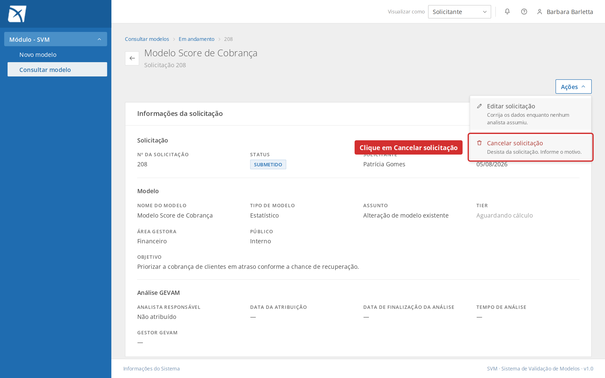

*Figura 17 – Passo 2: em Ações, clicar em Cancelar solicitação (destacado em vermelho).*

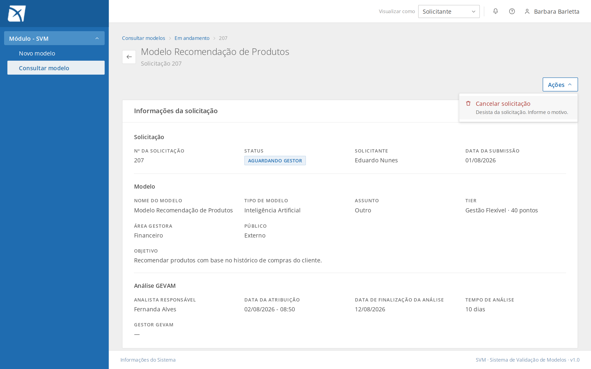

*Figura 18 – Cancelar solicitação também aparece nos outros status em andamento. Exemplo em Aguardando gestor: o menu mostra só Cancelar solicitação.*

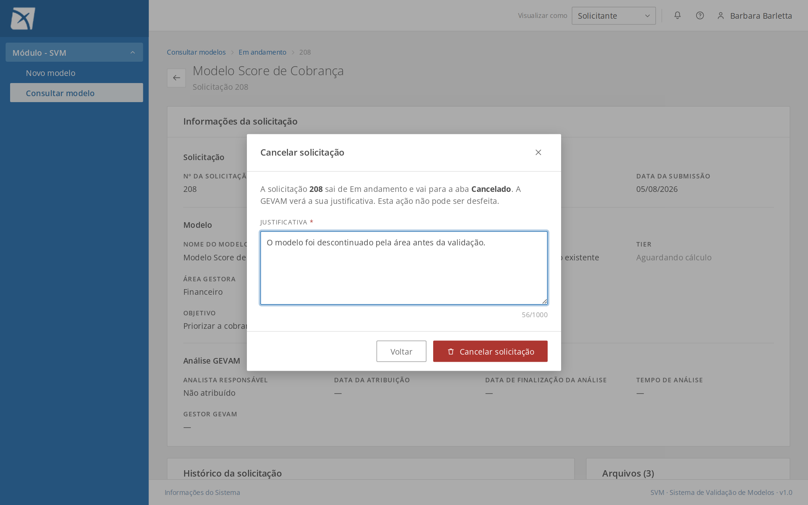

*Figura 19 – Abre a janela (popup) Cancelar solicitação, por cima da página, com a justificativa preenchida e os botões Voltar e Cancelar solicitação.*

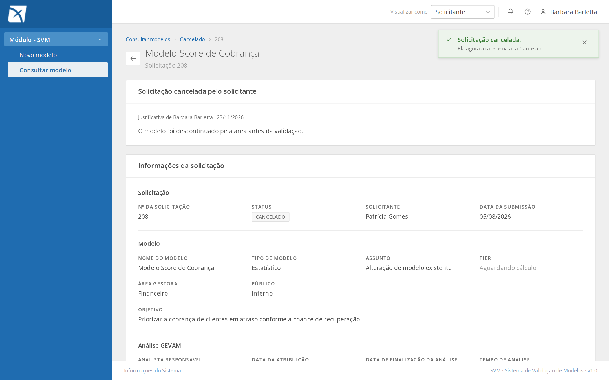

*Figura 20 – Depois de confirmar: a solicitação fica Cancelado, com o quadro da justificativa.*

### HS-07. Consultar os modelos inventariados e as solicitações canceladas

> **Como** solicitante, **quero** consultar os modelos da minha área que foram validados e as solicitações que foram canceladas, **para** saber o resultado de cada uma e, se foi cancelada, o motivo.

**A tela de hoje (aba Inventariado) será substituída por completo**

A aba Inventariado do solicitante é **a mesma aba Inventariado da GEVAM, com o mesmo nome**. A diferença é que o solicitante vê **só os modelos da área dele** e **só para leitura**.

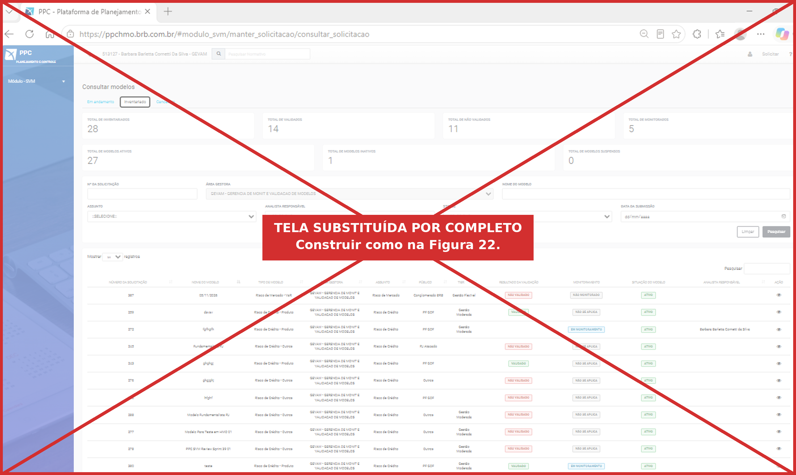

*Figura 21 – Hoje: aba Inventariado. A tela inteira sai e é construída de novo como na Figura 22.*

**Como deve ficar — aba Inventariado**

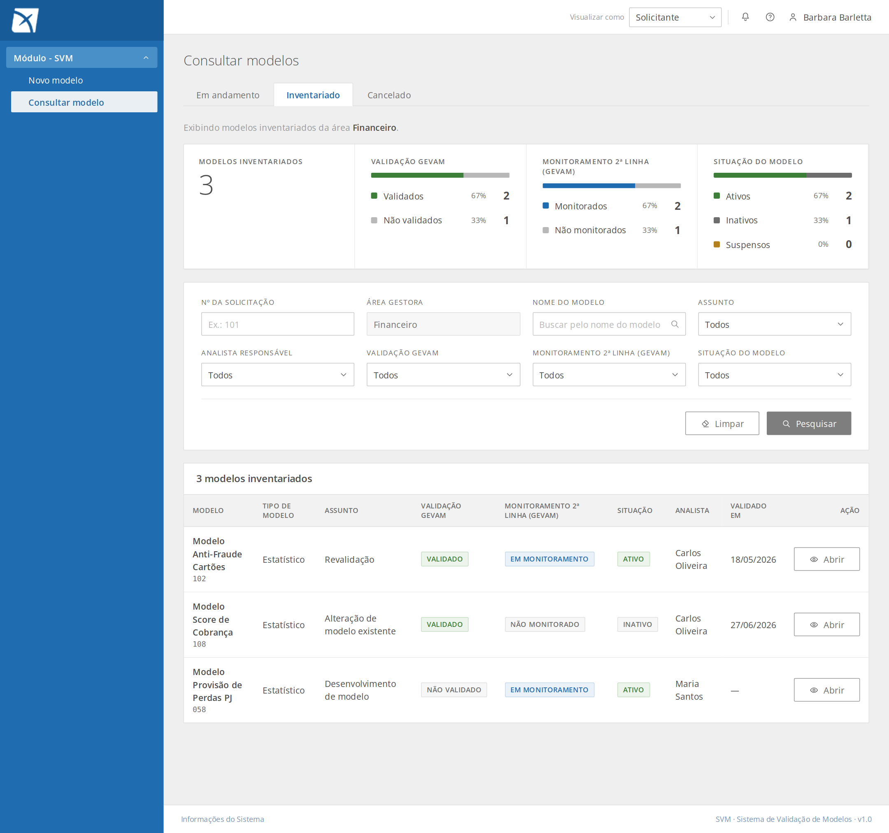

*Figura 22 – Aba Inventariado do solicitante: quadros e lista só com os modelos da área dele.*

**Aba Inventariado — passo a passo**

1. Em **Consultar modelo**, clicar na aba **Inventariado**.
2. Acima da lista aparece “Exibindo modelos inventariados da área [área]”.
3. No topo há quatro quadros informativos (não são clicáveis), que contam **só os modelos da área dele**:
   1. **Modelos inventariados** (total);
   2. **Validação GEVAM**: Validados e Não validados;
   3. **Monitoramento 2ª Linha (GEVAM)**: Monitorados e Não monitorados;
   4. **Situação do modelo**: Ativos, Inativos e Suspensos.
4. Filtros: Nº da solicitação · Área gestora (fixa) · Nome do modelo · Assunto · Analista responsável · Validação GEVAM · Monitoramento 2ª Linha (GEVAM) · Situação do modelo. Clicar em **Pesquisar** ou **Limpar**.
5. Colunas: Modelo (nome e nº da solicitação) · Tipo de modelo · Assunto · Validação GEVAM · Monitoramento 2ª Linha (GEVAM) · Situação · Analista · Validado em · Ação.
   - **Nem todo modelo do inventário foi validado pela GEVAM:** modelos antigos, que entraram no inventário sem passar pela avaliação, aparecem como **Não validado** (e podem ser monitorados). Para eles, “Validado em” fica “—”.
6. Em cada linha há **só** o botão **Abrir** (igual ao de Em andamento e Cancelado, não só um ícone de olho). Ele abre a **página do modelo**, só para leitura: informações do modelo, Informações Adicionais, histórico e arquivos. A seção **Informações do Modelo** (Contextualização, Metodologia, Resultados, Monitoramento da 1ª e da 2ª linha, Observações) **não aparece** para o solicitante, nem no modelo inventariado nem na solicitação cancelada: ela é só do analista e do gestor da GEVAM.

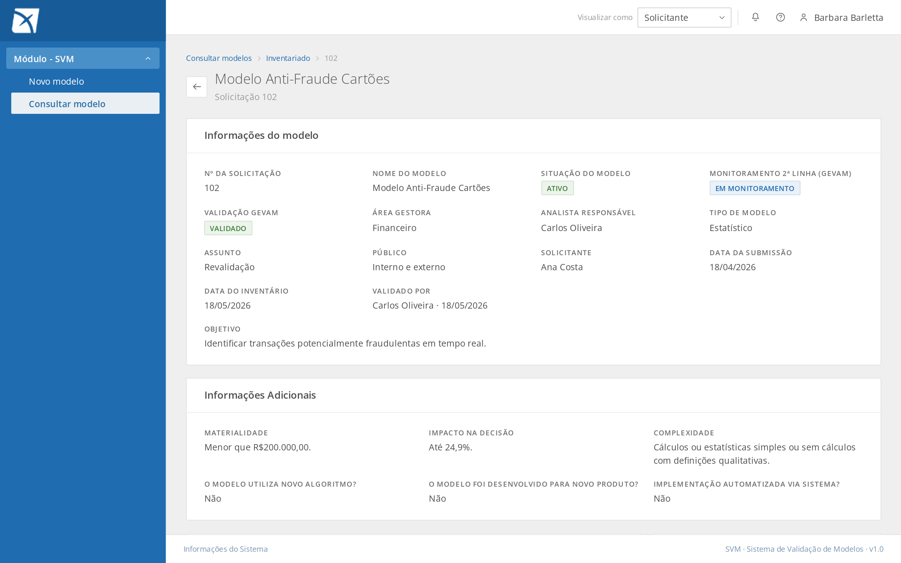

*Figura 23 – Página do modelo validado, vista pelo solicitante (só leitura, sem botões de ação e sem a seção Informações do Modelo).*

**Hoje × como deve ficar — aba Cancelado**

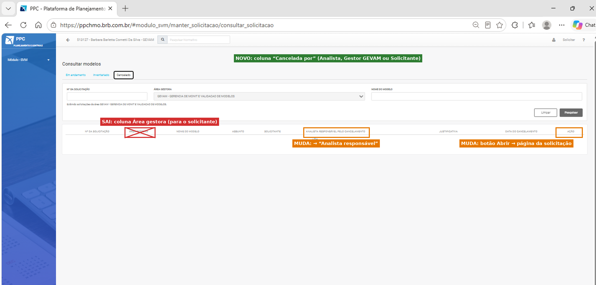

*Figura 24 – Hoje: aba Cancelado.*

O que muda em relação à tela de hoje:

1. **Sai** a coluna Área gestora (para o solicitante seria sempre a área dele).
2. “Analista responsável pelo cancelamento” passa a se chamar **“Analista responsável”**.
3. **Entra** a coluna **“Cancelada por”** (Analista, Gestor GEVAM ou Solicitante).
4. O botão **Abrir** leva a uma página própria da solicitação cancelada.

**Aba Cancelado — passo a passo**

1. Em **Consultar modelo**, clicar na aba **Cancelado**.
2. Aparece só o que foi cancelado **na área dele** (“Exibindo solicitações canceladas da área [área]”). O filtro Área gestora fica fixo.
3. A lista mostra quem cancelou (coluna **Cancelada por**: Analista, Gestor GEVAM ou Solicitante) e a justificativa.
4. Clicar em **Abrir** mostra a página da solicitação cancelada, com o quadro “Solicitação cancelada pelo …” (quem, quando e justificativa), as informações, o histórico e os arquivos.

**Como deve ficar — aba Cancelado**

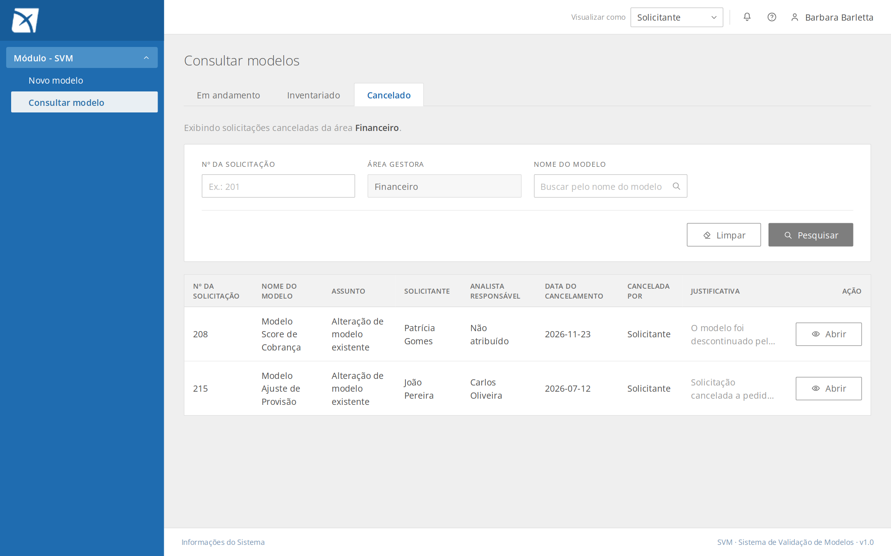

*Figura 25 – Aba Cancelado: só as canceladas da área do solicitante, com quem cancelou e a justificativa.*

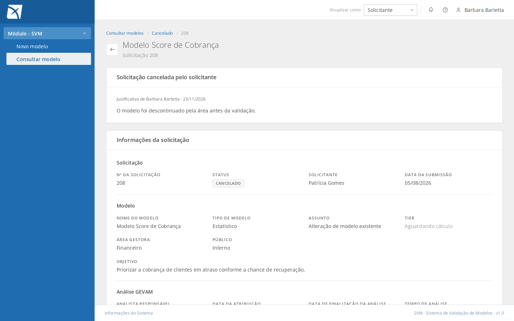

*Figura 26 – Página de uma solicitação cancelada, vista pelo solicitante (sem a seção Informações do Modelo).*

**Tudo na aba Inventariado e na aba Cancelado é só leitura para o solicitante:** não há botão Ações nem botões de edição nas páginas abertas por elas.
