# Sprint 42 — Histórias de usuário do fluxo da solicitação

Este documento descreve o que deve ser implementado no SVM, organizado por **história de usuário**. Cada história diz o que o usuário quer fazer, onde fica o botão, quando ele está disponível, o que acontece ao clicar e o que **não** é possível fazer (com a mensagem que o sistema mostra). As figuras são do protótipo (`svm-frontend`, pasta `handoff/img/`).

**Perfis**

- **Solicitante:** usuário da área gestora do modelo. Submete a solicitação e responde às complementações.
- **Analista GEVAM:** faz a avaliação preliminar (TAP), a análise e envia ao gestor.
- **Gestor GEVAM:** distribui as solicitações entre os analistas e finaliza a validação.

**Status da solicitação:** Submetido → Em análise ⇄ Em complementação → Aguardando gestor → Validada. **Cancelada** pode ocorrer a partir de qualquer status em andamento. O fluxo completo, com diagramas e a tabela de transições, está em `docs/fluxos-solicitacao.md`.

**Como ler cada história**

> **Como** [perfil], **quero** [ação], **para** [objetivo].

- **Onde:** tela e botão.
- **Disponível quando:** status e condições.
- **O que acontece:** campos, validações, mudança de status e registro no histórico.
- **Não é possível:** o que fica bloqueado e a mensagem exibida.

---

## 1. Resumo: o que cada perfil pode fazer em cada status

Legenda: ✅ disponível · ❌ indisponível (o item aparece desabilitado, com o motivo) · — não se aplica.

### 1.1. Solicitante

| Ação | Submetido | Em análise¹ | Em complementação | Validada / Cancelada |
| --- | --- | --- | --- | --- |
| Abrir (ver status, histórico e arquivos) | ✅ | ✅ | ✅ | ver ponto a confirmar 1 |
| Editar solicitação | ✅ | ❌ | ❌ | — |
| Responder complementação | — | — | ✅ | — |
| Cancelar solicitação | ✅ | ✅ | ✅ | — |

¹ Inclui “Aguardando gestor”, que o solicitante vê como “Em análise”.

### 1.2. Analista GEVAM

| Ação | Submetido | Em análise — avaliação preliminar | Em análise — após o TAP | Em complementação | Aguardando gestor | Validada / Cancelada |
| --- | --- | --- | --- | --- | --- | --- |
| Abrir | ✅ e assume² | ✅ | ✅ | ✅ (leitura) | ✅ (leitura) | ✅ (abas Inventariado e Cancelado) |
| Atualizar solicitação | ✅² | ✅ (inclui “TAP sem pendências”) | ✅ | ❌ | ❌ | — |
| Pedir complementação | ✅² | ✅ (= enviar **TAP com pendências**) | ✅ | ❌ | ❌ | — |
| Editar Cálculo do Tier, Matriz de Risco e Informações do Modelo | — | ❌ (abas bloqueadas) | ✅ | ❌ (leitura) | ❌ (leitura) | — |
| Gerar ficha do modelo | — | — | ✅ | ✅ | ✅ | — |
| Enviar para o gestor | — | ❌ | ✅ com as três abas preenchidas | ❌ | ❌ | — |
| Cancelar solicitação | ✅ | ✅ | ✅ | ✅ | ✅ | — |

² Ao abrir uma solicitação “Submetido”, o analista passa a ser o responsável e o status vira “Em análise”. As colunas “Em análise” em diante valem **só para o analista responsável**; outro analista vê tudo em modo leitura.

### 1.3. Gestor GEVAM

| Ação | Submetido | Em análise | Em complementação | Aguardando gestor | Validada / Cancelada |
| --- | --- | --- | --- | --- | --- |
| Abrir e conferir as abas (leitura) | ✅ | ✅ | ✅ | ✅ | ✅ (abas Inventariado e Cancelado) |
| Atribuir a um analista | ✅ | — | — | — | — |
| Reatribuir analista | — | ✅ | ✅ | ✅ | — |
| Gerar ficha do modelo | — | ✅ após o TAP | ✅ | ✅ | — |
| Finalizar validação | ❌ | ❌ | ❌ | ✅ | — |
| Cancelar solicitação | ✅ | ✅ | ✅ | ✅ | — |
| Alterar situação do modelo inventariado | — | — | — | — | ✅ (modelo no inventário) |

O gestor **não** edita as abas de análise e **não** recusa a validação: a revisão do gestor acontece por e-mail, fora do sistema, antes do aval formal.

---

## 2. Solicitante

### Fluxo do solicitante

Seta grossa = ação deste perfil · seta fina = ação de outro perfil.

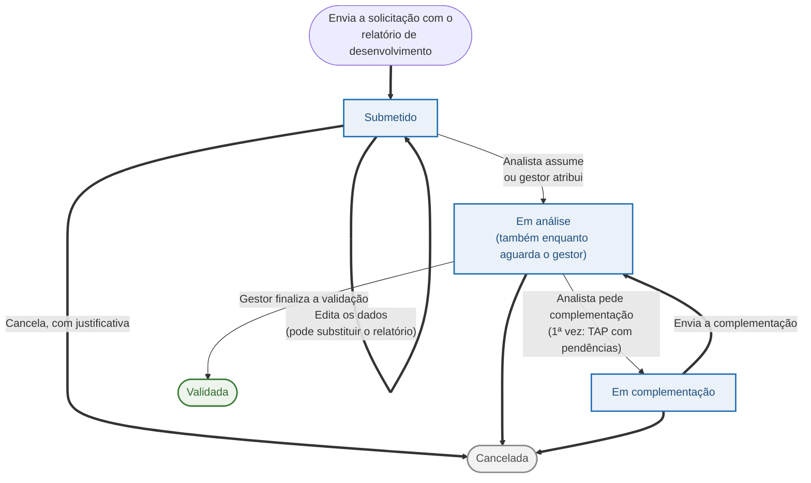

### HS-01. Submeter uma nova solicitação

> **Como** solicitante, **quero** submeter um novo modelo com o relatório de desenvolvimento, **para** que a GEVAM faça a validação independente.

- **Onde:** Novo Modelo > Solicitação.
- **Disponível quando:** sempre.
- **O que acontece:**
  - Campos, nesta ordem, todos obrigatórios: Nome do modelo · Assunto, Tipo de modelo e Área gestora · Público · Objetivo (até 500 caracteres) · **Relatório de desenvolvimento do modelo** (anexo; PDF, DOC, XLSX ou CSV até 20 MB).
  - Ao clicar em “Enviar”, a solicitação é criada com status **Submetido** e o sistema mostra o número gerado (REQ-AAAA-NNN).
- **Não é possível:**
  - Enviar com campo vazio: aparece “Campo obrigatório” abaixo do campo.
  - Enviar sem o relatório: aparece “Anexe o relatório de desenvolvimento do modelo.”
- **Mudanças em relação ao sistema atual:** para o Solicitante, retirar as abas superiores “Implantação” e “Metodologia e Monitoramento” e o campo textual “OBSERVAÇÕES” da aba “Solicitação”.

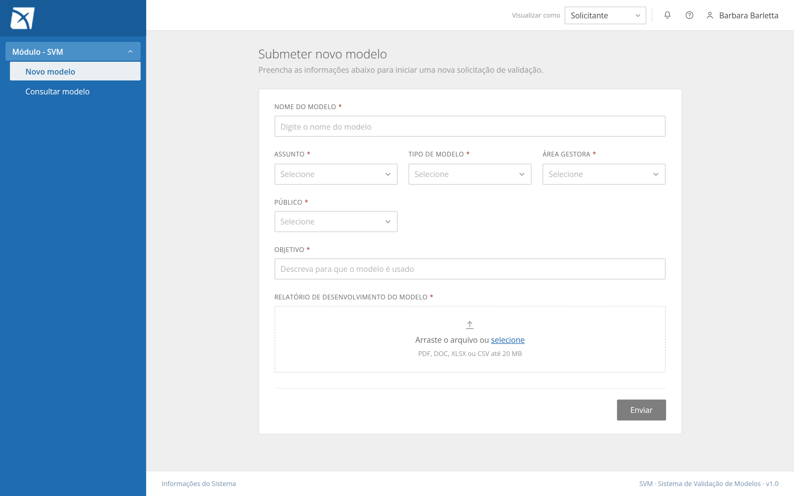

*Figura 1 – Formulário Novo Modelo > Solicitação.*

### HS-02. Acompanhar minhas solicitações

> **Como** solicitante, **quero** ver as solicitações da minha área e o status de cada uma, **para** saber o que está com a GEVAM e o que depende de mim.

- **Onde:** Consultar modelo > Em andamento.
- **O que aparece:**
  - Somente as solicitações da área do solicitante (“Exibindo solicitações da área Financeiro”).
  - Status: Submetido, Em análise ou Em complementação. **“Aguardando gestor” aparece como “Em análise”.**
  - Quando há complementação pendente, um aviso no topo: “N solicitação(ões) aguarda(m) sua complementação”, com o número, o nome do modelo e o link “Ver pedido e complementar”.
  - Em cada linha: botão **Complementar** (só em “Em complementação”; atalho para responder), botão **Abrir** e botão **Ações** (Editar solicitação e Cancelar solicitação).
- **Não aparece para o solicitante:** os cards de contagem por status e as ações de analista e gestor (atribuir, alterar solicitante, atualizar, pedir complementação, enviar ao gestor, finalizar validação).

*Figura 2 – Lista do solicitante, com o aviso de complementação pendente.*

### HS-03. Ver os detalhes da solicitação

> **Como** solicitante, **quero** abrir a solicitação, **para** ver o status, o histórico e todos os documentos.

- **Onde:** botão **Abrir**.
- **O que aparece:** a aba “Status de Acompanhamento” com “Informações da solicitação” (HA-03), “Histórico da solicitação” e “Arquivos”.
- O solicitante vê **todos os documentos**: os dele, os do analista (TAP, pedidos de complementação) e os do gestor.
- **Não aparece para o solicitante:** as abas “Cálculo do Tier”, “Matriz de Risco” e “Informações do Modelo”.

### HS-04. Editar a solicitação

> **Como** solicitante, **quero** corrigir os dados que enviei, **para** não precisar abrir outra solicitação por causa de um erro.

- **Onde:** Ações > **Editar solicitação** (na lista ou na página da solicitação).
- **Disponível quando:** status **Submetido** (nenhum analista assumiu).
- **O que acontece:**
  - Abre o formulário “Editar solicitação” com os mesmos campos da submissão, já preenchidos.
  - Campo opcional **“Substituir relatório de desenvolvimento”**, com o nome do relatório atual abaixo. Se o solicitante enviar um novo arquivo, ele **substitui** o anterior: o arquivo antigo **não fica salvo** (sai do histórico e da seção Arquivos) e só o novo fica disponível para download.
  - “Salvar alterações” grava os dados e registra no histórico “Dados da solicitação editados pelo solicitante.” Quando há troca de relatório, o registro é “Dados da solicitação editados pelo solicitante. Relatório de desenvolvimento substituído (o arquivo anterior foi descartado).”, com o novo arquivo anexado ao evento.
- **Não é possível:** editar depois que um analista assumiu. O item fica desabilitado com o motivo “Só é possível editar enquanto nenhum analista assumiu (status Submetido).”

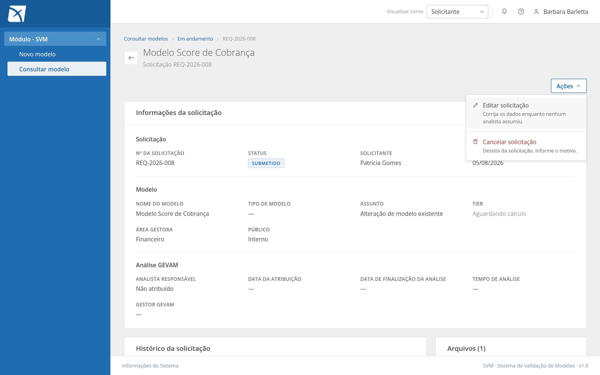

*Figura 3 – Menu Ações do solicitante.*

*Figura 4 – Formulário Editar solicitação, com um novo relatório de desenvolvimento escolhido para substituir o atual.*

### HS-05. Responder a uma complementação

> **Como** solicitante, **quero** ver o que o analista pediu e enviar o que falta, **para** que a análise continue.

- **Onde:** botão **Complementar** na lista, link “Ver pedido e complementar” no aviso, ou **Abrir**.
- **Disponível quando:** status **Em complementação**.
- **O que aparece:** o painel “O analista pediu uma complementação”, com autor, data, texto e anexo do pedido (na primeira vez, o anexo é o **TAP com as pendências**), e o formulário de resposta.
- **O que acontece:**
  - Campos: “Anexo da complementação” (obrigatório) e “Observação para o analista” (opcional, até 500 caracteres).
  - “Enviar complementação”: o status volta para **Em análise** com o mesmo analista, e o histórico registra “Complementação enviada pelo solicitante.” e “Solicitação retornou para análise.”
- **Não é possível:** enviar sem anexo. Aparece “Anexe o documento solicitado pelo analista para enviar a complementação.”
- Se a resposta não resolver tudo, o analista pede uma nova complementação (HA-06). Não há prazo nem limite de rodadas.

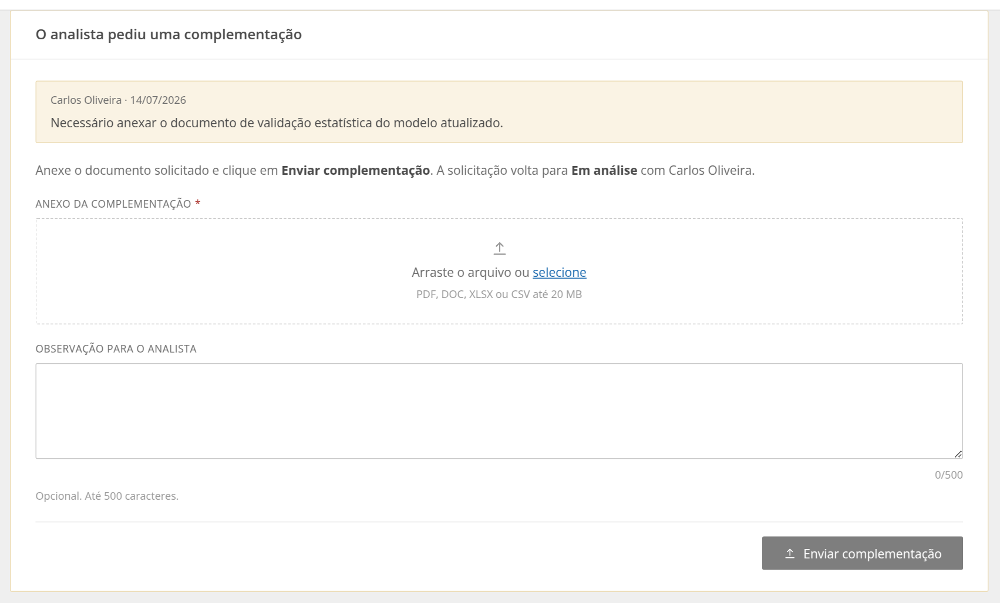

*Figura 5 – Pedido do analista e formulário de resposta.*

### HS-06. Cancelar a solicitação

> **Como** solicitante, **quero** desistir da solicitação, **para** encerrar uma validação que não é mais necessária.

- **Onde:** Ações > **Cancelar solicitação**.
- **Disponível quando:** qualquer status em andamento (Submetido, Em análise, Em complementação).
- **O que acontece:** campo “Justificativa” obrigatório (até 1.000 caracteres). Ao confirmar, o status vira **Cancelada**, a solicitação sai de Em andamento e a página mostra “Solicitação cancelada pelo solicitante”, com nome, data e justificativa. A justificativa fica visível para todos.
- **Não é possível:** cancelar sem justificativa (“Informe o motivo do cancelamento.”) ou desfazer o cancelamento.

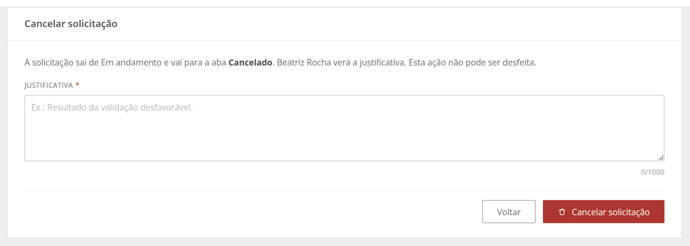

*Figura 6 – Formulário Cancelar solicitação (o mesmo para os três perfis).*

---

## 3. Analista GEVAM

### Fluxo do analista GEVAM

Seta grossa = ação deste perfil · seta fina = ação de outro perfil.

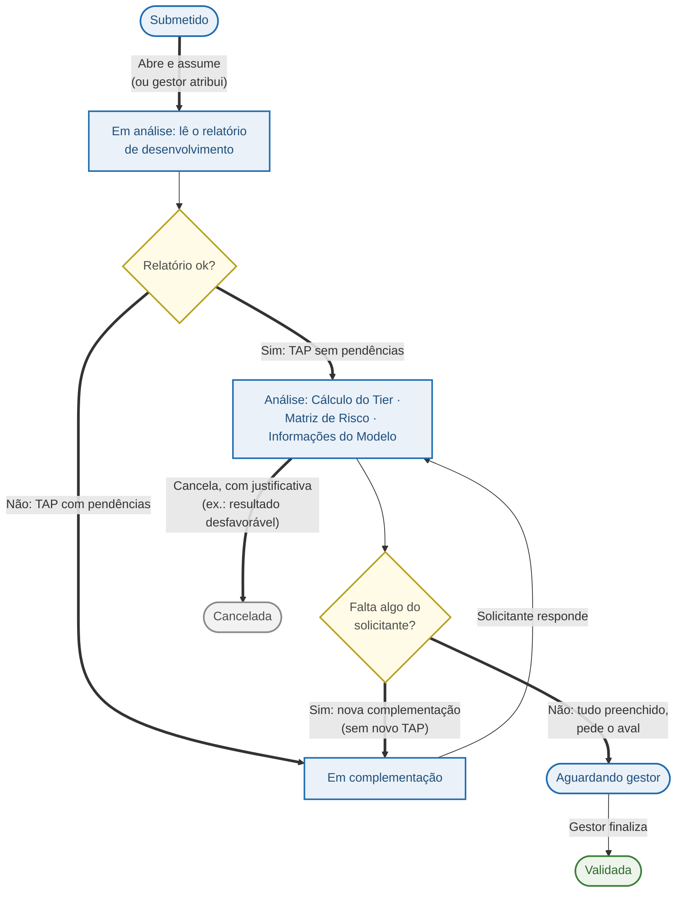

### HA-01. Ver as solicitações em andamento

> **Como** analista, **quero** ver todas as solicitações em andamento por status, **para** escolher o que assumir e acompanhar o que está comigo.

- **Onde:** Consultar modelo > Em andamento.
- **O que aparece:**
  - Quatro cards com a quantidade por status: **Novas submissões** (Submetido), **Em análise**, **Em complementação** e **Aguardando gestor** (novo). Clicar num card filtra a lista por aquele status.
  - Filtros: Nº da solicitação, Área gestora, Nome do modelo, Assunto e Analista responsável.
  - Em cada linha: **Abrir** e **Ações**. No menu Ações, cada item indisponível aparece desabilitado com o motivo: “Aguardando o solicitante.”, “Aguardando decisão do gestor.”, “Em análise com [analista].” ou “Antes, emita o TAP (avaliação preliminar).”
- Validadas e canceladas saem desta lista e ficam nas abas **Inventariado** e **Cancelado** (HG-06).

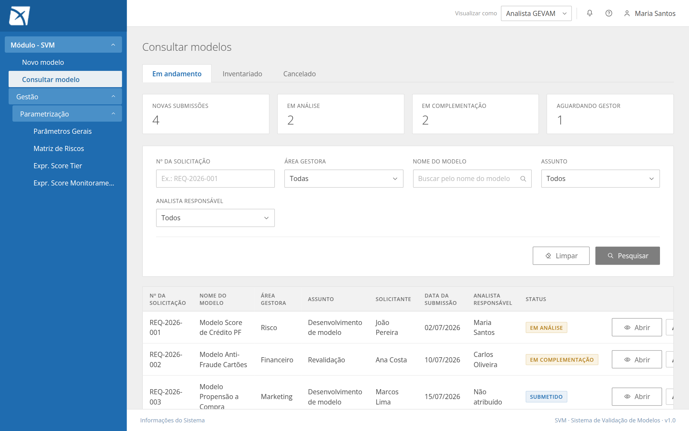

*Figura 7 – Em andamento para o analista, com os quatro cards de status.*

### HA-02. Assumir uma solicitação

> **Como** analista, **quero** abrir uma solicitação nova e ficar responsável por ela, **para** iniciar a avaliação preliminar.

- **Onde:** botão **Abrir** numa solicitação “Submetido”.
- **O que acontece:** o analista passa a ser o **analista responsável**, o status vira **Em análise**, o sistema grava a **data e hora da atribuição** e mostra “Solicitação atribuída a você.” O histórico registra “Solicitação atribuída a [analista]. Avaliação preliminar da documentação iniciada.”
- A solicitação também pode chegar ao analista por atribuição do gestor (HG-02).
- **Não é possível:** agir numa solicitação que está com outro analista. Aparece o aviso “Esta solicitação está em análise com [analista]. Só o analista responsável pode agir sobre ela.” e tudo fica em modo leitura.

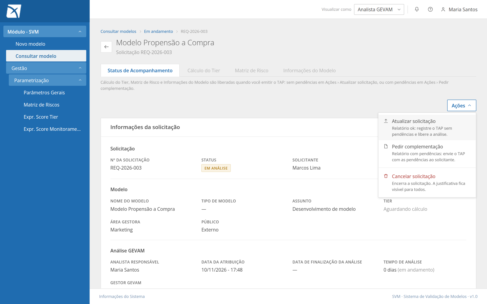

*Figura 8 – Solicitação recém-assumida: abas de análise bloqueadas e menu Ações da avaliação preliminar.*

### HA-03. Ver as informações, o histórico e os arquivos

> **Como** analista (e também gestor e solicitante), **quero** ver os dados da solicitação, o histórico e os documentos num só lugar, **para** não precisar procurar anexos no histórico.

- **Onde:** aba **Status de Acompanhamento** (primeira aba da solicitação).
- **Informações da solicitação**, em três blocos:
  - **Solicitação:** Nº da solicitação, Status, Solicitante e Data da submissão.
  - **Modelo:** Nome do modelo, Tipo de modelo, Assunto, Tier, Área gestora, Público e Objetivo (linha inteira).
  - **Análise GEVAM:** Analista responsável, Data de atribuição, Data de finalização da análise, Tempo de análise e Gestor GEVAM.

| Campo | Regra |
| --- | --- |
| Tier | Último cálculo ou recálculo, no formato “Gestão Moderada · 75 pontos”. Antes do cálculo: “Aguardando cálculo”. |
| Data de atribuição | Data e hora em que o analista assumiu ou foi atribuído (a mais recente, se houve reatribuição). |
| Data de finalização da análise | Data e hora do envio ao gestor. Vazia antes disso. |
| Tempo de análise | Dias corridos entre a atribuição e a finalização da análise. Enquanto não termina, conta até hoje e mostra “(em andamento)”. |
| Gestor GEVAM | Último gestor que atribuiu ou finalizou a validação. Vazio antes disso. |
| Status | Para o solicitante, “Aguardando gestor” aparece como “Em análise”. |

- **Histórico da solicitação:** cada evento com data, descrição e autor. Textos enviados (pedido, observação, justificativa) aparecem citados, e os anexos aparecem no evento em que entraram, com botão de download.
- **Arquivos:** todos os documentos enviados e recebidos durante a validação, com nome, data, quem enviou e botão de download.

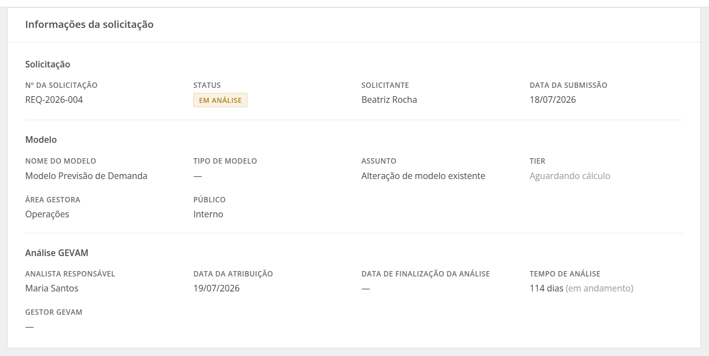

*Figura 9 – Informações da solicitação.*

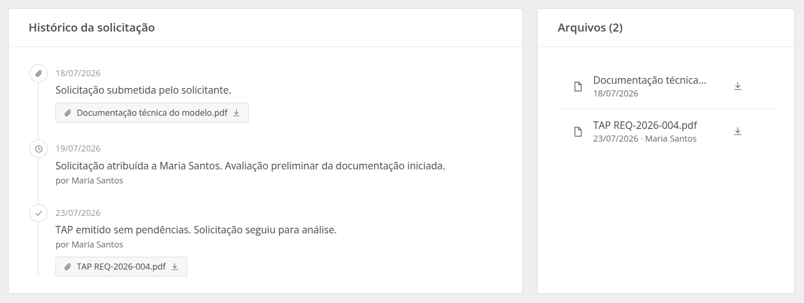

*Figura 10 – Histórico da solicitação e Arquivos.*

### HA-04. Emitir o TAP sem pendências

> **Como** analista, **quero** registrar o TAP quando o relatório de desenvolvimento está ok, **para** liberar a análise.

- **Onde:** Ações > **Atualizar solicitação**, marcando “Esta atualização é o TAP sem pendências”.
- **Disponível quando:** Em análise, na avaliação preliminar (TAP ainda não emitido), sendo o analista responsável.
- **O que acontece:** com a opção marcada, o anexo passa a se chamar “TAP” e fica obrigatório; a “Descrição da atualização” também é obrigatória. Ao confirmar, o TAP é registrado, as abas **Cálculo do Tier, Matriz de Risco e Informações do Modelo são liberadas** e o sistema leva o analista para “Cálculo do Tier”. O histórico registra “TAP emitido sem pendências. Solicitação seguiu para análise.”
- **Não é possível:** marcar a opção sem anexar o TAP (“Anexe o TAP para concluir a avaliação preliminar.”).

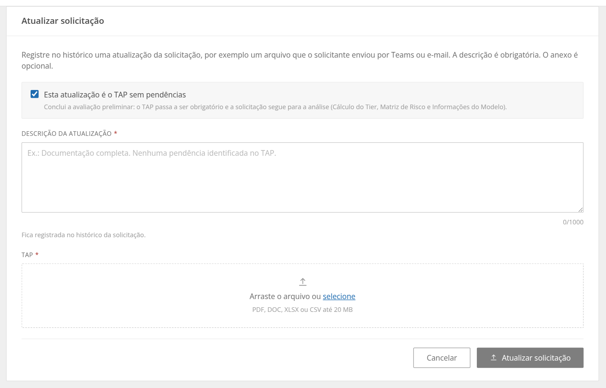

*Figura 11 – Atualizar solicitação com “TAP sem pendências” marcado.*

### HA-05. Emitir o TAP com pendências

> **Como** analista, **quero** enviar ao solicitante o TAP com as pendências do relatório de desenvolvimento, **para** que ele resolva os apontamentos.

- **Onde:** Ações > **Pedir complementação**. Na avaliação preliminar o formulário se chama “Enviar TAP com pendências ao solicitante”.
- **Disponível quando:** Em análise, na avaliação preliminar, sendo o analista responsável.
- **O que acontece:** campos “TAP com pendências” (anexo obrigatório) e “Observações” (opcional, até 1.000 caracteres); botão “Enviar TAP”. O anexo é gravado como **o TAP da solicitação**, as abas de análise são **liberadas** e o status vira **Em complementação**. O histórico registra “TAP emitido com pendências. Complementação solicitada ao solicitante.”
- **Regra importante: o TAP é emitido uma única vez.** Se a resposta do solicitante não resolver todos os apontamentos, o analista faz um **novo pedido de complementação** (HA-06), não um novo TAP.

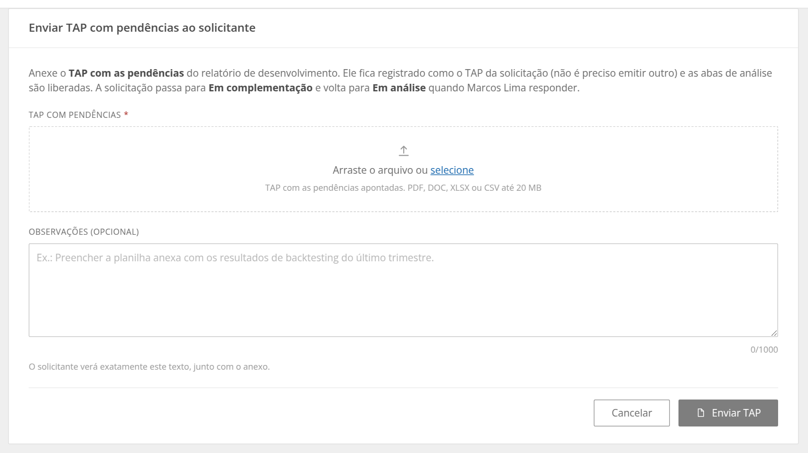

*Figura 12 – Enviar TAP com pendências ao solicitante.*

**Quando o analista pode passar para as próximas abas?** As abas “Cálculo do Tier”, “Matriz de Risco” e “Informações do Modelo” ficam bloqueadas durante a avaliação preliminar e são liberadas assim que o TAP é emitido (HA-04 ou HA-05). Enquanto estão bloqueadas, aparece abaixo delas: “Cálculo do Tier, Matriz de Risco e Informações do Modelo são liberadas quando você emitir o TAP: sem pendências em Ações › Atualizar solicitação, ou com pendências em Ações › Pedir complementação.” Depois de liberadas, ficam liberadas até o fim.

### HA-06. Pedir complementação durante a análise

> **Como** analista, **quero** pedir documentos ou esclarecimentos ao solicitante, **para** completar a análise.

- **Onde:** Ações > **Pedir complementação** (depois do TAP).
- **Disponível quando:** Em análise, após o TAP, sendo o analista responsável.
- **O que acontece:** campos “Anexo para o solicitante” (obrigatório) e “Observações” (opcional). A observação é opcional porque o anexo costuma trazer as explicações. O status vira **Em complementação** e o histórico registra “Complementação solicitada ao solicitante.” Quando o solicitante responde, volta para **Em análise**.
- **Não é possível:** pedir complementação ou enviar ao gestor enquanto a solicitação já está “Em complementação” (“Aguardando o solicitante.”). Nesse status o analista só pode cancelar.

### HA-07. Registrar documentos recebidos por outros meios

> **Como** analista, **quero** registrar no histórico um documento que recebi por Teams ou e-mail, **para** que tudo fique documentado na solicitação.

- **Onde:** Ações > **Atualizar solicitação** (sem marcar a opção de TAP).
- **O que acontece:** “Descrição da atualização” obrigatória e anexo opcional. O status não muda; o histórico registra “Solicitação atualizada pelo analista.” e o anexo aparece em Arquivos.

### HA-08. Calcular o Tier

> **Como** analista, **quero** informar os parâmetros do modelo e calcular o Tier, **para** classificar o nível de gestão do modelo.

- **Onde:** aba **Cálculo do Tier** (liberada após o TAP).
- **O que acontece:**
  - Parâmetros, todos obrigatórios: Materialidade, Impacto na decisão, Complexidade, O modelo utiliza novo algoritmo?, O modelo foi desenvolvido para novo produto?, Implementação automatizada via sistema?
  - “Calcular Tier” registra o cálculo e mostra “Resultado do cálculo” e “Tier cálculo”.
  - Depois aparecem “Ajustes de MRM” (pontos inteiros, positivos ou negativos) e “Override” (forçar um Tier). O botão vira “Recalcular” e mostra “Resultado do recálculo” e “Tier recálculo”.
  - **Tiers:** Gestão Flexível, Gestão Moderada e Gestão Rigorosa.
  - **Histórico cálculo e recálculo:** Descrição, Resultado, Tier, MRM, Override, Data e Usuário; cada linha expande para mostrar os parâmetros.
- **Não é possível:** calcular com parâmetro vazio; informar MRM que não seja número inteiro (“Informe um número inteiro de pontos (ex.: 5 ou -10).”).
- A fórmula de pontuação e as faixas do protótipo são **provisórias** (ponto a confirmar 3).

*Figura 13 – Cálculo do Tier: parâmetros.*

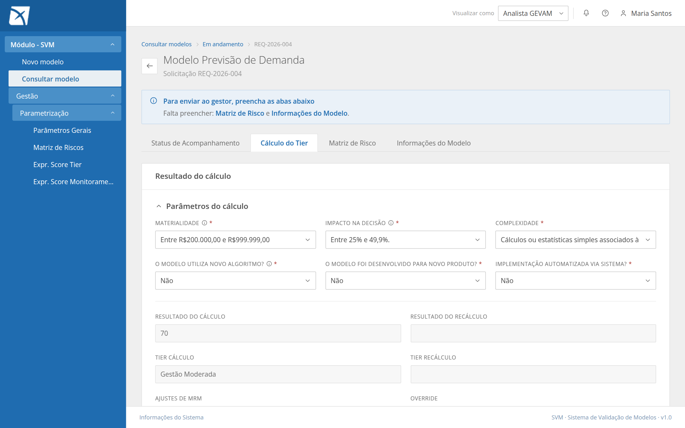

*Figura 14 – Cálculo do Tier: resultado.*

### HA-09. Preencher a Matriz de Risco

> **Como** analista, **quero** registrar a nota de classificação do modelo, **para** obter a classificação de risco.

- **Onde:** aba **Matriz de Risco**.
- **O que acontece:**
  - Campos: “Prazo de revalidação (meses)” e “Alçada sugerida” (opcionais), “Tier” e “Nota de classificação” (obrigatórios) e “Classificação de risco” (calculada, só leitura).
  - O **Tier** vem preenchido com o resultado do Cálculo do Tier; o analista pode alterá-lo só na matriz.
  - **Nota de classificação:**
    - A - O modelo e o seu entorno atendem plenamente aos seus objetivos em todos os aspectos avaliados.
    - B - O modelo e o seu entorno atendem aos seus objetivos com oportunidades de melhorias em alguns de seus componentes ou critérios avaliados.
    - C - O modelo e o seu entorno atendem aos seus objetivos com falhas mínimas em alguns de seus componentes ou critérios avaliados.
    - D - O modelo e/ou seu entorno atendem parcialmente a seus objetivos com falhas importantes em componente central que demandam ação corretiva tempestiva.
    - E - O modelo e/ou seu entorno não atendem aos seus objetivos com falhas cuja somatória compromete as suas estimativas, sendo recomendado sua desativação a uso.
  - “Calcular” na primeira vez; depois “Recalcular” e “Cancelar” (volta aos valores salvos; os dois só ficam ativos quando algo mudou).
  - **Histórico Matriz de Risco:** Descrição, Tier, Nota, Classificação de risco, Prazo (meses), Alçada sugerida, Data e Usuário.
- A tabela Tier × Nota → Classificação de risco do protótipo é **provisória** (ponto a confirmar 2).

*Figura 15 – Matriz de Risco.*

*Figura 16 – Matriz de Risco depois de calcular, com o histórico.*

### HA-10. Preencher as Informações do Modelo

> **Como** analista, **quero** registrar as informações-chave do modelo, **para** consultar depois sem reler o relatório de desenvolvimento.

- **Onde:** aba **Informações do Modelo**.
- **O que acontece:** seções em texto livre (até 4.000 caracteres cada). Cada título tem um ícone (i) com uma dica, exibida ao passar o mouse ou ao focar com o teclado. “Salvar” grava as seções.

| Seção | Obrigatória | Dica (tooltip) |
| --- | --- | --- |
| Contextualização | Sim | Qual o objetivo do modelo e a justificativa para ele existir, o público e a carteira em que é aplicado, e se substitui outro modelo (qual e por quê). |
| Metodologia | Sim | Quais técnicas foram utilizadas (regressão logística, SARIMAX, árvore de decisão, XGBoost, redes neurais…), a variável resposta ou evento e o horizonte. |
| Resultados | Sim | Valores dos indicadores de performance (KS, AUROC, acurácia, MAPE…) associados a cada período (desenvolvimento, teste, out-of-time) e os valores dos testes realizados. |
| Monitoramento da 1ª linha | Sim | Qual monitoramento será realizado pela área solicitante: indicadores acompanhados, periodicidade e limites de alerta. |
| Monitoramento da 2ª linha | Sim | Qual monitoramento será realizado pela GEVAM e com quais indicadores (e com que periodicidade). |
| Observações | Não | Informações complementares que não se encaixam nas seções anteriores. |

- **Não é possível:** salvar com seção obrigatória vazia (“Campo obrigatório”).

*Figura 17 – Informações do Modelo, com a dica da Contextualização aberta.*

### HA-11. Gerar a ficha do modelo

> **Como** analista ou gestor, **quero** gerar a ficha do modelo, **para** ter um resumo para consulta e para anexar a documentos.

- **Onde:** botão **Gerar ficha do modelo**, no topo da aba Informações do Modelo (analista e gestor).
- **O que acontece:** abre a pré-visualização do “Relatório Individual de Modelo”, com “Baixar Excel” e “Imprimir / PDF”. A ficha usa os dados **salvos** e tem, nesta ordem:
  1. Cabeçalho: Nome do Modelo, Assunto, Tipo de Modelo, Público, Situação do Modelo, Área Gestora, Data da Validação (= data de finalização da análise) e Objetivo.
  2. Cálculo do Tier: Materialidade, Impacto, Complexidade, Novo Algoritmo?, Novo Produto?, Automatizado?, MRM, Override e Tier (cálculo / recálculo).
  3. Matriz de Risco: Validado, Nota de Classificação, Classificação de Risco, Prazo de Revalidação (meses), Alçada Sugerida e Analista.
  4. Informações do Modelo: as seções de texto.
- **Modelo da planilha:** `handoff/ficha-do-modelo.xlsx` traz o layout da ficha com os campos marcados (aba “Modelo da ficha”), um exemplo preenchido e a origem de cada campo no SVM (aba “Mapeamento de campos”).

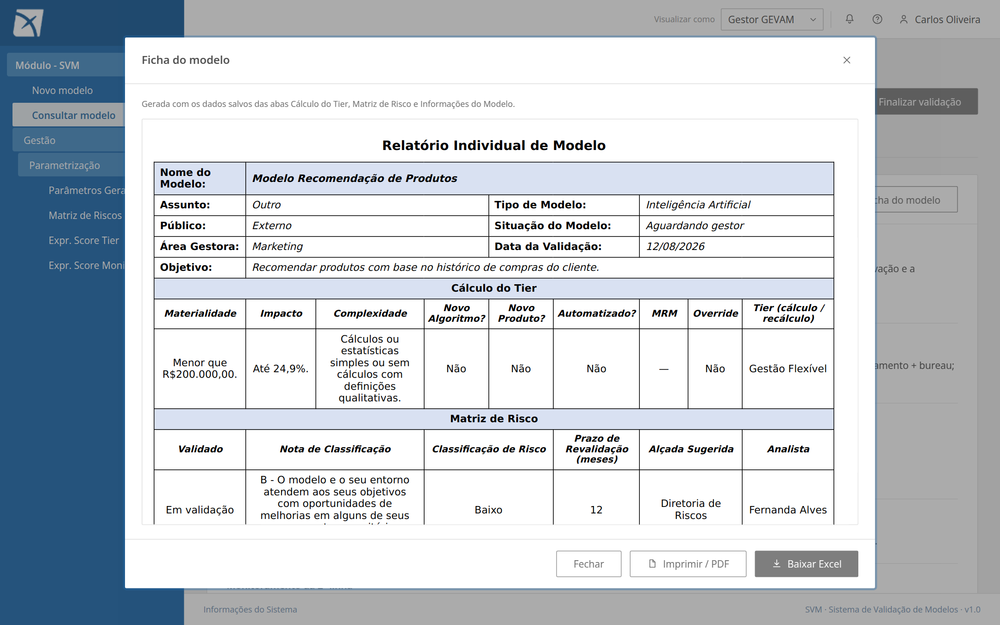

*Figura 18 – Pré-visualização da ficha do modelo.*

### HA-12. Enviar para o gestor

> **Como** analista, **quero** enviar a análise concluída ao gestor, **para** que ele finalize a validação.

- **Onde:** Ações > **Enviar para o gestor**.
- **Disponível quando:** Em análise, após o TAP, sendo o analista responsável, **sem pendências**: Cálculo do Tier, Matriz de Risco e Informações do Modelo preenchidos e nenhuma complementação em aberto.
- **O que acontece:** o analista confirma o envio; **não há anexo nem parecer** — ele está pedindo o aval do gestor, que lê os documentos já disponíveis em Arquivos. O status vira **Aguardando gestor**, o sistema grava a **data e hora de finalização da análise** e o histórico registra “Análise concluída e enviada para o gestor. Aval solicitado.”
- **Não é possível:**
  - Enviar com aba pendente: aparece “Preencha as abas pendentes para enviar ao gestor”, com links para as abas que faltam.
  - Enviar na avaliação preliminar: “Antes, emita o TAP (avaliação preliminar).”
  - Enviar com a solicitação “Em complementação”: “Aguardando o solicitante.”

*Figura 19 – Aviso de abas pendentes.*

*Figura 20 – Confirmação do envio ao gestor (sem anexo).*

### HA-13. Cancelar a solicitação

> **Como** analista responsável, **quero** cancelar a solicitação, **para** encerrar uma validação com resultado desfavorável ou que não vai prosseguir.

- **Onde:** Ações > **Cancelar solicitação** (formulário da Figura 6).
- **Disponível quando:** qualquer status em andamento, sendo o analista responsável (ou numa solicitação ainda “Submetido”).
- **O que acontece:** igual a HS-06; a página mostra “Solicitação cancelada pelo analista”.
- **Não é possível:** cancelar solicitação de outro analista (“Só o analista responsável ([analista]), o gestor ou o solicitante cancelam.”).
- Resultado desfavorável da validação **não** tem status próprio: a solicitação é cancelada.

### HA-14. Incluir no histórico de um modelo inventariado um documento recebido por fora

> **Como** analista, **quero** anexar ao histórico de um modelo inventariado um documento recebido por Teams ou e-mail, **para** manter a documentação completa.

- **Onde:** Consultar modelo > Inventariado > abrir o modelo > “Adicionar documento ao histórico”.
- **O que acontece:** campos “Documento” e “Recebido por” (obrigatórios) e “Observações” (opcional). O documento entra no histórico e em Arquivos.
- **Não é possível:** salvar sem documento (“Anexe o documento.”) ou sem informar por onde chegou (“Informe por onde o documento chegou.”).

---

## 4. Gestor GEVAM

### Fluxo do gestor GEVAM

Seta grossa = ação deste perfil · seta fina = ação de outro perfil.

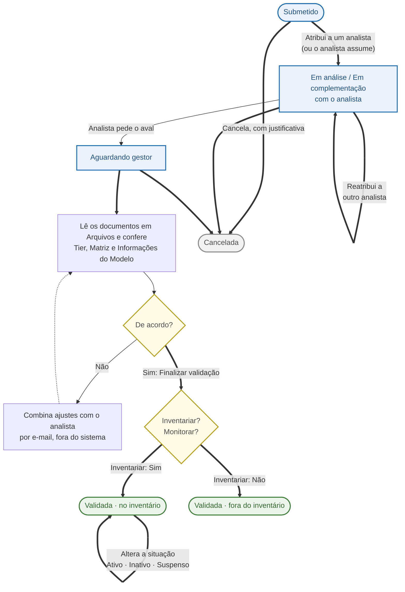

### HG-01. Ver as solicitações em andamento

> **Como** gestor, **quero** ver todas as solicitações e quantas estão em cada status, **para** distribuir o trabalho e saber o que aguarda minha decisão.

- **Onde:** Consultar modelo > Em andamento (mesma tela do analista, Figura 7). O card **Aguardando gestor** mostra o que depende do gestor.
- No menu Ações de cada linha: “Finalizar validação” (desabilitado fora de Aguardando gestor, com o motivo “Disponível quando o analista enviar para o gestor.”), “Atribuir solicitação para analista” e “Cancelar solicitação”.

### HG-02. Atribuir ou reatribuir uma solicitação

> **Como** gestor, **quero** atribuir uma solicitação a um analista ou trocar o analista responsável, **para** distribuir a carga de trabalho.

- **Onde:** Ações > **Atribuir a um analista** (solicitação “Submetido”) ou **Reatribuir analista** (solicitação em andamento).
- **O que acontece:** campo “Analista” (obrigatório; lista sem o analista atual).
  - **Atribuir:** o status vira **Em análise** com o analista escolhido; grava a data de atribuição e o gestor GEVAM. Histórico: “Solicitação atribuída a [analista] pelo gestor.”
  - **Reatribuir:** o status não muda; mudam o analista responsável e a data de atribuição. Histórico: “Solicitação reatribuída de [anterior] para [novo] pelo gestor.”
- **Não é possível:** atribuir sem escolher o analista (“Escolha o analista.”); atribuir solicitação Validada ou Cancelada.
- O analista não atribui: para ele o item fica desabilitado com “Ao abrir uma solicitação Submetido, ela é atribuída a você.”

*Figura 21 – Atribuir a um analista.*

### HG-03. Conferir a análise

> **Como** gestor, **quero** ler os documentos e conferir as abas preenchidas pelo analista, **para** dar o aval com segurança.

- **Onde:** abrir uma solicitação “Aguardando gestor”.
- **O que aparece:** painel “Aval solicitado pelo analista” (quem enviou e quando, com a orientação de ler os documentos em Arquivos); as abas Cálculo do Tier, Matriz de Risco e Informações do Modelo **em modo leitura**; o botão “Gerar ficha do modelo” (HA-11).
- **Não é possível:** editar as abas ou devolver ao analista pelo sistema. Ajustes são combinados por e-mail antes do aval.

*Figura 22 – Solicitação Aguardando gestor, com o aviso de aval solicitado e o botão Finalizar validação.*

### HG-04. Finalizar a validação

> **Como** gestor, **quero** dar o aval à validação e decidir se o modelo entra no inventário e se será monitorado, **para** concluir a validação independente.

- **Onde:** botão **Finalizar validação** no topo da página (ou no menu Ações da lista).
- **Disponível quando:** status **Aguardando gestor**.
- **O que acontece:** abre a janela “Finalizar validação”, que mostra a Matriz de Risco do analista (Tier, nota e classificação) e pergunta, com resposta obrigatória:
  - **O modelo será inventariado?** Sim / Não
  - **O modelo será monitorado?** Sim / Não
- Ao confirmar, o status vira **Validada**, a solicitação sai de Em andamento e a página mostra “Solicitação finalizada” (Resultado, Validada por, Inventariado, Monitorado).
  - **Inventariar = Sim:** o modelo entra em Consultar modelo > Inventariado com número INV-AAAA-NNN, Resultado da validação “Validado”, Monitoramento conforme a resposta e Situação “Ativo”, levando os dados de Cálculo do Tier, Matriz de Risco e Informações do Modelo.
  - **Inventariar = Não:** fica só como Validada. Não inventariar **não** é reprovação.
  - **Monitorar** não muda o status: indica quais modelos a 2ª linha vai acompanhar (o acompanhamento é feito fora do sistema).
- **Não é possível:** confirmar sem responder as duas perguntas (“Escolha Sim ou Não.”).

*Figura 23 – Janela Finalizar validação.*

### HG-05. Cancelar a solicitação

> **Como** gestor, **quero** cancelar uma solicitação, **para** encerrar uma validação que não vai prosseguir.

- **Onde:** Ações > **Cancelar solicitação** (formulário da Figura 6).
- **Disponível quando:** qualquer status em andamento.
- **O que acontece:** igual a HS-06; a página mostra “Solicitação cancelada pelo gestor GEVAM”.

### HG-06. Consultar o inventário e os cancelados

> **Como** gestor (ou analista), **quero** consultar os modelos inventariados e as solicitações canceladas, **para** acompanhar a carteira de modelos.

- **Onde:** Consultar modelo > **Inventariado** e Consultar modelo > **Cancelado**.
- **Inventariado:**
  - Cards **informativos** (sem clique): Modelos inventariados, Resultado da validação, Monitoramento e Situação do modelo, com quantidade, percentual e barra.
  - Filtros novos: “Resultado da validação” (Todos, Validados, Não validados), “Monitoramento” (Todos, Monitorados, Não monitorados, Não se aplica) e “Situação do modelo” (Todos, Ativos, Inativos, Suspensos). Os filtros em uso aparecem como etiquetas acima da tabela, removíveis pelo X.
  - Na página do modelo, o **gestor** altera a situação (Ativo, Inativo, Suspenso); a alteração fica no histórico.
- **Cancelado:** lista com a coluna nova **“Cancelada por”** (Analista, Gestor GEVAM ou Solicitante) e a justificativa.

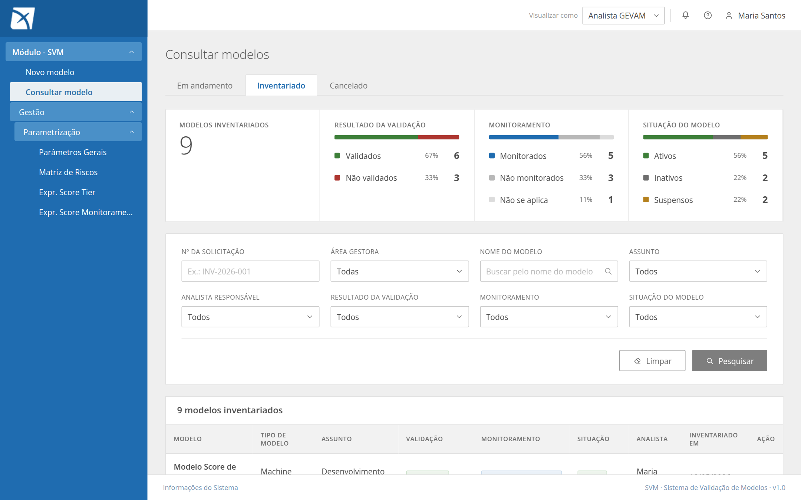

*Figura 24 – Inventariado, com os cards informativos e os novos filtros.*

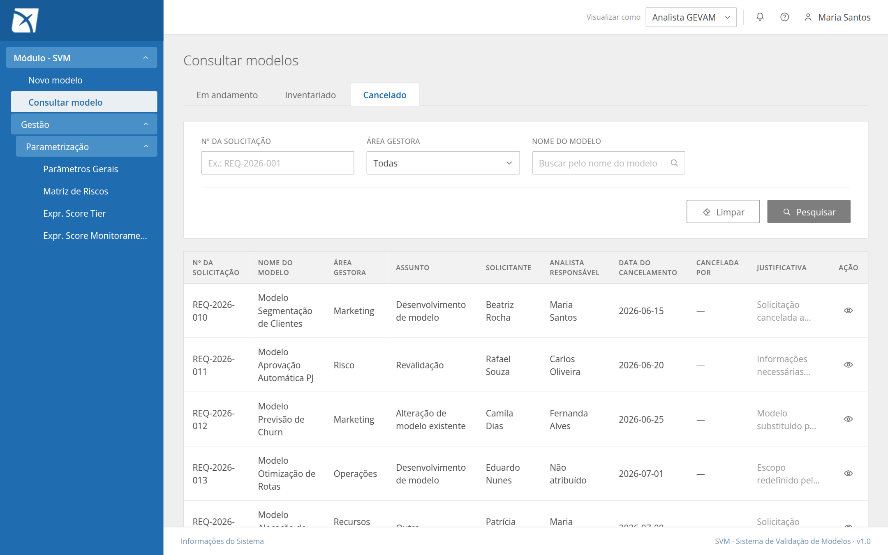

*Figura 25 – Cancelado, com a coluna “Cancelada por”.*

### HG-07. Inventariar um modelo existente (gestor e analista)

> **Como** gestor ou analista, **quero** registrar direto no inventário um modelo que já existe, **para** que ele passe a constar no inventário da GEVAM.

- **Onde:** Novo Modelo > Inventariar.
- **O que acontece:** as mesmas abas da solicitação, nesta ordem: “Inventariar” (dados do modelo) → “Cálculo do Tier” → “Matriz de Risco” → “Informações do Modelo”. Cada aba só libera a seguinte quando está completa; o botão final é “Incluir no inventário”.

---

## 5. Back-end e regras

- **Transições de status** feitas no servidor, junto com o registro no histórico, numa única operação. A tabela completa está em `docs/fluxos-solicitacao.md`.
- **Permissões validadas no servidor**, conforme as tabelas da seção 1: só o analista responsável age em Em análise; a complementação só é respondida pelo solicitante e com anexo; o envio ao gestor só ocorre sem pendências; “Finalizar validação” só pelo gestor em Aguardando gestor; o cancelamento só em status em andamento e com justificativa.
- **TAP único:** gravar o TAP uma vez (sem pendências pelo Atualizar solicitação, ou com pendências pelo primeiro pedido de complementação). A existência do TAP é o que libera as abas de análise.
- **Novos dados da solicitação:** data/hora de atribuição, data/hora de finalização da análise, gestor GEVAM, TAP (anexo, data, autor, com ou sem pendências), cancelamento (data, autor, perfil e justificativa), histórico de Cálculo do Tier, histórico de Matriz de Risco e Informações do Modelo (seis textos).
- **Substituição do relatório de desenvolvimento:** na edição (status Submetido), o novo arquivo substitui o anterior, que é **apagado** (não fica no histórico nem em Arquivos). O evento da edição guarda o novo arquivo.
- **Anexos:** gravar o arquivo, ligar ao evento do histórico e servir o download. Limite de 20 MB; formatos PDF, DOC, DOCX, XLSX e CSV.
- **Notificações:** o solicitante é notificado quando o status muda, principalmente quando entra em complementação.

Tipos de referência: `Solicitacao`, `TimelineEvent`, `CalculoTier`, `MatrizRisco` e `InformacoesModelo` em `src/types.ts`. Regras de permissão: `src/pages/ConsultarModelo/fluxo.ts`.

## 6. Pontos a confirmar

1. [ ] **O solicitante perde o acesso às solicitações finalizadas.** Ele só tem a aba “Em andamento”, e Validadas e Canceladas saem dela. Com isso ele não vê a justificativa de um cancelamento nem o resultado da validação. Sugestão: dar ao solicitante uma aba “Finalizadas” (ou as abas Inventariado e Cancelado filtradas pela área dele).
2. [ ] Tabela oficial de Classificação de Risco (Tier × Nota). Hoje só “Gestão Moderada + A = Baixo” está confirmado.
3. [ ] Fórmula oficial de pontuação do Tier e as faixas de cada Tier.
4. [ ] “Prazo de revalidação” e “Alçada sugerida” são digitados pelo analista (como no protótipo) ou calculados a partir do Tier e da classificação?
5. [ ] O “Tempo de análise” deve descontar o período em “Em complementação”?
6. [ ] Se o analista alterar o Tier na Matriz de Risco, o campo “Tier” das Informações da solicitação deve mostrar o Tier da matriz?
7. [ ] “Alterar solicitante” (menu Ações de analista e gestor) continua existindo? Quem pode usar? Hoje não está implementado.
8. [ ] O botão “Complementar” na lista do solicitante (atalho para responder) fica, ou o solicitante usa só “Abrir”?
9. [ ] A ficha do modelo deve ser um .xlsx real (hoje é uma planilha HTML que o Excel abre com aviso de formato) e levar o logo do banco?
