# Sprint 42 — Histórias de usuário do fluxo da solicitação

Este documento descreve o que deve ser implementado no SVM, organizado por **história de usuário**. Cada história diz o que o usuário quer fazer, onde fica o botão, quando ele está disponível, o que acontece ao clicar e o que **não** é possível fazer (com a mensagem que o sistema mostra). As figuras são do protótipo (`svm-frontend`, pasta `handoff/img/`).

**Perfis**

- **Solicitante:** usuário da área gestora do modelo. Submete a solicitação, responde às complementações e consulta os modelos inventariados (aba Inventariado) e as canceladas da sua área.
- **Analista GEVAM:** lê o relatório de desenvolvimento, emite o TAP, faz a análise e pede o aval do gestor.
- **Gestor GEVAM:** distribui as solicitações entre os analistas e finaliza a validação.

**Status da solicitação:** Submetido → Em análise ⇄ Em complementação → Aguardando gestor → **Validado**. **Cancelado** pode ocorrer a partir de qualquer status em andamento. Todo modelo **Validado** entra no inventário (situação Ativo, não monitorado). O fluxo completo, com diagramas e a tabela de transições, está em `docs/fluxos-solicitacao.md`. A correspondência entre os status antigos e os novos está na seção 5.1 (**de-para**).

**Onde ficam as ações:** o botão **Ações** aparece **só dentro da solicitação** (depois de clicar em **Abrir**). Na lista Em andamento cada linha tem apenas **Abrir**. Tudo o que se faz com a solicitação (inclusive responder complementação) fica no botão **Ações**, dentro dela.

**Como ler cada história**

> **Como** [perfil], **quero** [ação], **para** [objetivo].

- **Onde:** tela e botão.
- **Disponível quando:** status e condições.
- **O que acontece:** campos, validações, mudança de status e registro no histórico.
- **Não é possível:** o que fica bloqueado e a mensagem exibida.

---

## 1. Resumo: o que cada perfil pode fazer em cada status

Legenda: ✅ disponível · ❌ indisponível (o item aparece desabilitado, com o motivo) · — não se aplica.

### 1.1. Solicitante

| Ação | Submetido | Em análise | Em complementação | Aguardando gestor | Validado / Cancelado |
| --- | --- | --- | --- | --- | --- |
| Abrir (ver status, histórico e arquivos) | ✅ | ✅ | ✅ | ✅ | ✅ só leitura: inventariados da sua área (aba Inventariado, abre a página do modelo) e cancelados da sua área (aba Cancelado) |
| Editar solicitação | ✅ | 🚫 não aparece | 🚫 não aparece | 🚫 não aparece | — |
| Responder complementação (Ações) | — | — | ✅ | — | — |
| Cancelar solicitação | ✅ | ✅ | ✅ | ✅ | — |

O solicitante vê o status **Aguardando gestor** como ele é (não é mais trocado por “Em análise”).

### 1.2. Analista GEVAM

| Ação | Submetido | Em análise | Em complementação | Aguardando gestor | Validado / Cancelado |
| --- | --- | --- | --- | --- | --- |
| Abrir | ✅ (leitura, não assume) | ✅ | ✅ | ✅ (leitura) | ✅ (abas Inventariado e Cancelado) |
| Assumir solicitação (menu Ações) | ✅² | — | — | — | — |
| Acrescentar documentação (TAP ou outro documento) | ❌² | ✅ | ✅ | ✅ | ✅ Validado: na página do modelo (HA-13); Cancelado: na página da solicitação. Sem mudar o status³ |
| Preencher Cálculo do Tier, Matriz de Risco e Informações do Modelo | ❌² | ✅ | ✅ | ❌ (leitura) | — |
| Pedir complementação (inclusive com o TAP com pendências) | ❌² | ✅ | ❌ | ❌ | — |
| Gerar ficha do modelo | — | ✅ | ✅ | ✅ | — |
| Enviar para o gestor | — | ✅ com as três abas preenchidas | ❌ | ❌ | — |
| Editar solicitação: **só trocar o solicitante** (os dados informados pelo solicitante ficam só para leitura) | ❌² | ✅ | ✅ | ✅ | — |
| Cancelar solicitação | ❌² | ✅ | ✅ | ✅ | — |
| Editar modelo inventariado (situação, monitoramento e Informações do Modelo) | — | — | — | — | ✅ Validado (HA-15) |

² Abrir uma solicitação “Submetido” não muda nada: o menu **Ações** mostra só “Assumir solicitação”. Ao clicar nela, o analista passa a ser o responsável e o status vira “Em análise”; só então aparecem as outras ações e as abas de análise podem ser preenchidas. As colunas “Em análise” em diante valem **só para o analista responsável**; outro analista vê tudo em modo leitura.

³ Os validados são abertos pela aba **Inventariado** (página do modelo) e os cancelados pela aba **Cancelado** (página da solicitação) (HG-06). O status não muda: Validado continua Validado; Cancelado continua Cancelado.

### 1.3. Gestor GEVAM

| Ação | Submetido | Em análise | Em complementação | Aguardando gestor | Validado / Cancelado |
| --- | --- | --- | --- | --- | --- |
| Abrir e conferir as abas (leitura) | ✅ | ✅ | ✅ | ✅ | ✅ (abas Inventariado e Cancelado) |
| Assumir solicitação (ele mesmo analisa) | ✅⁴ | — | — | — | — |
| Atribuir a um analista | ✅ | — | — | — | — |
| Reatribuir analista | — | ✅ | ✅ | ✅ | — |
| Gerar ficha do modelo | — | ✅ | ✅ | ✅ | — |
| Editar solicitação: **só trocar o solicitante** (os dados informados pelo solicitante ficam só para leitura) | ✅ | ✅ | ✅ | ✅ | — |
| Finalizar validação | ❌ | ❌ | ❌ | ✅ | — |
| Cancelar solicitação | ✅ | ✅ | ✅ | ✅ | — |
| Editar modelo inventariado (situação, monitoramento e Informações do Modelo) | — | — | — | — | ✅ Validado (HA-15) |

⁴ O gestor também pode **assumir** uma solicitação “Submetido” (Ações > “Assumir solicitação”). Aí ele passa a ser o **responsável** e faz **tudo o que o analista responsável faz** (tabela 1.2): acrescentar documentação, pedir complementação, preencher Cálculo do Tier, Matriz de Risco e Informações do Modelo, enviar para o gestor. Continua tendo as ações de gestor (reatribuir, editar, cancelar e finalizar a validação). Depois de enviar para o gestor, **ele mesmo pode finalizar a validação** (HG-04).

Se **não** assumiu a solicitação, o gestor **não** edita as abas de análise. Ele **não** recusa a validação: a revisão do gestor acontece por e-mail, fora do sistema, antes do aval formal.

### 1.4. Botão Ações

O botão **Ações** fica no canto superior direito da aba **Status de Acompanhamento**, dentro da solicitação (depois de clicar em **Abrir** na lista). Ele abre um menu com os itens abaixo, cada um com uma linha explicando para que serve. **Só aparecem os itens que o usuário pode usar naquele status**; se nenhum se aplica, o botão não aparece. A lista Em andamento **não** tem o botão Ações: só **Abrir**.

**Solicitante** (Figura 4)

| Item do menu | Aparece quando | O que faz |
| --- | --- | --- |
| Editar solicitação | **Só em Submetido.** Nos outros status o item **não aparece** no menu (some; não fica desabilitado). | Abre o formulário de edição (HS-04) |
| Responder complementação | **Só em Em complementação** | Abre a janela (popup) de resposta (HS-05) |
| Cancelar solicitação | Submetido, Em análise, Em complementação ou Aguardando gestor | Abre a janela (popup) que pede a justificativa e cancela (HS-06) |

Em solicitações Validado ou Cancelado o solicitante não tem o botão Ações.

**Analista GEVAM** (Figura 11) — só o analista **responsável** vê o menu; outro analista vê a solicitação em modo leitura, sem o botão.

| Item do menu | Aparece quando | O que faz |
| --- | --- | --- |
| Assumir solicitação | Submetido (é a **única** opção do menu nesse status) | O analista passa a ser o responsável e o status vira Em análise; só então aparecem as outras ações (HA-02) |
| Acrescentar documentação | **Qualquer status**, inclusive Em complementação, Aguardando gestor e Cancelado (para Validado, o botão fica na página do modelo, HA-13) | Abre a janela (popup) que inclui um documento (TAP ou outro); o status não muda (HA-04) |
| Pedir complementação | Em análise | Abre a janela (popup) que envia o pedido com anexo ao solicitante; status Em complementação (HA-05) |
| Enviar para o gestor | Em análise. Se faltar alguma aba, a linha de apoio diz “Antes, preencha …” e, ao clicar, aparece o aviso de abas pendentes | Abre a janela (popup) que pede o aval do gestor, sem anexo; status Aguardando gestor (HA-11) |
| Editar solicitação | Qualquer status em andamento | Só troca o solicitante: os dados informados pelo solicitante aparecem só para leitura (o analista corrige o que ele mesmo inseriu nas abas de análise); status não muda (HA-14) |
| Cancelar solicitação | Qualquer status em andamento depois de assumir (Em análise, Em complementação, Aguardando gestor) | Abre a janela (popup) que pede a justificativa e cancela (HA-12) |

**Gestor GEVAM** (Figura 26)

| Item do menu | Aparece quando | O que faz |
| --- | --- | --- |
| Assumir solicitação | Submetido | O próprio gestor passa a ser o responsável; status Em análise. Daí em diante o menu também traz as ações do analista responsável: Acrescentar documentação, Pedir complementação e Enviar para o gestor (HG-02) |
| Atribuir a um analista | Submetido | Escolhe o analista; status Em análise (HG-02) |
| Reatribuir analista | Em análise, Em complementação ou Aguardando gestor | Troca o analista responsável; status não muda (HG-02) |
| Editar solicitação | Qualquer status em andamento | Só troca o solicitante: os dados informados pelo solicitante aparecem só para leitura; status não muda (HG-08) |
| Cancelar solicitação | Qualquer status em andamento | Abre a janela (popup) que pede a justificativa e cancela (HG-05) |

**Finalizar validação** não fica no menu Ações: é um botão próprio no topo da página, que aparece para o gestor quando a solicitação está **Aguardando gestor** (HG-04). Em solicitações Validado ou Cancelado o gestor não tem o botão Ações.

### 1.5. Botões

Regra geral: cada botão **só aparece para quem pode usá-lo**. Quando a ação existe para o perfil mas não vale no status atual, o item aparece **desabilitado com o motivo** (exceção: o “Editar solicitação” do solicitante, que some fora de Submetido). Botões de confirmação (Salvar, Enviar, Atribuir…) **validam os campos antes**: com erro, nada é gravado e a mensagem aparece abaixo do campo. **Cancelar** e **Voltar** nunca gravam nada.

**Nas listas (Consultar modelo)**

| Botão | Onde | Quem vê | O que faz |
| --- | --- | --- | --- |
| Abrir | Cada linha de Em andamento, Cancelado e Inventariado (o mesmo botão “Abrir” nas três abas, não só o ícone de olho) | Todos | Em andamento e Cancelado: abre a solicitação em página própria. Inventariado: abre a página do modelo. Abrir só abre, inclusive para o analista numa solicitação “Submetido”: para assumir, ele usa **Ações** > “Assumir solicitação” (HA-02) |
| Pesquisar / Limpar | Barra de filtros | Todos | Aplica os filtros / volta todos os filtros para “Todos” |

**Dentro da solicitação**

| Botão | Onde | Quem vê | O que faz |
| --- | --- | --- | --- |
| Ações | Canto superior direito da aba Status de Acompanhamento | Solicitante, analista responsável e gestor, só quando há algum item para ele (seção 1.4) | Abre o menu com as ações do perfil. Escolher um item abre a ação: Responder complementação, Cancelar solicitação, Acrescentar documentação, Pedir complementação e Enviar para o gestor abrem numa janela (popup); Atribuir / Reatribuir analista também abre numa janela (popup); Editar solicitação abre na própria página |
| Finalizar validação | Topo da página | Gestor, só em “Aguardando gestor” | Abre a janela Finalizar validação (HG-04) |
| Gerar ficha do modelo | Topo da aba Informações do Modelo | Analista e gestor | Abre a pré-visualização da ficha, com **Baixar Excel** (arquivo .xlsx), **Imprimir / PDF** e **Fechar** (HA-10) |
| Voltar para a lista | Topo da página | Todos | Volta para a aba de onde a solicitação foi aberta |

**Nos formulários das ações** (aparecem depois de escolher um item em Ações)

| Formulário | Botão que grava | O que grava |
| --- | --- | --- |
| Editar solicitação | **Salvar alterações** | Solicitante: os dados e o novo relatório escolhido. Analista e gestor: **só o solicitante** (HS-04, HA-14, HG-08) |
| Responder complementação (Ações) | **Enviar complementação** | O anexo e a observação; status volta para Em análise (HS-05) |
| Cancelar solicitação | **Cancelar solicitação** (o botão **Voltar** desiste sem cancelar) | A justificativa; status Cancelado (HS-06) |
| Acrescentar documentação | **Acrescentar** | O documento e a descrição; status não muda (HA-04) |
| Pedir complementação | **Enviar pedido** | O anexo e as observações; status Em complementação (HA-05) |
| Enviar para o gestor | **Enviar para o gestor** | O pedido de aval; status Aguardando gestor (HA-11) |
| Atribuir / Reatribuir analista | **Atribuir** | O analista responsável (HG-02) |
| Finalizar validação | **Finalizar validação** (na janela de confirmação) | O aval; status Validado e o modelo entra no inventário, Ativo e não monitorado (HG-04) |

Todos os formulários têm também **Cancelar**, que fecha o formulário sem gravar.

**Nas abas de análise** (analista responsável, em Em análise e Em complementação)

| Aba | Botões | O que fazem |
| --- | --- | --- |
| Cálculo do Tier | **Calcular Tier**, depois **Recalcular** | Gravam um cálculo novo no histórico do Tier; nada é sobrescrito (HA-07) |
| Matriz de Risco | **Calcular**, depois **Recalcular** e **Cancelar** | Calcular/Recalcular gravam uma linha nova no histórico da matriz; Cancelar volta aos valores salvos. Recalcular e Cancelar só ficam ativos quando algo mudou (HA-08) |
| Informações do Modelo | **Salvar** | Salvar valida as seções obrigatórias, grava o texto e mostra o que ainda falta para enviar ao gestor (HA-09). Não há botão Voltar: a navegação é pelas abas do topo |

Fora desses casos (outro perfil, outro analista ou depois do envio ao gestor) as abas ficam em modo leitura e esses botões não aparecem.

**Na página do modelo inventariado**

| Botão | Quem vê | O que faz |
| --- | --- | --- |
| Acrescentar documentação | Analista | Abre a janela (popup) com Documento, Recebido por e Observações; o botão **Acrescentar** grava (HA-13) |
| Editar modelo | Analista e gestor | Abre o formulário com Situação (Ativo, Inativo, Suspenso), Validação GEVAM (Validado, Não validado), o toggle **Monitoramento 2ª Linha (GEVAM)** e os textos de Informações do Modelo; **Salvar alterações** grava e registra cada mudança no histórico (HA-15) |
| Voltar para a lista | Todos | Volta para a aba Inventariado (Validado, para o solicitante) |

**Em Novo Modelo**

| Tela | Botões | O que fazem |
| --- | --- | --- |
| Solicitação (solicitante) | **Enviar** | Valida os campos e cria a solicitação com status Submetido (HS-01) |
| Inventariar (analista e gestor) | **Avançar**, **Voltar** e, na última aba, **Incluir no inventário** | Avançar só libera a próxima aba quando a atual está completa; Incluir no inventário grava o modelo (HG-07) |

---

## 2. Solicitante

### Fluxo do solicitante

Seta grossa = ação deste perfil · seta fina = ação de outro perfil.

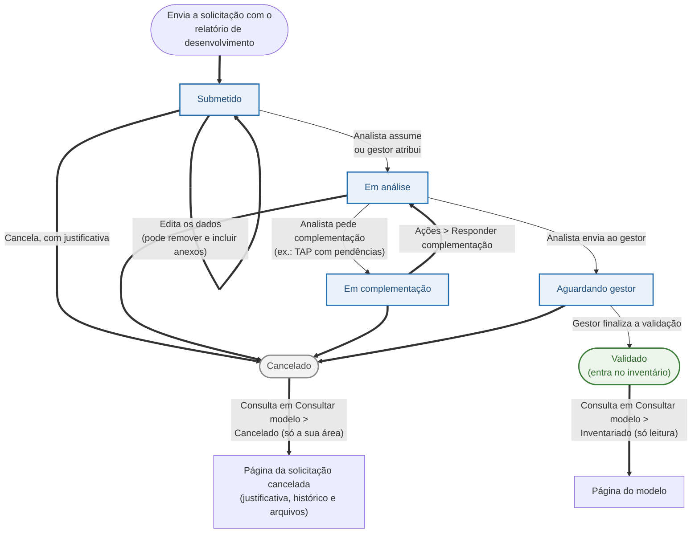

### HS-01. Submeter uma nova solicitação

> **Como** solicitante, **quero** submeter um novo modelo com o relatório de desenvolvimento, **para** que a GEVAM faça a validação independente.

- **Onde:** Novo Modelo > Solicitação.
- **Disponível quando:** sempre.
- **O que acontece:**
  - Campos, nesta ordem, todos obrigatórios: Nome do modelo · Assunto, Tipo de modelo e Área gestora · Público · Objetivo (até 500 caracteres) · **Anexo(s)** (pelo menos um; **quantos arquivos precisar, de qualquer tipo**, até 20 MB cada). Ao lado do nome do campo, um ícone **(i)** explica: “Esperamos o relatório de desenvolvimento do modelo em PDF, os scripts de código, as planilhas e qualquer outro arquivo que ajude na análise. Você pode anexar quantos arquivos precisar.”
  - Ao clicar em “Enviar”, a solicitação é criada com status **Submetido** e o sistema mostra o número gerado: **só o número, sem prefixo nem traços** (ex.: 244).
- **Não é possível:**
  - Enviar com campo vazio: aparece “Campo obrigatório” abaixo do campo.
  - Enviar sem nenhum anexo: aparece “Campo obrigatório” abaixo de Anexo(s). O tipo do arquivo não é conferido.
- **Mudanças em relação ao sistema atual:** para o Solicitante, retirar as abas superiores “Implantação” e “Metodologia e Monitoramento” e o campo textual “OBSERVAÇÕES” da aba “Solicitação”.

*Figura 1 – Formulário Novo Modelo > Solicitação.*

### HS-02. Acompanhar minhas solicitações

> **Como** solicitante, **quero** ver as solicitações da minha área e o status de cada uma, **para** saber o que está com a GEVAM e o que depende de mim.

- **Onde:** Consultar modelo > Em andamento.
- **O que aparece:**
  - Somente as solicitações da área do solicitante (ex.: “Exibindo solicitações da área GERIC”).
  - Status: Submetido, Em análise, Em complementação ou **Aguardando gestor** (o solicitante vê esse status como ele é).
  - Filtros: Nº da solicitação, **Status da solicitação** (novo), Área gestora (fixa na área dele), Nome do modelo, Assunto e Analista responsável.
  - **Status da solicitação** tem as opções Todos, Submetido, Em análise, Em complementação e Aguardando gestor (as mesmas da GEVAM).
  - Quando há complementação pendente, um aviso no topo: “Existe(m) N solicitação(ões) que exige(m) complementação”, com o texto “É preciso que o solicitante envie a complementação para dar continuidade à análise do especialista. Abra a solicitação e use Ações > Responder complementação.” e o número e o nome de cada uma (sem link de ação).
  - Colunas: Nº da solicitação, Nome do modelo, Assunto, Solicitante, Data da submissão, Analista responsável, Status e Ação. **Sem a coluna Área gestora**, que seria sempre a área dele.
  - Em cada linha: **só** o botão **Abrir**. Editar, Responder complementação e Cancelar ficam no botão **Ações**, dentro da solicitação.
- **Não aparece para o solicitante:** os cards de contagem por status e as ações de analista e gestor (atribuir, editar com troca de solicitante, acrescentar documentação, pedir complementação, enviar ao gestor, finalizar validação).

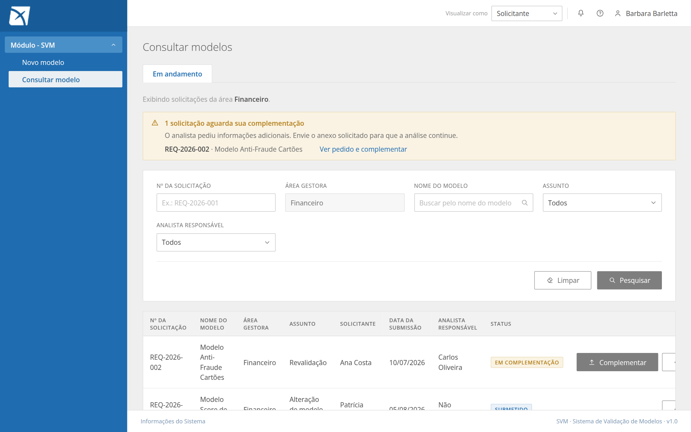

*Figura 2 – Lista do solicitante, com o aviso de complementação pendente.*

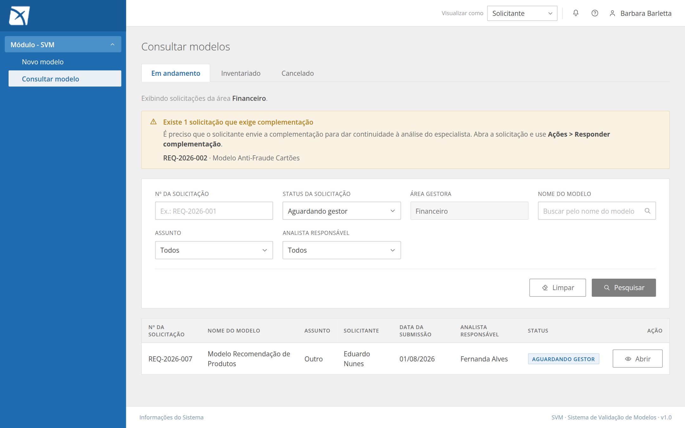

*Figura 3 – Filtro Status da solicitação para o solicitante: “Em análise” inclui as que aguardam o gestor.*

### HS-03. Ver os detalhes da solicitação

> **Como** solicitante, **quero** abrir a solicitação, **para** ver o status, o histórico e todos os documentos.

- **Onde:** botão **Abrir**.
- **O que aparece:** a aba “Status de Acompanhamento” com “Informações da solicitação” (HA-03), “Histórico da solicitação” e “Arquivos”.
- O solicitante vê **todos os documentos**: os dele, os do analista (TAP, pedidos de complementação) e os do gestor.
- **Não aparece para o solicitante:** as abas “Cálculo do Tier”, “Matriz de Risco” e “Informações do Modelo”. Também não aparece a seção **Informações do Modelo** na página do modelo inventariado nem na solicitação cancelada (é só do analista e do gestor).

### HS-04. Editar a solicitação

> **Como** solicitante, **quero** corrigir os dados que enviei, **para** não precisar cancelar e abrir outra solicitação por causa de um erro.

- **Onde:** dentro da solicitação, Ações > **Editar solicitação**.
- **Disponível quando:** apenas status **Submetido** (nenhum analista assumiu). Nos outros status o item “Editar solicitação” **não aparece** no menu Ações.
- **O que acontece:**
  - Abre o formulário “Editar solicitação” com os mesmos campos da submissão, já preenchidos.
  - Campo **Anexo(s)**, com o mesmo (i) do envio: lista os arquivos já enviados, cada um com lixeira, e embaixo o quadro para incluir quantos arquivos novos precisar. Anexo removido **não fica salvo** (sai do histórico e da seção Arquivos).
  - “Salvar alterações” grava os dados e registra no histórico **um único registro**: “Solicitação editada pelo solicitante.”, sem detalhar o que mudou. Os anexos novos ficam anexados a esse registro.
- **Não é possível:** editar depois que um analista assumiu (o item some do menu); salvar sem nenhum anexo (“Campo obrigatório” abaixo de Anexo(s)).

*Figura 4 – Menu Ações do solicitante.*

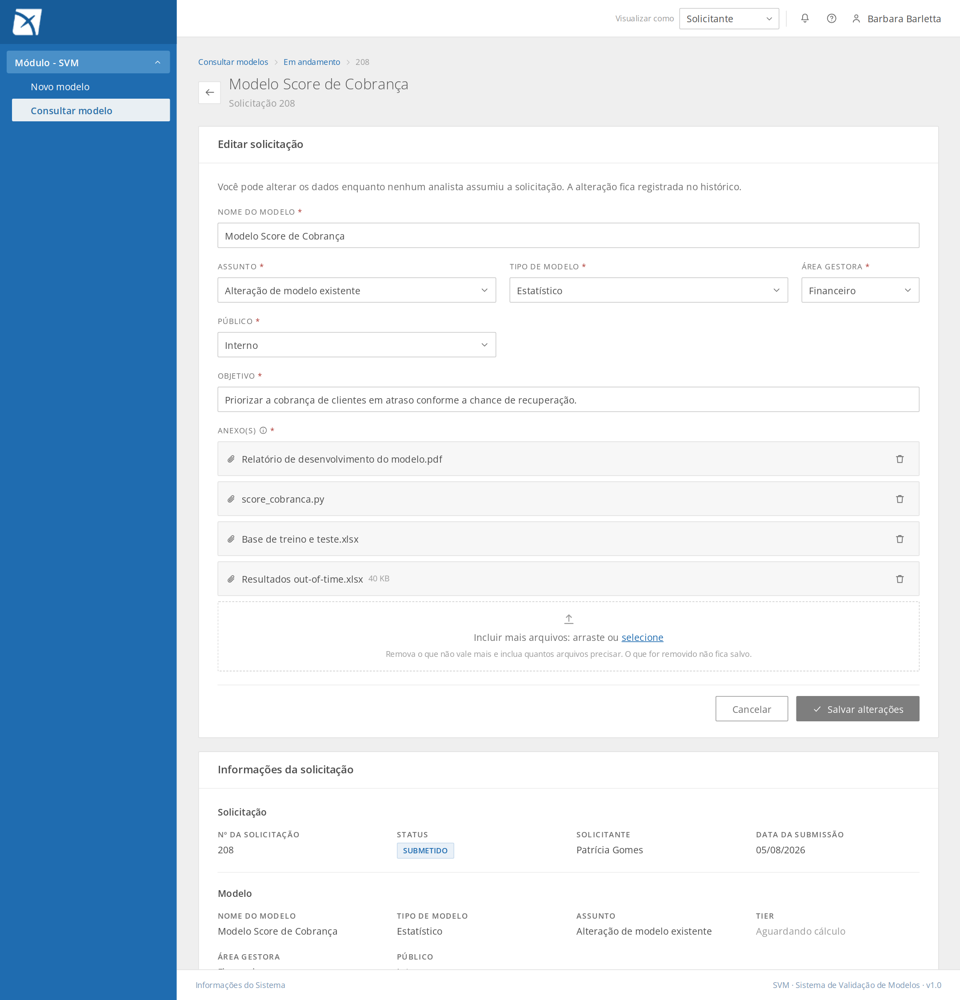

*Figura 5 – Formulário Editar solicitação, com os anexos já enviados (cada um com lixeira) e um anexo novo incluído.*

### HS-05. Responder a uma complementação

> **Como** solicitante, **quero** ver o que o analista pediu e enviar o que falta, **para** que a análise continue.

- **Onde:** abrir a solicitação (botão **Abrir**) > **Ações** > **Responder complementação**. Não há botão de complementar na lista; o aviso do topo de Em andamento mostra quais solicitações esperam resposta.
- **Disponível quando:** status **Em complementação**.
- **O que aparece:** o painel “O analista pediu uma complementação”, com autor, data, texto e anexo do pedido (pode ser o **TAP com as pendências** do relatório). A resposta é feita na janela (popup) aberta por Ações > Responder complementação.
- **O que acontece:**
  - Campos: “Anexo da complementação” (obrigatório) e “Observação para o analista” (opcional, até 500 caracteres).
  - “Enviar complementação”: o status volta para **Em análise** com o mesmo analista, e o histórico registra **um único registro**: “Complementação enviada pelo solicitante.”
- **Não é possível:** enviar sem anexo. Aparece “Anexe o documento solicitado pelo analista para enviar a complementação.”
- Se a resposta não resolver tudo, o analista pede uma nova complementação (HA-05). Não há prazo nem limite de rodadas.

*Figura 6 – Janela (popup) Responder complementação: pedido do analista e campos de resposta.*

### HS-06. Cancelar a solicitação

> **Como** solicitante, **quero** desistir da solicitação, **para** encerrar uma validação que não é mais necessária.

- **Onde:** dentro da solicitação, Ações > **Cancelar solicitação**.
- **Disponível quando:** enquanto a solicitação estiver em andamento: Submetido, Em análise ou Em complementação.
- **O que acontece:** campo “Justificativa” obrigatório (até 1.000 caracteres). Ao confirmar, o status vira **Cancelado**, a solicitação sai de Em andamento e a página mostra “Solicitação cancelada pelo solicitante”, com nome, data e justificativa. A justificativa fica visível para todos.
- **Não é possível:** cancelar sem justificativa (“Informe o motivo do cancelamento.”) ou desfazer o cancelamento.

*Figura 7 – Janela (popup) Cancelar solicitação (a mesma para os três perfis).*

### HS-07. Consultar os modelos inventariados e as solicitações canceladas

> **Como** solicitante, **quero** consultar os modelos inventariados da minha área e as solicitações que foram canceladas, **para** saber o resultado de cada uma e, se cancelada, o motivo.

- **Onde:** Consultar modelo > **Inventariado** e **Cancelado** (novas abas para o solicitante, com os **mesmos nomes** da GEVAM).
- **Inventariado:** é **a mesma aba Inventariado da GEVAM, com o mesmo nome**, mas só com os modelos da área do solicitante e só leitura. Sem filtro nem coluna “Status”.
  - No topo: “Exibindo modelos inventariados da área [área]”; o filtro Área gestora fica fixo na área dele.
  - **Cards informativos** (sem clique), contando **só os modelos da área dele**: Modelos inventariados, Validação GEVAM (Validados, Não validados), Monitoramento 2ª Linha (GEVAM) (Monitorados, Não monitorados) e Situação do modelo (Ativos, Inativos, Suspensos), com quantidade, percentual e barra.
  - Colunas: Modelo (nome e nº da solicitação), Tipo de modelo, Assunto, Validação GEVAM, Monitoramento 2ª Linha (GEVAM), Situação, Analista e Validado em. Filtros: Nº da solicitação, Nome do modelo, Assunto, Analista responsável, Validação GEVAM, Monitoramento 2ª Linha (GEVAM) e Situação do modelo.
  - **Abrir** leva à página do modelo, **só em modo leitura** (sem botões de ação). O caminho no topo mostra “Consultar modelos > Inventariado”.
- **Cancelado:** a mesma lista do analista e do gestor (HG-06), mas **só com as canceladas da área do solicitante** (“Exibindo solicitações canceladas da área Financeiro”); o filtro Área gestora fica fixo na área dele. **Abrir** leva à página da solicitação cancelada (justificativa, informações, histórico e arquivos), sem o botão Ações.
- **Não aparece para o solicitante:** botões de ação nas páginas abertas por essas abas (é tudo só leitura).

*Figura 8 – Aba Inventariado do solicitante: cards e lista só com os modelos da área dele.*

*Figura 9 – Aba Cancelado para o solicitante, só com a área dele.*

---

## 3. Analista GEVAM

### Fluxo do analista GEVAM

Seta grossa = ação deste perfil · seta fina = ação de outro perfil.

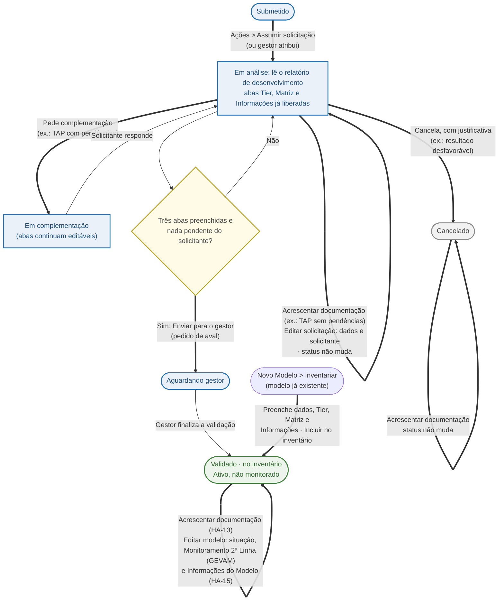

### HA-01. Ver as solicitações em andamento

> **Como** analista, **quero** ver todas as solicitações em andamento por status, **para** escolher o que assumir e acompanhar o que está comigo.

- **Onde:** Consultar modelo > Em andamento.
- **O que aparece:**
  - Quatro cards com a quantidade por status: **Novas submissões** (Submetido), **Em análise**, **Em complementação** e **Aguardando gestor** (novo). Os cards são só informativos: não são clicáveis e não filtram a lista (para filtrar, usar o filtro **Status da solicitação**).
  - Filtros: Nº da solicitação, **Status da solicitação** (novo: Todos, Submetido, Em análise, Em complementação e Aguardando gestor), Área gestora, Nome do modelo, Assunto e Analista responsável.
  - Os cards são **atalhos do filtro Status da solicitação**: clicar num card preenche o filtro com aquele status e aplica na hora; clicar de novo (ou em Limpar) volta para Todos. O card e o campo nunca ficam diferentes.
  - Em cada linha: só o botão **Abrir**. As ações (Acrescentar documentação, Pedir complementação, Enviar para o gestor e Cancelar) ficam no botão **Ações**, dentro da solicitação.
- Solicitações Validado e Cancelado saem desta lista e ficam nas abas **Inventariado** e **Cancelado** (HG-06).

*Figura 10 – Em andamento para o analista, com os quatro cards de status.*

### HA-02. Assumir uma solicitação

> **Como** analista, **quero** assumir uma solicitação nova e ficar responsável por ela, **para** começar a análise.

- **Onde:** abrir a solicitação “Submetido” e clicar em **Ações** > “Assumir solicitação”. Abrir sozinho não muda nada: enquanto ninguém assume, essa é a única opção do menu Ações, aparece o aviso “Esta solicitação ainda não tem analista responsável. Para analisá-la, clique em Ações > Assumir solicitação.” e as abas ficam só para leitura.
- **O que acontece:** o analista passa a ser o **analista responsável**, o status vira **Em análise**, o sistema grava a **data e hora da atribuição** e mostra “Solicitação atribuída a você.” O histórico registra “Solicitação atribuída a [analista].” Só então aparecem as outras ações no menu Ações e as abas **Cálculo do Tier, Matriz de Risco e Informações do Modelo** ficam liberadas para preenchimento.
- A solicitação também pode chegar ao analista por atribuição do gestor (HG-02).
- **Não é possível:** agir numa solicitação que está com outro analista. Aparece o aviso “Esta solicitação está em análise com [analista]. Só o analista responsável pode agir sobre ela.” e tudo fica em modo leitura.

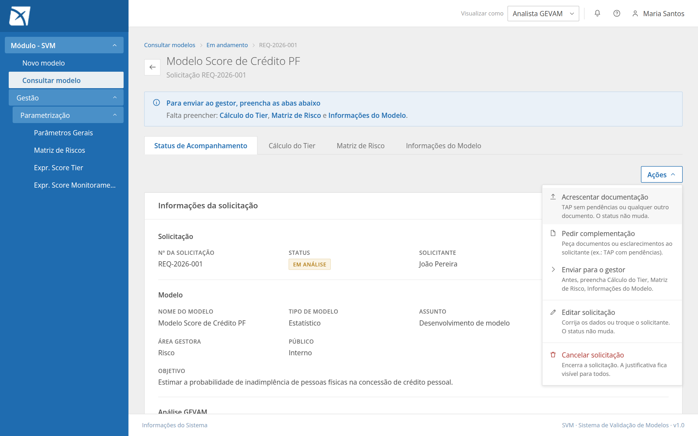

*Figura 11 – Solicitação recém-assumida: abas de análise liberadas e menu Ações do analista.*

### HA-03. Ver as informações, o histórico e os arquivos

> **Como** analista (e também gestor e solicitante), **quero** ver os dados da solicitação, o histórico e os documentos num só lugar, **para** não precisar procurar anexos no histórico.

- **Onde:** aba **Status de Acompanhamento** (primeira aba da solicitação).
- **Informações da solicitação**, em três blocos:
  - **Solicitação:** Nº da solicitação, Status, Solicitante e Data da submissão.
  - **Modelo:** Nome do modelo, Tipo de modelo, Assunto, Tier, Área gestora, Público e Objetivo (linha inteira).
  - **Análise GEVAM:** Analista responsável, Data de atribuição, Data de finalização da análise, Tempo de análise e Gestor GEVAM.

| Campo | Regra |
| --- | --- |
| Tier | Último cálculo ou recálculo, no formato “Gestão Moderada · 75 pontos”. **Se o analista alterar o Tier na Matriz de Risco, vale o Tier da matriz**, com a indicação “(definido na Matriz de Risco)”. Antes do cálculo: “Aguardando cálculo”. |
| Data de atribuição | Data e hora em que o analista assumiu ou foi atribuído (a mais recente, se houve reatribuição). |
| Data de finalização da análise | Data e hora do envio ao gestor. Vazia antes disso. |
| Tempo de análise | Dias corridos entre a atribuição e a finalização da análise, **descontando o tempo Em complementação**: o relógio pausa quando o analista pede um complemento e volta a contar quando o solicitante envia. Soma todas as rodadas. Enquanto não termina, conta até hoje e mostra “(em andamento)”; durante uma complementação mostra “(pausado: aguardando o solicitante)”. |
| Gestor GEVAM | Último gestor que atribuiu ou finalizou a validação. Vazio antes disso. |
| Status | O mesmo para todos os perfis (o solicitante também vê “Aguardando gestor”). |

- **Histórico da solicitação:** cada evento com data, descrição e autor. Textos enviados (pedido, observação, justificativa) aparecem citados, e os anexos aparecem no evento em que entraram, com botão de download.
- **Arquivos:** todos os documentos enviados e recebidos durante a validação, com nome, data, quem enviou e botão de download.

*Figura 12 – Informações da solicitação.*

*Figura 13 – Histórico da solicitação e Arquivos.*

### HA-04. Acrescentar documentação

> **Como** analista, **quero** incluir documentos na solicitação — o TAP sem pendências ou qualquer outro (por exemplo, recebido por Teams ou e-mail) —, **para** que tudo fique registrado.

- **Onde:** dentro da solicitação, Ações > **Acrescentar documentação**.
- **Disponível quando:** sempre, para o analista responsável, **em qualquer status** — inclusive Em complementação, Aguardando gestor e **Cancelado** (aberta pela aba **Cancelado**, HG-06). Para um modelo **Validado**, o botão fica na página do modelo, aberta pela aba **Inventariado** (HA-13).
- **O que acontece:** campos “Documento” (obrigatório) e “Descrição” (opcional, até 1.000 caracteres; ex.: “TAP sem pendências.”). O documento entra no histórico (“Documentação acrescentada pelo analista.”) e em Arquivos. **O status da solicitação não muda**: se está em análise, continua em análise; se está **Validado**, continua Validado; se está **Cancelado**, continua Cancelado.
- **Não é possível:** acrescentar sem anexar o documento (“Anexe o documento.”).
- O TAP **não é mais uma etapa controlada pelo sistema**: o TAP sem pendências entra por aqui, como qualquer documento, e não libera nem bloqueia nada.

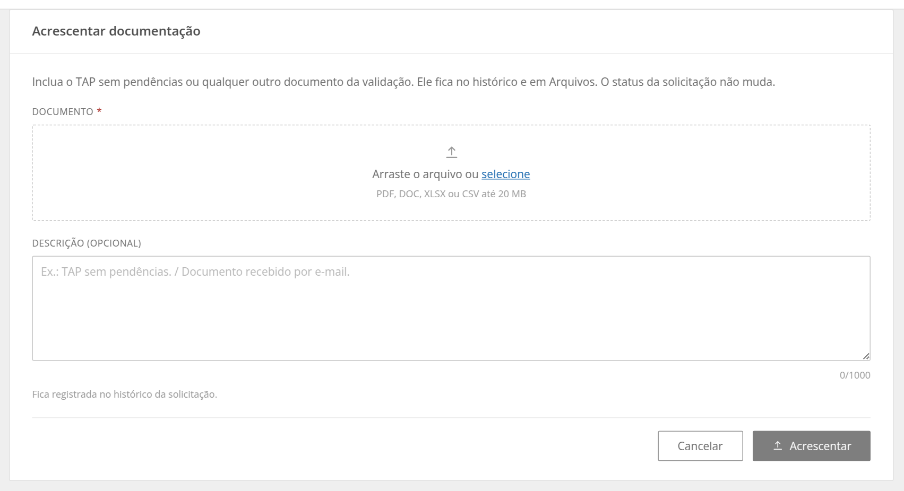

*Figura 14 – Acrescentar documentação.*

### HA-05. Pedir complementação

> **Como** analista, **quero** pedir documentos ou esclarecimentos ao solicitante — inclusive enviando o TAP com as pendências do relatório de desenvolvimento —, **para** completar a análise.

- **Onde:** dentro da solicitação, Ações > **Pedir complementação**.
- **Disponível quando:** Em análise, sendo o analista responsável.
- **O que acontece:** campos “Anexo para o solicitante” (obrigatório; ex.: o **TAP com pendências**, um documento com o pedido ou uma planilha a preencher) e “Observações” (opcional, até 1.000 caracteres). A observação é opcional porque o anexo costuma trazer as explicações. O status vira **Em complementação** e o histórico registra “Complementação solicitada ao solicitante.” Quando o solicitante responde, volta para **Em análise**.
- Se a resposta não resolver tudo, o analista faz um novo pedido de complementação (não há novo TAP). Não há prazo nem limite de rodadas.
- **Não é possível:** pedir de novo enquanto a solicitação já está “Em complementação” (o item não aparece no menu); enviar sem anexo (“Anexe o arquivo para enviar.”).

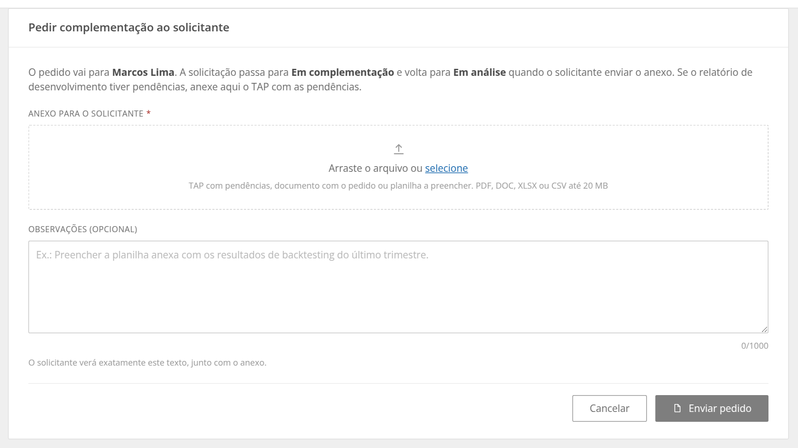

*Figura 15 – Pedir complementação ao solicitante.*

### HA-06. Preencher as abas de análise

> **Como** analista, **quero** preencher Cálculo do Tier, Matriz de Risco e Informações do Modelo assim que assumo a solicitação, **para** adiantar a análise.

- **Quando:** as três abas ficam **liberadas desde a atribuição** (o analista assume em Ações > “Assumir solicitação”, ou o gestor atribui). Não dependem do TAP.
- **Quem edita:** só o analista responsável, enquanto a solicitação está **Em análise** ou **Em complementação**. Depois do envio ao gestor (e para gestor, solicitante e outros analistas) ficam em modo leitura.
- **Para enviar ao gestor:** as três abas precisam estar preenchidas (HA-11). Enquanto faltar alguma, aparece no topo “Para enviar ao gestor, preencha as abas abaixo — Falta preencher: …”, com links para as abas.

### HA-07. Calcular o Tier

> **Como** analista, **quero** informar os parâmetros do modelo e calcular o Tier, **para** classificar o nível de gestão do modelo.

- **Onde:** aba **Cálculo do Tier** (liberada desde a atribuição).
- **O que acontece:**
  - Parâmetros, todos obrigatórios: Materialidade, Impacto na decisão, Complexidade, O modelo utiliza novo algoritmo?, O modelo foi desenvolvido para novo produto?, Implementação automatizada via sistema?
  - “Calcular Tier” registra o cálculo e mostra “Resultado do cálculo” e “Tier cálculo”.
  - Depois aparecem “Ajustes de MRM” (pontos inteiros, positivos ou negativos) e “Override” (forçar um Tier). O botão vira “Recalcular” e mostra “Resultado do recálculo” e “Tier recálculo”.
  - **Tiers:** Gestão Flexível, Gestão Moderada e Gestão Rigorosa.
  - **Histórico cálculo e recálculo:** Descrição, Resultado, Tier, MRM, Override, Data e Usuário; cada linha expande para mostrar os parâmetros.
- **Não é possível:** calcular com parâmetro vazio; informar MRM que não seja número inteiro (“Informe um número inteiro de pontos (ex.: 5 ou -10).”).
- A fórmula de pontuação e as faixas serão **as mesmas já existentes no SVM**.

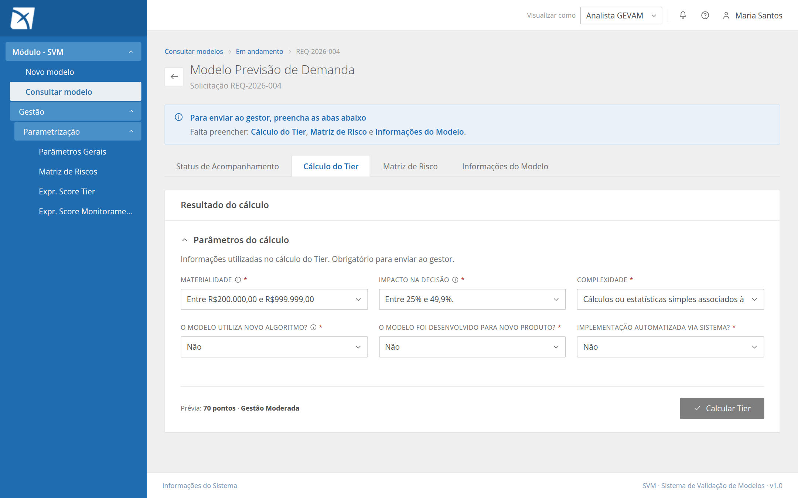

*Figura 16 – Cálculo do Tier: parâmetros.*

*Figura 17 – Cálculo do Tier: resultado.*

### HA-08. Preencher a Matriz de Risco

> **Como** analista, **quero** registrar a nota de classificação do modelo, **para** obter a classificação de risco.

- **Onde:** aba **Matriz de Risco**.
- **O que acontece:**
  - Campos: “Prazo de revalidação (meses)” e “Alçada sugerida” (opcionais), “Tier” e “Nota de classificação” (obrigatórios) e “Classificação de risco” (calculada, só leitura).
  - O **Tier** vem preenchido com o resultado do Cálculo do Tier; o analista pode alterá-lo só na matriz.
  - **Nota de classificação:**
    - A - O modelo e o seu entorno atendem plenamente aos seus objetivos em todos os aspectos avaliados.
    - B - O modelo e o seu entorno atendem aos seus objetivos com oportunidades de melhorias em alguns de seus componentes ou critérios avaliados.
    - C - O modelo e o seu entorno atendem aos seus objetivos com falhas mínimas em alguns de seus componentes ou critérios avaliados.
    - D - O modelo e/ou seu entorno atendem parcialmente a seus objetivos com falhas importantes em componente central que demandam ação corretiva tempestiva.
    - E - O modelo e/ou seu entorno não atendem aos seus objetivos com falhas cuja somatória compromete as suas estimativas, sendo recomendado sua desativação a uso.
  - “Calcular” na primeira vez; depois “Recalcular” e “Cancelar” (volta aos valores salvos; os dois só ficam ativos quando algo mudou).
  - **Histórico Matriz de Risco:** Descrição, Tier, Nota, Classificação de risco, Prazo (meses), Alçada sugerida, Data e Usuário.
- A tabela Tier × Nota → Classificação de risco será **a mesma já existente no SVM**.

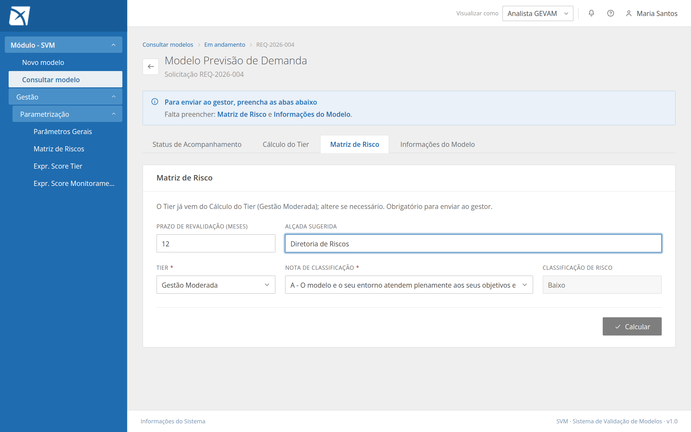

*Figura 18 – Matriz de Risco.*

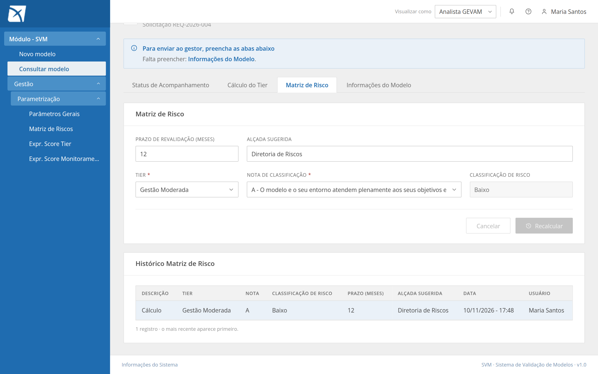

*Figura 19 – Matriz de Risco depois de calcular, com o histórico.*

### HA-09. Preencher as Informações do Modelo

> **Como** analista, **quero** registrar as informações-chave do modelo, **para** consultar depois sem reler o relatório de desenvolvimento.

- **Onde:** aba **Informações do Modelo**.
- **O que acontece:** seções em texto livre (até 4.000 caracteres cada). Cada título tem um ícone (i) com uma dica, exibida ao passar o mouse ou ao focar com o teclado. “Salvar” grava as seções.

| Seção | Obrigatória | Dica (tooltip) |
| --- | --- | --- |
| Contextualização | Sim | Qual o objetivo do modelo e a justificativa para ele existir, o público e a carteira em que é aplicado, e se substitui outro modelo (qual e por quê). |
| Metodologia | Sim | Quais técnicas foram utilizadas (regressão logística, SARIMAX, árvore de decisão, XGBoost, redes neurais…), a variável resposta ou evento e o horizonte. |
| Resultados | Sim | Valores dos indicadores de performance (KS, AUROC, acurácia, MAPE…) associados a cada período (desenvolvimento, teste, out-of-time) e os valores dos testes realizados. |
| Monitoramento da 1ª linha | Sim | Qual monitoramento será realizado pela área solicitante: indicadores acompanhados, periodicidade e limites de alerta. |
| Monitoramento da 2ª linha | Sim | Qual monitoramento será realizado pela GEVAM e com quais indicadores (e com que periodicidade). |
| Observações | Não | Informações complementares que não se encaixam nas seções anteriores. |

- **Não é possível:** salvar com seção obrigatória vazia (“Campo obrigatório”).

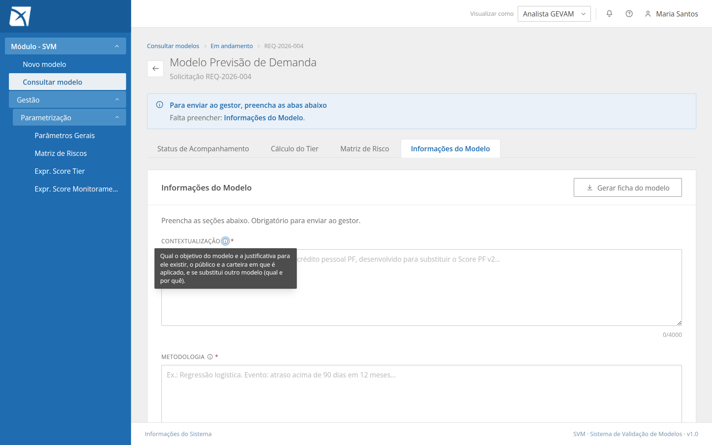

*Figura 20 – Informações do Modelo, com a dica da Contextualização aberta.*

### HA-10. Gerar a ficha do modelo

> **Como** analista ou gestor, **quero** gerar a ficha do modelo, **para** ter um resumo para consulta e para anexar a documentos.

- **Onde:** botão **Gerar ficha do modelo**, no topo da aba Informações do Modelo (analista e gestor).
- **O que acontece:** abre a pré-visualização do “Relatório Individual de Modelo”, com “Baixar Excel” e “Imprimir / PDF”. A ficha usa os dados **salvos** e tem, nesta ordem:
  1. Cabeçalho: Nome do Modelo, Assunto, Tipo de Modelo, Público, Situação do Modelo, Área Gestora, Data da Validação (= data de finalização da análise) e Objetivo.
  2. Cálculo do Tier: Materialidade, Impacto, Complexidade, Novo Algoritmo?, Novo Produto?, Automatizado?, MRM, Override e Tier (cálculo / recálculo).
  3. Matriz de Risco: Validado, Nota de Classificação, Classificação de Risco, Prazo de Revalidação (meses), Alçada Sugerida e Analista.
  4. Informações do Modelo: as seções de texto.
- **Baixar Excel:** gera um arquivo **.xlsx** de verdade (não o HTML que o Excel abria com aviso de formato), com o **logo do BRB** no topo, ao lado do título, e o mesmo layout da pré-visualização: células mescladas, bordas, títulos de seção em azul-claro e texto com quebra de linha. Nome do arquivo: `Ficha_[nº da solicitação]_[nome do modelo].xlsx`. A pré-visualização e a impressão também mostram o logo.
- **Modelo da planilha:** `handoff/ficha-do-modelo.xlsx` traz o layout da ficha, com o logo do BRB no canto superior esquerdo e os campos marcados (aba “Modelo da ficha”), um exemplo preenchido e a origem de cada campo no SVM (aba “Mapeamento de campos”).

*Figura 21 – Pré-visualização da ficha do modelo.*

### HA-11. Enviar para o gestor

> **Como** analista, **quero** enviar a análise concluída ao gestor, **para** que ele finalize a validação.

- **Onde:** dentro da solicitação, Ações > **Enviar para o gestor**.
- **Disponível quando:** Em análise, sendo o analista responsável, **sem pendências**: Cálculo do Tier, Matriz de Risco e Informações do Modelo preenchidos e nenhuma complementação em aberto.
- **O que acontece:** o analista confirma o envio; **não há anexo nem parecer** — ele está pedindo o aval do gestor, que lê os documentos já disponíveis em Arquivos. O status vira **Aguardando gestor**, o sistema grava a **data e hora de finalização da análise** e o histórico registra “Análise concluída e enviada para o gestor. Aval solicitado.”
- **Não é possível:**
  - Enviar com aba pendente: aparece “Preencha as abas pendentes para enviar ao gestor”, com links para as abas que faltam.
  - Enviar com a solicitação “Em complementação”: “Aguardando o solicitante.”

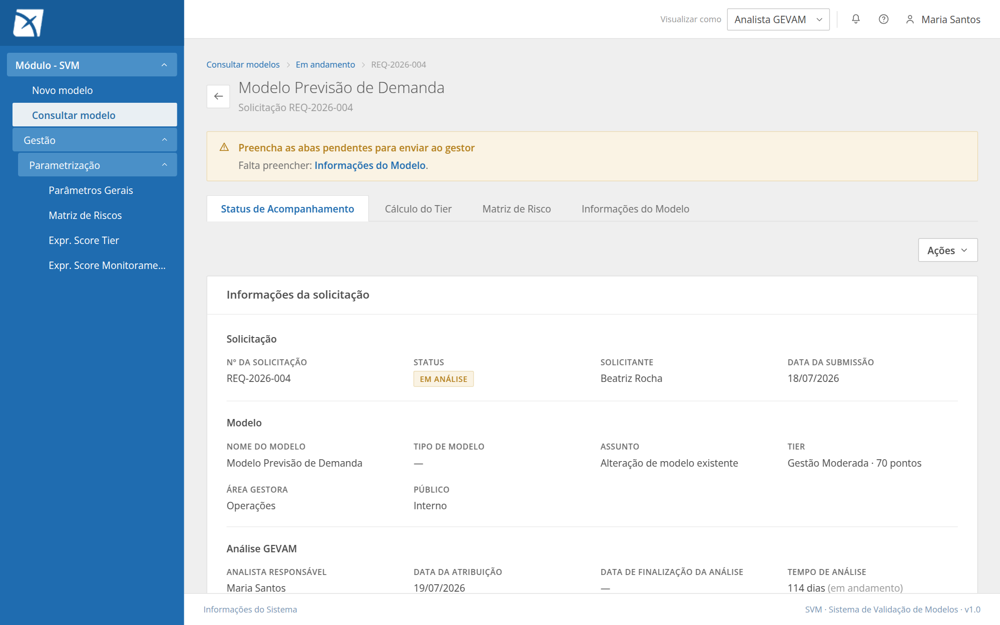

*Figura 22 – Aviso de abas pendentes.*

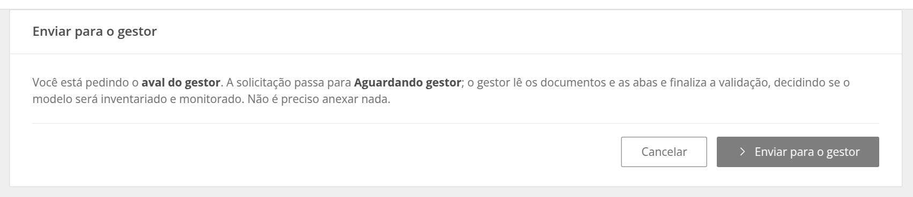

*Figura 23 – Confirmação do envio ao gestor (sem anexo).*

### HA-12. Cancelar a solicitação

> **Como** analista responsável, **quero** cancelar a solicitação, **para** encerrar uma validação com resultado desfavorável ou que não vai prosseguir.

- **Onde:** dentro da solicitação, Ações > **Cancelar solicitação** (formulário da Figura 7).
- **Disponível quando:** qualquer status em andamento, sendo o analista responsável (ou numa solicitação ainda “Submetido”).
- **O que acontece:** igual a HS-06; a página mostra “Solicitação cancelada pelo analista”.
- **Não é possível:** cancelar solicitação de outro analista (“Só o analista responsável ([analista]), o gestor ou o solicitante cancelam.”).
- Resultado desfavorável da validação **não** tem status próprio: a solicitação é cancelada.

### HA-13. Acrescentar documentação em um modelo inventariado

> **Como** analista, **quero** anexar ao histórico de um modelo inventariado um documento recebido por Teams ou e-mail, **para** manter a documentação completa.

- **Onde:** Consultar modelo > Inventariado > abrir o modelo > **Acrescentar documentação**.
- **O que acontece:** campos “Documento” e “Recebido por” (obrigatórios) e “Observações” (opcional). O documento entra no histórico e em Arquivos.
- **Não é possível:** salvar sem documento (“Anexe o documento.”) ou sem informar por onde chegou (“Informe por onde o documento chegou.”).

### HA-14. Editar a solicitação (inclusive trocar o solicitante)

> **Como** analista (ou gestor), **quero** corrigir os dados informados pelo solicitante e, se for preciso, trocar o solicitante, **para** que a solicitação reflita a realidade sem precisar cancelar e abrir outra.

- **Onde:** dentro da solicitação, Ações > **Editar solicitação**. Não há item separado para trocar o solicitante: ele é um campo deste formulário.
- **Disponível quando:** qualquer status em andamento (Submetido, Em análise, Em complementação, Aguardando gestor), para o **analista responsável** e para o **gestor**. Não vale em Validado nem Cancelado. O analista, numa Submetido, precisa assumir antes (HA-02).
- **Analista só altera o que ele mesmo inseriu:** para o analista, só o campo **Solicitante** fica editável; os dados informados pelo solicitante aparecem desabilitados (só leitura). O que o analista inseriu é corrigido onde foi inserido (Cálculo do Tier e Matriz de Risco por recálculo, Informações do Modelo e Acrescentar documentação). O gestor segue a mesma regra (HG-08).
- **O que aparece:** o mesmo formulário do solicitante (HS-04), com o campo **Solicitante** no topo (obrigatório; vem preenchido com o atual) e depois Nome do modelo, Assunto, Tipo de modelo, Área gestora, Público e Objetivo, todos obrigatórios. **Não** há o campo de substituir o relatório de desenvolvimento (documentos novos entram por Acrescentar documentação). Quando o solicitante é trocado, aparece abaixo dos campos: “O solicitante passa de [anterior] para [novo], que passa a acompanhar a solicitação e a responder às complementações.”
- **O que acontece:** “Salvar alterações” grava; o status não muda. O histórico registra **um único registro**: “Solicitação editada pelo analista.” (ou “pelo gestor GEVAM.”). Se o solicitante foi trocado, o registro traz o detalhe “Solicitante: [anterior] → [novo].”
- **Não é possível:** salvar com campo vazio (“Campo obrigatório”).
- Para o **solicitante**, “Editar solicitação” continua valendo só em Submetido (HS-04), sem o campo Solicitante.

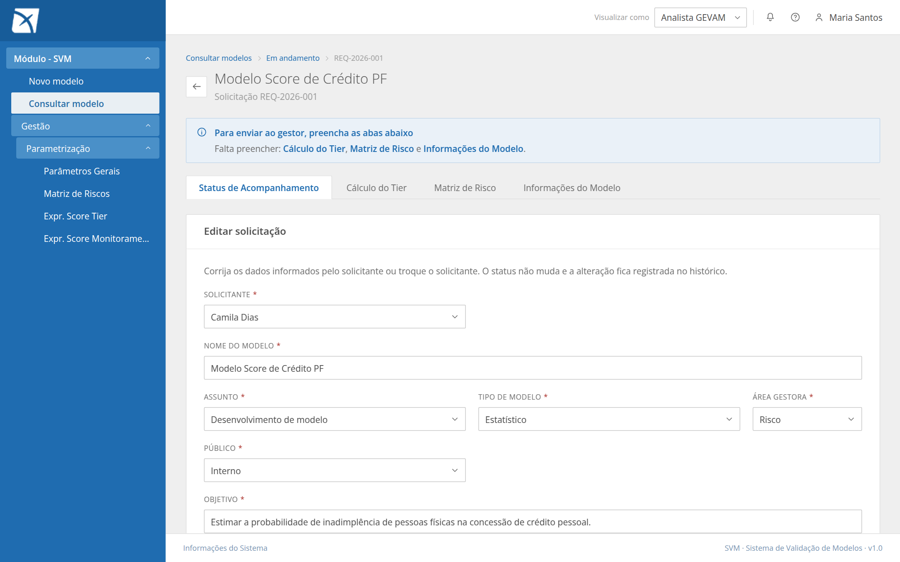

*Figura 24 – Editar solicitação pelo analista, com o campo Solicitante.*

### HA-15. Editar o modelo inventariado

> **Como** analista (ou gestor), **quero** alterar a situação e a validação GEVAM de um modelo do inventário, indicar se ele é monitorado pela GEVAM e atualizar os textos de Informações do Modelo, **para** manter o inventário em dia depois da validação.

- **Onde:** Consultar modelo > Inventariado > abrir o modelo > botão **Editar modelo** (no topo da página).
- **Disponível quando:** sempre, para **analista** e **gestor**, em qualquer modelo do inventário. O solicitante só consulta.
- **Como o modelo entra no inventário:** todo modelo validado pelo gestor entra como **Ativo** e **não monitorado** (HG-04).
- **O que acontece:** abre o painel “Editar modelo” com:
  - **Situação do modelo** (obrigatório): Ativo, Inativo ou Suspenso.
  - **Validação GEVAM** (obrigatório): Validado ou Não validado.
  - **Monitoramento 2ª Linha (GEVAM)**: toggle Sim / Não. Indica se a 2ª linha acompanha o modelo; o acompanhamento é feito fora do sistema.
  - **Informações do Modelo**: as mesmas seções de texto da HA-09, já preenchidas, com as mesmas regras (obrigatórias e até 4.000 caracteres).
- **Salvar alterações** grava e registra no histórico **um único registro**: “Modelo editado no inventário.”, com o resumo do que mudou no detalhe (ex.: “Situação: Ativo → Suspenso · Validação GEVAM: Não validado → Validado · Monitoramento 2ª Linha (GEVAM): Não → Sim · Informações do Modelo atualizadas”) e o nome de quem alterou. **Cancelar** fecha sem gravar.
- **Não é possível:** salvar com seção obrigatória de Informações do Modelo vazia (“Campo obrigatório”).
- **Nem todo modelo do inventário foi validado:** modelos antigos, que entraram sem passar pela avaliação da GEVAM, ficam com Validação GEVAM = **Não validado** (e podem ser monitorados). Toda solicitação Validado entra como **Validado**.

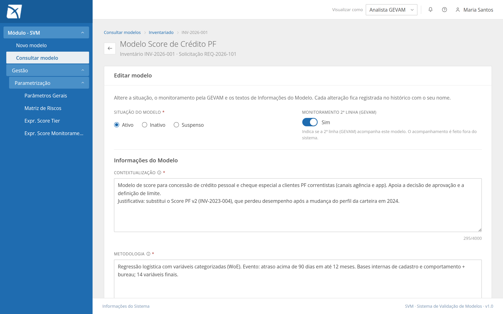

*Figura 25 – Editar modelo: situação, Monitoramento 2ª Linha (GEVAM) e Informações do Modelo.*

---

## 4. Gestor GEVAM

### Fluxo do gestor GEVAM

Seta grossa = ação deste perfil · seta fina = ação de outro perfil.

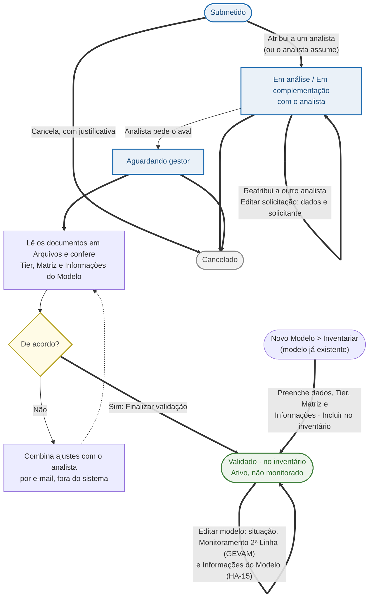

### HG-01. Ver as solicitações em andamento

> **Como** gestor, **quero** ver todas as solicitações e quantas estão em cada status, **para** distribuir o trabalho e saber o que aguarda minha decisão.

- **Onde:** Consultar modelo > Em andamento (mesma tela do analista, Figura 10), com os mesmos filtros, inclusive **Status da solicitação** (HA-01). O card **Aguardando gestor**, ou o filtro com esse status, mostra o que depende do gestor.
- Na lista há só o botão **Abrir**. Finalizar validação, Atribuir / Reatribuir e Cancelar ficam dentro da solicitação.

### HG-02. Assumir, atribuir ou reatribuir uma solicitação

> **Como** gestor, **quero** assumir eu mesmo uma solicitação, atribuí-la a um analista ou trocar o analista responsável, **para** distribuir a carga de trabalho.

- **Onde:** dentro da solicitação, Ações > **Assumir solicitação** ou **Atribuir a um analista** (solicitação “Submetido”), ou **Reatribuir analista** (solicitação em andamento).
- **Assumir:** igual ao analista (HA-02). O gestor passa a ser o responsável, o status vira **Em análise** e o histórico registra “Solicitação atribuída a [gestor].” A partir daí ele faz **a mesma coisa que um analista**: as abas de análise ficam liberadas para ele e o menu Ações traz Acrescentar documentação, Pedir complementação e Enviar para o gestor. Ele continua podendo reatribuir para um analista.
- **O que acontece:** campo “Analista” (obrigatório; lista sem o analista atual).
  - **Atribuir:** o status vira **Em análise** com o analista escolhido; grava a data de atribuição e o gestor GEVAM. Histórico: “Solicitação atribuída a [analista] pelo gestor.”
  - **Reatribuir:** o status não muda; mudam o analista responsável e a data de atribuição. Histórico: “Solicitação reatribuída de [anterior] para [novo] pelo gestor.”
- **Não é possível:** atribuir sem escolher o analista (“Escolha o analista.”); atribuir solicitação Validado ou Cancelado.
- O analista não atribui a outra pessoa: ele só assume a solicitação para si (Ações > “Assumir solicitação”, HA-02).

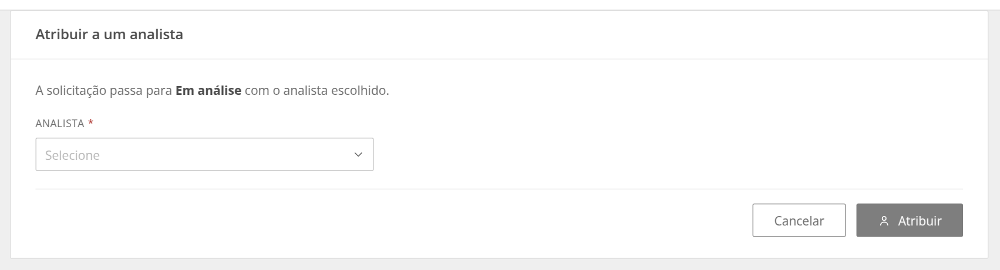

*Figura 26 – Atribuir a um analista.*

### HG-03. Conferir a análise

> **Como** gestor, **quero** ler os documentos e conferir as abas preenchidas pelo analista, **para** dar o aval com segurança.

- **Onde:** abrir uma solicitação “Aguardando gestor”.
- **O que aparece:** painel “Aval solicitado pelo analista” (quem enviou e quando, com a orientação de ler os documentos em Arquivos); as abas Cálculo do Tier, Matriz de Risco e Informações do Modelo **em modo leitura**; o botão “Gerar ficha do modelo” (HA-10).
- **Não é possível:** editar as abas ou devolver ao analista pelo sistema. Ajustes são combinados por e-mail antes do aval.

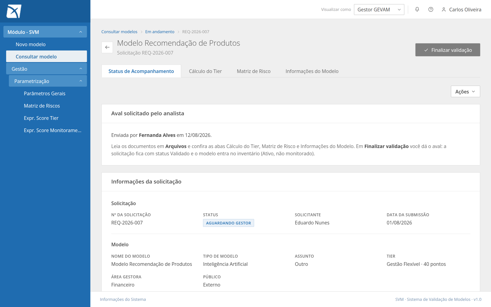

*Figura 27 – Solicitação Aguardando gestor, com o aviso de aval solicitado e o botão Finalizar validação.*

### HG-04. Finalizar a validação

> **Como** gestor, **quero** dar o aval à validação, **para** concluir a validação independente e incluir o modelo no inventário.

- **Onde:** botão **Finalizar validação** no topo da página da solicitação.
- **Disponível quando:** status **Aguardando gestor**. Vale também quando o próprio gestor assumiu e analisou a solicitação (HG-02): ele envia para o gestor e ele mesmo finaliza.
- **O que acontece:** abre uma confirmação “Finalizar validação”, que mostra a Matriz de Risco do analista (Tier, nota e classificação). **Não há perguntas**: todo modelo validado entra no inventário.
- Ao confirmar, o status vira **Validado**, a solicitação sai de Em andamento e a página mostra “Solicitação finalizada” (Resultado e Validado por).
  - O modelo entra em Consultar modelo > Inventariado com o **mesmo número da solicitação** (não há numeração própria de inventário), situação **Ativo**, **não monitorado** e Validação GEVAM **Validado**, levando os dados de Cálculo do Tier, Matriz de Risco e Informações do Modelo. O histórico registra “Solicitação validada pelo gestor. Modelo incluído no inventário.”
  - Situação e monitoramento são alterados depois, na página do modelo (HA-15).
- **Cancelar**, na confirmação, fecha sem validar.

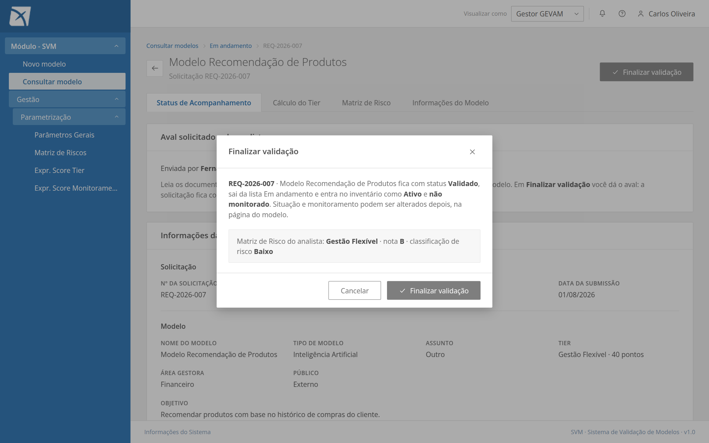

*Figura 28 – Confirmação de Finalizar validação.*

### HG-05. Cancelar a solicitação

> **Como** gestor, **quero** cancelar uma solicitação, **para** encerrar uma validação que não vai prosseguir.

- **Onde:** dentro da solicitação, Ações > **Cancelar solicitação** (formulário da Figura 7).
- **Disponível quando:** qualquer status em andamento.
- **O que acontece:** igual a HS-06; a página mostra “Solicitação cancelada pelo gestor GEVAM”.

### HG-06. Consultar inventário e cancelados

> **Como** gestor (ou analista), **quero** consultar os modelos do inventário e as solicitações canceladas, **para** acompanhar a carteira de modelos.

- **Onde:** Consultar modelo > **Inventariado** e **Cancelado**. O solicitante também tem as duas abas, com os mesmos nomes: só a área dele e só leitura (HS-07).
- **Inventariado:** lista **todos os modelos do inventário**: toda solicitação Validado entra nele (como Validado), e há modelos antigos que entraram sem avaliação da GEVAM (Não validado). Não há filtro nem coluna “Status”.
  - **Abrir** leva à página do modelo, onde analista e gestor acrescentam documentação (HA-13) e editam o modelo (HA-15).
  - A coluna “Inventariado em” virou **“Validado em”** (“—” para os não validados); o filtro de número é o nº da solicitação (o modelo no inventário tem o mesmo número).
  - Cards **informativos** (sem clique): Modelos inventariados, Validação GEVAM (Validados, Não validados), Monitoramento 2ª Linha (GEVAM) (Monitorados, Não monitorados) e Situação do modelo (Ativos, Inativos, Suspensos), com quantidade, percentual e barra.
  - **Validação GEVAM** (Validado / Não validado) substitui o antigo “Resultado da validação”, com card, filtro e coluna. Resultado desfavorável de uma solicitação continua virando **Cancelado** (não entra no inventário); “Não validado” é só para modelos antigos que estão no inventário sem avaliação da GEVAM.
  - Filtros novos: “Validação GEVAM” (Todos, Validados, Não validados), “Monitoramento 2ª Linha (GEVAM)” (Todos, Monitorados, Não monitorados) e “Situação do modelo” (Todos, Ativos, Inativos, Suspensos). Os filtros em uso aparecem como etiquetas acima da tabela, removíveis pelo X.
- **Cancelado:** lista com a coluna nova **“Cancelada por”** (Analista, Gestor GEVAM ou Solicitante) e a justificativa. **Abrir** leva à **página própria da solicitação** (não há mais painel lateral), com o painel “Solicitação cancelada pelo …” (autor, data e justificativa), as informações, o histórico e os arquivos. O analista responsável pode acrescentar documentação; o status continua Cancelado.

*Figura 29 – Inventariado, com os cards informativos e os filtros novos.*

*Figura 30 – Cancelado, com a coluna “Cancelada por” e o botão Abrir.*

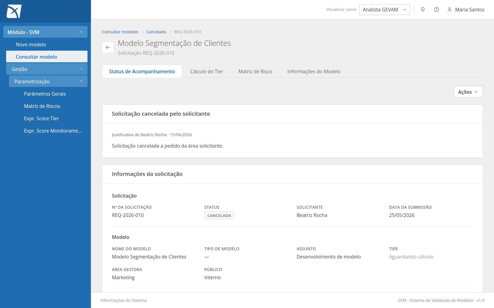

*Figura 31 – Página de uma solicitação cancelada.*

### HG-07. Inventariar um modelo existente (gestor e analista)

> **Como** gestor ou analista, **quero** registrar direto no inventário um modelo que já existe, **para** que ele passe a constar no inventário da GEVAM.

- **Onde:** Novo Modelo > Inventariar.
- **O que acontece:** as mesmas abas da solicitação, nesta ordem: “Inventariar” (dados do modelo) → “Cálculo do Tier” → “Matriz de Risco” → “Informações do Modelo”. Cada aba só libera a seguinte quando está completa; o botão final é “Incluir no inventário”. Na aba Inventariar há o campo obrigatório **“Validado pela GEVAM?”** (Sim / Não): modelos antigos podem entrar no inventário sem terem passado pela avaliação da GEVAM.

### HG-08. Trocar o solicitante e trocar o analista

> **Como** gestor, **quero** trocar o solicitante e trocar o analista responsável, **para** manter a solicitação com as pessoas certas sem cancelar e abrir outra.

- **Trocar o solicitante:** Ações > **Editar solicitação**, igual ao analista (HA-14). Só o campo **Solicitante** é editável; os dados informados pelo solicitante (Nome do modelo, Assunto, Tipo de modelo, Área gestora, Público e Objetivo) ficam **só para leitura**. O histórico registra “Solicitação editada pelo gestor GEVAM.”, com o detalhe “Solicitante: [anterior] → [novo].”
- **Trocar o analista:** Ações > **Reatribuir analista** (HG-02). **Só o gestor** troca o analista: o analista não passa a solicitação para outro analista.
- **Disponível quando:** qualquer status em andamento.

---

## 5. Back-end e regras

- **Transições de status** feitas no servidor, junto com o registro no histórico, numa única operação. A tabela completa está em `docs/fluxos-solicitacao.md`.
- **Permissões validadas no servidor**, conforme as tabelas da seção 1: só o analista responsável age sobre a solicitação; as abas de análise são editáveis por ele em Em análise e Em complementação; a complementação só é respondida pelo solicitante e com anexo; o envio ao gestor só ocorre sem pendências; “Finalizar validação” só pelo gestor em Aguardando gestor e sempre cria o registro no inventário (Ativo, não monitorado); editar o modelo inventariado só por analista e gestor; o cancelamento só em status em andamento e com justificativa; o solicitante só lê o inventário (sem Validadas fora do inventário) e as canceladas da área dele, sem acrescentar documentação nem alterar situação.
- **TAP:** é um documento como outro qualquer. O TAP sem pendências entra por Acrescentar documentação; o TAP com pendências, como anexo de um pedido de complementação. Não há etapa de TAP no fluxo de status e ele não libera nem bloqueia as abas.
- **Acrescentar documentação** nunca altera o status, em nenhum status.
- **Novos dados da solicitação:** data/hora de atribuição, data/hora de finalização da análise, gestor GEVAM, cancelamento (data, autor, perfil e justificativa), histórico de Cálculo do Tier, histórico de Matriz de Risco e Informações do Modelo (seis textos).
- **Anexo(s) da solicitação:** vários arquivos por envio, de qualquer tipo (o tipo não é conferido), pelo menos um. Na edição (status Submetido), o solicitante remove anexos já enviados, que são **apagados** (não ficam no histórico nem em Arquivos), e inclui novos; o evento da edição guarda os novos.
- **Anexos:** gravar o arquivo, ligar ao evento do histórico e servir o download. Limite de 20 MB por arquivo. Fora o Anexo(s) da solicitação, os demais campos de anexo seguem com PDF, DOC, DOCX, XLSX e CSV.
- **Nº da solicitação:** só o número, sem prefixo nem traços (ex.: 244). O modelo no inventário usa **o mesmo número**; não existe mais o nº de inventário INV-AAAA-NNN. Modelo inventariado direto (Novo Modelo > Inventariar) recebe um número da mesma sequência.
- **Tempo de análise:** calculado a partir do histórico — dias corridos da atribuição até o envio ao gestor, menos os dias entre cada “Complementação solicitada” e a “Complementação enviada” seguinte (todas as rodadas).
- **Tier exibido:** o Tier da última Matriz de Risco, quando houver; senão, o do último cálculo/recálculo.
- **Editar solicitação (GEVAM):** analista responsável e gestor, em qualquer status em andamento, editam os dados e trocam o solicitante no mesmo formulário; nunca muda o status; o histórico registra quem fez e só o que mudou. O novo solicitante passa a receber as notificações.
- **Ficha do modelo:** exportação em .xlsx real com o logo do BRB.
- **Histórico:** cada ação gera **um único registro** no histórico (sem registros automáticos extras, como “retornou para análise”).
- **Notificações:** o solicitante é notificado quando o status muda, principalmente quando entra em complementação.

### 5.1. De-para dos status (dados que já existem no sistema)

Os status e o resultado da validação mudaram. Na migração, os registros atuais passam a ter:

| Antes | Agora | Observação |
| --- | --- | --- |
| Status “Finalizada e no inventário” (Validada e inventariada) | **Validado** | Continua no inventário, com a situação e o monitoramento que já tinha. |
| Status “Validada” (fora do inventário) | **Validado** | Como todo Validado está no inventário, passa a constar nele: situação **Ativo**, **não monitorado** (ver ponto a confirmar 2). |
| Resultado da validação “Não validado”, vindo de uma solicitação que a GEVAM reprovou | **Cancelado** | Resultado desfavorável = cancelamento. O registro sai do inventário e vai para a aba Cancelado. |
| Resultado da validação “Não validado”, de modelo antigo inventariado sem avaliação da GEVAM | **Validação GEVAM = Não validado** | Continua no inventário, com a situação e o monitoramento que já tinha. |
| Resultado da validação “Validado” | **Validação GEVAM = Validado** | O campo passa a se chamar Validação GEVAM. |
| Status “Cancelada” | **Cancelado** | Só muda o nome. |
| Monitoramento “Em monitoramento” | **Monitoramento 2ª Linha (GEVAM) = Sim** | Toggle na página do modelo. |
| Monitoramento “Não monitorado” ou “Não se aplica” | **Monitoramento 2ª Linha (GEVAM) = Não** | “Não se aplica” deixa de existir. |
| Submetido, Em análise, Em complementação, Aguardando gestor | Sem mudança | — |

Tipos de referência: `Solicitacao`, `TimelineEvent`, `CalculoTier`, `MatrizRisco` e `InformacoesModelo` em `src/types.ts`. Regras de permissão: `src/pages/ConsultarModelo/fluxo.ts`.

## 6. Pontos a confirmar

1. [ ] “Prazo de revalidação” e “Alçada sugerida” são digitados pelo analista (como no protótipo) ou calculados a partir do Tier e da classificação?
2. [ ] **Migração das “Validada” fora do inventário (seção 5.1):** pela regra nova elas entram no inventário como Ativo e não monitorado. Confirmar se é isso mesmo ou se alguma deve ser tratada de outro jeito.
3. [ ] **Migração dos “Não validado” que vieram de solicitação reprovada (seção 5.1):** como distinguir dos modelos antigos sem avaliação (ex.: ter ou não uma solicitação de origem)? E, na aba Cancelado, quem aparece em “Cancelada por” e qual justificativa? Sugestão: “Gestor GEVAM” e “Não validado na validação independente (migração)”.

**Decididos nesta revisão:** os status finais passam a ser **Validado** e **Cancelado**; todo modelo validado entra no inventário como Ativo e não monitorado, sem perguntas na finalização; analista e gestor editam no inventário a situação, o Monitoramento 2ª Linha (GEVAM) (toggle) e as Informações do Modelo; o antigo “Resultado da validação” vira **Validação GEVAM** (Validado / Não validado: modelos antigos podem estar no inventário sem validação), editável em Editar modelo; o solicitante tem a aba Inventariado (mesmo nome da GEVAM), só com a área dele e só leitura; cada ação gera um único registro no histórico; o Tempo de análise pausa durante a complementação; o Tier das Informações da solicitação segue a Matriz de Risco; Editar solicitação continua para analista responsável e gestor, e é nele que se troca o solicitante (não há item “Alterar solicitante”); na lista do solicitante não há botão Complementar: responder fica em Ações > Responder complementação, e o aviso do topo indica o que está pendente; o solicitante vê o status Aguardando gestor; a ficha é exportada em .xlsx com o logo do BRB. A lista Em andamento ganhou o filtro **Status da solicitação** nos três perfis (para o solicitante, sem “Aguardando gestor”, que ele vê como Em análise). De-para: “Finalizada e no inventário” e “Validada” viram **Validado**; “Não validado” vira **Cancelado** (seção 5.1).
